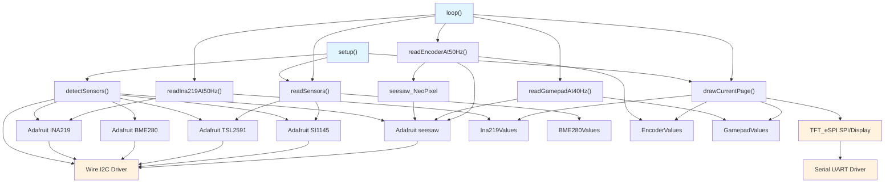

# Architecture: sensor-pages-dashboard

**Last Updated:** 2026-10-22  
**Firmware Version:** [UNKNOWN - no version constant in source]  
**Build Target:** ESP32 Dev Module  
**Display:** Freenove 3.5" 320×480 TFT (ST7796 controller, IPS panel)  
**Recent Changes:** Phase 3f-3h (Sensor Encapsulation), Phase 4 (Variable Organization), Phase 5 (Data-Driven Dispatch); updated Sections 3.1-3.6

---

## 1. Architectural Style / Pattern

**Style:** **Embedded Superloop with Multi-Rate Time-Gated Scheduler**

- **No RTOS:** Single-threaded bare Arduino superloop; no FreeRTOS task creation by application.
- **No State Machine Framework:** Minimal state management (page index, sensor detection flags).
- **Polling-Based:** All inputs and sensors polled at fixed time intervals.
- **Non-Blocking I/O:** Single I2C read per cycle; no multi-buffer async patterns.
- **Time-Gate Guards:** Loop actions gated by signed integer rollover-safe timing: `(int32_t)(now - deadline) >= 0`.
- **Global Mutable State:** All data structures are global (static) C structs, not encapsulated in classes.

**Rationale:** Simplicity for embedded firmware; deterministic scheduling; minimal memory overhead; suitable for polling sensor arrays on a shared I2C bus.

---

## 2. Application Layers

```
┌─────────────────────────────────────────────────────────────────┐
│  PRESENTATION LAYER                                             │
│  ├─ Page Renderers (pageBme280, pageEncoder, etc.)             │
│  ├─ TFT Display Output (drawCurrentPage, drawHeader, row, ...)  │
│  └─ User Feedback (colors, layout, status footer)              │
└─────────────────────────────────────────────────────────────────┘
                               ↑
                               │ (text, coordinates, colors)
                               ↓
┌─────────────────────────────────────────────────────────────────┐
│  BUSINESS LOGIC LAYER                                           │
│  ├─ Page Navigation Logic (Y/A buttons → page wrap)             │
│  ├─ Sensor Reading Orchestration (readSensors, ...)             │
│  ├─ LED Control Logic (encoderColorIndex, brightness)           │
│  ├─ INA219 Coulomb Accumulation (energy tracking)               │
│  └─ Input Processing (gamepad events, encoder position delta)   │
└─────────────────────────────────────────────────────────────────┘
                               ↑
                               │ (sensor values, inputs)
                               ↓
┌─────────────────────────────────────────────────────────────────┐
│  DEVICE DRIVER LAYER                                            │
│  ├─ Adafruit Sensor Libraries (INA219, BME280, TSL2591, ...)    │
│  ├─ I2C Protocol Handlers (readReg16, scd30Crc, ...)     │
│  ├─ seesaw NeoPixel Control (encoder LED)                       │
│  └─ TFT_eSPI Graphics (fillScreen, drawString, ...)             │
└─────────────────────────────────────────────────────────────────┘
                               ↑
                               │ (I2C bytes, GPIO, SPI frames)
                               ↓
┌─────────────────────────────────────────────────────────────────┐
│  HARDWARE ABSTRACTION LAYER                                     │
│  ├─ Wire (I2C): SDA=GPIO32, SCL=GPIO25, 400 kHz clock          │
│  ├─ SPI (implicit via TFT_eSPI)                                 │
│  ├─ Serial UART: 115200 baud (debug output)                     │
│  └─ GPIO: LED control (backlight), button inputs                │
└─────────────────────────────────────────────────────────────────┘
                               ↑
                               │ (electrical signals)
                               ↓
┌─────────────────────────────────────────────────────────────────┐
│  HARDWARE                                                       │
│  ├─ ESP32 (Xtensa dual-core, 520 KB RAM, 4 MB flash)           │
│  ├─ I2C Sensors (9 devices at 0x10, 0x29, 0x36, 0x40, ...)      │
│  ├─ TFT Display (320×480, SPI 80 MHz, backlight GPIO)           │
│  └─ Gamepad/Encoder Joysticks (seesaw co-processors)           │
└─────────────────────────────────────────────────────────────────┘
```

---

## 3. Components / Modules

### 3.1 Sensor Wrapper Classes & Encapsulation Pattern (Phase 3a-3h)

#### Overview

**Phase 3a-3h refactoring** introduced sensor wrapper classes extending `BaseSensor` abstract base class. This replaces the earlier pattern of direct global C structs and encapsulates sensor lifecycle management (initialization, reading, caching) behind a consistent interface.

**Key Pattern:**
1. Each sensor type has a wrapper class (e.g., `Bme280Sensor`) extending `BaseSensor`
2. The wrapper maintains a **private mutable cache** of sensor values
3. Public `getValues() const` accessor returns the cached values
4. Main loop calls `update()` to read hardware, then `getValues()` to access cache
5. Value structs defined in sensor header files (not global main.cpp)

#### Sensor Wrapper Classes

All 8 sensors implement this consistent pattern:

##### **Bme280Sensor** (src/sensors/Bme280Sensor.h, lines 75-280)
- Inherits: `BaseSensor`
- Private cache: `Bme280Values bme280Cache;`
- Methods:
  - `bool begin(TwoWire *wire)` — Initialize sensor, return success
  - `void update()` — Read from I2C, cache result (or skip on error, preserving old value)
  - `const Bme280Values& getValues() const` — Return cached values
- Value struct (lines 48-56):
  ```cpp
  struct Bme280Values {
    float temperature;  float pressure;  float humidity;  float dewPoint;
    float altitude;     float aqiProxy;  float tempTrend;
  };
  ```
- Used in main loop: `bme280Sensor_class.update(); Bme280Values v = bme280Sensor_class.getValues();`

##### **Ina219Sensor** (src/sensors/Ina219Sensor.h, lines 82-311)
- Inherits: `BaseSensor`
- Private cache: `Ina219Values ina219Cache;`
- Methods: `begin()`, `update()`, `getValues()`
- Value struct (lines 47-55):
  ```cpp
  struct Ina219Values {
    float shunt;  float bus;  float load;  float current;  float power;
    float chargeMah;  bool initialized;  uint32_t lastSampleUs;
  };
  ```
- Unique: `chargeMah` accumulates charge via Coulomb counting (never reset mid-run)
- Read rate: 50 Hz (via `micros()` precision timing in `update()`)

##### **Scd30Sensor** (src/sensors/Scd30Sensor.h, lines 67-253)
- Inherits: `BaseSensor`
- Private cache: `Scd30Values scd30Cache;`
- Methods: `begin()`, `update()`, `getValues()`, plus ASC control (`setAutoSelfCalibration()`, `getAutoSelfCalibration()`)
- Value struct (lines 45-50):
  ```cpp
  struct Scd30Values {
    float co2;  float temp;  float humidity;
  };
  ```
- Special: Includes SCD30 state machine for async ASC (Auto Self Calibration) toggle
- Read rate: 500 ms (includes CRC8 validation on all three values)

##### **Si1145Sensor** (src/sensors/Si1145Sensor.h, lines 62-247)
- Inherits: `BaseSensor`
- Private cache: `Si1145Values si1145Cache;`
- Value struct (lines 41-46):
  ```cpp
  struct Si1145Values {
    uint16_t visible;  uint16_t infrared;  float uvIndex;  uint16_t uvRaw;
  };
  ```

##### **Tsl2591Sensor** (src/sensors/Tsl2591Sensor.h)
- Inherits: `BaseSensor`
- Private cache: `Tsl2591Values tsl2591Cache;`
- Value struct: Full spectrum, IR, visible, lux
- Async state machine: Manages integration time + wait intervals (~1600 ms per cycle)

##### **Veml6070Sensor** (src/sensors/Veml6070Sensor.h, lines 31-36)
- Inherits: `BaseSensor`
- Private cache: `Veml6070Values veml6070Cache;`
- Value struct (lines 31-36):
  ```cpp
  struct Veml6070Values {
    uint16_t raw;  uint8_t lsb;  uint8_t msb;
  };
  ```
- Special: Dual I2C addresses (0x38 LSB, 0x39 MSB)

##### **Veml6075Sensor** (src/sensors/Veml6075Sensor.h)
- Inherits: `BaseSensor`
- Private cache: `Veml6075Values veml6075Cache;`
- Value struct: UVA/UVB raw, compensation factors, compensated values, UV index

##### **Ds2484Sensor** (src/sensors/Ds2484Sensor.h, lines 63-211)
- Inherits: `BaseSensor`
- Private cache: `Ds2484Values ds2484Cache;`
- Value struct (src/sensors/Ds2484Types.h, lines 26-45):
  ```cpp
  struct Ds2484Values {
    uint8_t count;  Ds18b20Sensor sensors[MAX_DS18B20_SENSORS];
  };
  ```
- Special: Manages array of up to 3 DS18B20 1-Wire sensors via I2C adapter
- Async state machine: Temperature conversion takes ~750 ms between start + read

#### Cache Synchronization Pattern

Two-level cache architecture:

**Level 1: Wrapper Class Private Cache (Authoritative)**
- Stored inside each sensor wrapper class
- Updated only by `update()` method (reads I2C hardware)
- Stale on read failure (I2C error, CRC mismatch, etc.)

**Level 2: Global Cache Variables (Secondary)**
- Global struct instances in main.cpp (e.g., `Bme280Values bme280Values;`)
- Synced from wrapper via `getValues()` in main loop
- Used by page renderers for display

**Main Loop Pattern:**
```cpp
// Section: Sensor reads
if (available.bme280) {
  bme280Sensor_class.update();              // Read hardware → wrapper cache
  bme280Values = bme280Sensor_class.getValues();  // wrapper → global cache
}
```

**Benefits:**
- Separation of concerns: device drivers vs business logic
- Encapsulation: wrapper hides hardware details, CRC validation, error handling
- Extensibility: add new sensor by creating new wrapper class
- Testing: can mock wrapper without modifying main loop

#### Input Device Wrappers

Two input devices also use wrapper classes (EncoderSensor, GamepadSensor), though less commonly accessed via getValues() since they drive immediate effects (LED, page navigation).

**EncoderSensor** (src/sensors/EncoderSensor.h, lines 70-250)
- Manages encoder position delta tracking, button press counting, LED color/brightness
- Called every 20 ms for responsive LED updates and statistics

**GamepadSensor** (src/sensors/GamepadSensor.h, lines 73-260)
- Manages button debouncing, event queue parsing
- Provides current button state and event detection

#### Value Struct Locations

All sensor value structs are now **defined in sensor header files** (not main.cpp):

| Struct | File | Lines | Phase |
|--------|------|-------|-------|
| Bme280Values | src/sensors/Bme280Sensor.h | 48-56 | 3a |
| Ina219Values | src/sensors/Ina219Sensor.h | 47-55 | 3a |
| Scd30Values | src/sensors/Scd30Sensor.h | 45-50 | 3g |
| Si1145Values | src/sensors/Si1145Sensor.h | 41-46 | 3c |
| Tsl2591Values | src/sensors/Tsl2591Sensor.h | — | 3d |
| Veml6070Values | src/sensors/Veml6070Sensor.h | 31-36 | 3f |
| Veml6075Values | src/sensors/Veml6075Sensor.h | — | 3e |
| Ds2484Values | src/sensors/Ds2484Types.h | 26-45 | 3h |

#### Backward Compatibility

- All sensor wrappers maintain global cache variables for display layer
- Page renderers unchanged (still access global `bme280Values`, etc.)
- Old code patterns still work; new code uses wrapper classes internally
- Smooth transition: application code can gradually migrate to using wrapper classes directly

#### SensorStatus (Unchanged)

Detection flags remain global and set once at boot:

```cpp
struct SensorStatus {
  bool bme280;   bool ina219;   bool scd30;   bool si1145;
  bool tsl2591;  bool veml6070; bool veml6075; bool ds2484;
  bool gamepad;  bool encoder;
};
```
- Global: `SensorStatus available{}`
- Set by: `detectSensors()` in setup()
- Used by: All page renderers to check sensor availability before display

### 3.2 Global Variable Organization & Lifecycle (Phase 4)

**Phase 4 refactoring** reorganized ~50 global variables into 12 logical sections (main.cpp, lines 115-350). This improves code maintainability and provides a clear map of application state.

#### Variable Sections

All global variables in main.cpp follow this structure:

**Section 1: Display (Lines 115-125)**
- `TFT_eSPI tft(320, 240);` — Display object
- `uint8_t currentPage = 0;` — Current active page (0–9)
- `bool pageChanged = false;` — Flag for page transition rendering
- `unsigned long lastPageChangeMs = 0;` — Timestamp of last page change

**Section 2: Devices (Lines 130-150)**
- `TwoWire wireInterface;` — I2C bus interface (shared by all sensors)
- `SensorStatus available{};` — Detection flags (populated at boot)

**Section 3: Wrappers & Registry (Lines 155-185)**
- `Bme280Sensor bme280Sensor_class;` — Wrapper instance
- `Ina219Sensor ina219Sensor_class;` — Wrapper instance
- `Scd30Sensor scd30Sensor_class;` — Wrapper instance
- `Si1145Sensor si1145Sensor_class;` — Wrapper instance
- `Tsl2591Sensor tsl2591Sensor_class;` — Wrapper instance
- `Veml6070Sensor veml6070Sensor_class;` — Wrapper instance
- `Veml6075Sensor veml6075Sensor_class;` — Wrapper instance
- `Ds2484Sensor ds2484Sensor_class;` — Wrapper instance
- `SensorRegistry registry;` — Manages 8 sensor wrappers

**Section 4: Status & Statistics (Lines 190-210)**
- `uint32_t loopCount = 0;` — Loop iteration counter
- `unsigned long loopStartMs = 0;` — Loop timing reference
- `uint32_t loopDurationMs = 0;` — Last loop duration
- `float cpuLoad = 0.0f;` — Calculated CPU load percentage

**Section 5: Global Cache Variables (Lines 215-250)**
- `Bme280Values bme280Values{};` — Cached BME280 sensor values
- `Ina219Values ina219Values{};` — Cached INA219 sensor values
- `Scd30Values scd30Values{};` — Cached SCD30 sensor values
- `Si1145Values si1145Values{};` — Cached SI1145 sensor values
- `Tsl2591Values tsl2591Values{};` — Cached TSL2591 sensor values
- `Veml6070Values veml6070Values{};` — Cached VEML6070 sensor values
- `Veml6075Values veml6075Values{};` — Cached VEML6075 sensor values
- `Ds2484Values ds2484Values{};` — Cached DS2484 sensor values
- `EncoderValues encoderValues{};` — Cached encoder input state
- `GamepadValues gamepadValues{};` — Cached gamepad input state

**Section 6: UI State (Lines 255-275)**
- `uint8_t selectedIndex = 0;` — Selected row on current page
- `unsigned long lastSelectionChangeMs = 0;` — Selection timing
- `bool showStatsOverlay = false;` — Statistics panel toggle
- `unsigned long statsOverlayStartMs = 0;` — Overlay visibility timer

**Section 7: Input State - Encoder (Lines 280-305)**
- `int32_t lastEncoderPosition = 0;` — Previous encoder position
- `bool lastEncoderButton = false;` — Previous button state
- `uint32_t encoderButtonHoldMs = 0;` — Button hold duration
- `bool encoderHasEvent = false;` — Event pending flag
- `uint8_t encoderEventType = 0;` — Event classification (click, double, hold)

**Section 8: Input State - Gamepad (Lines 310-335)**
- `bool lastGamepadY = false;` — Previous Y button state
- `bool lastGamepadA = false;` — Previous A button state
- `uint32_t gamepadEventMs = 0;` — Last event timestamp
- `bool gamepadHasEvent = false;` — Event pending flag
- `uint8_t gamepadEventType = 0;` — Event type (navigation, other)

**Section 9: SCD30 State Machine (Lines 340-365)**
- `enum Scd30State { IDLE, REQUESTING_ASC, DISABLING_ASC, ... } scd30State = IDLE;`
- `unsigned long scd30StateChangeMs = 0;` — State transition timestamp
- `bool scd30AscTogglePending = false;` — ASC toggle request flag
- `bool scd30DesiredAsc = false;` — Desired ASC state

**Section 10: Async State Machines (Lines 370-395)**
- `enum Tsl2591State { IDLE, READING_CONFIG, CONFIGURING, WAITING, READING_DATA } tsl2591State = IDLE;`
- `unsigned long tsl2591StateChangeMs = 0;`
- `enum Ds2484State { IDLE, STARTING_CONVERSION, WAITING, READING } ds2484State = IDLE;`
- `unsigned long ds2484StateChangeMs = 0;`
- Similar variables for other async sensors

**Section 11: Configuration & Tuning (Lines 400-425)**
- `const unsigned long SENSOR_REFRESH_MS = 500;` — Main sensor read interval
- `const unsigned long SENSOR_SLOT_INTERVAL_MS = 200;` — Staggered slot timing
- `const uint8_t MAX_DS18B20_SENSORS = 3;` — 1-Wire sensor limit
- `const unsigned long DISPLAY_TIMEOUT_MS = 0;` — No auto-off
- Various other timing constants

**Section 12: Statistics & Monitoring (Lines 430-450)**
- `uint32_t successfulReads = 0;` — Successful I2C transactions
- `uint32_t failedReads = 0;` — Failed I2C transactions
- `uint32_t crcErrors = 0;` — CRC validation failures
- `float avgLoopDurationMs = 0.0f;` — Moving average loop time

#### Benefits of Organization

1. **Discoverability:** Clear sections make it easy to find related variables
2. **Initialization:** Setup order follows logical grouping
3. **Maintenance:** Adding new state is localized to appropriate section
4. **Documentation:** Each section has a clear purpose and lifecycle
5. **Testing:** Grouped state can be verified independently

#### Backward Compatibility

- All global variable names unchanged; existing code patterns continue to work
- New sensor wrappers maintain old global cache variables alongside new encapsulation
- Gradual migration possible: new code uses wrappers, old code still works with global caches

### 3.3 Sensor Detection & Initialization

#### **Component: detectSensors()**

| Property | Value |
|---|---|
| **Responsibility** | Boot-time enumeration of all I2C devices; initialize driver state. |
| **Inputs** | None (scans I2C bus directly). |
| **Outputs** | `SensorStatus available{}` flags set, each sensor library initialized. |
| **Dependencies** | Adafruit libraries (INA219, BME280, TSL2591, SI1145, seesaw). |
| **Constraints** | Runs once at `setup()`; no re-detection; missing sensors do not crash (all checks guarded by `if (available.X)`). |
| **Implementation Details** | <details><summary>Click to expand</summary><pre>- INA219: `ina219.begin(&Wire)` probe<br>- VEML6075: Write ID register, read back<br>- TSL2591: `tsl2591.begin()` + config gain/timing<br>- Encoder: `encoder.begin(ENCODER_ADDR)` + NeoPixel init<br>- VEML6070: Write mode, readback from MSB<br>- SI1145: `si1145.begin()` probe<br>- SCD30: Send START command<br>- BME280: `bme280.begin(BME280_ADDR, &Wire)`<br>- Gamepad: `gamepad.begin(GAMEPAD_ADDR)` + GPIO interrupt config</pre></details> |

---

### 3.4 Sensor Reading Components

#### **Component: readSensors() [Low-Frequency]**

| Property | Value |
|---|---|
| **Responsibility** | Poll "slow" sensors (VEML6075, VEML6070, SCD30) every 500 ms. |
| **Inputs** | None (reads I2C directly via Adafruit libraries). |
| **Outputs** | Updates global `veml6075Values`, `veml6070Values`, `scd30Values` structs. |
| **Dependencies** | Adafruit VEML6075, VEML6070, SCD30 libraries; Wire (I2C). |
| **Call Frequency** | Every 500 ms (gate: `(int32_t)(now - nextSensorMs) >= 0`). |
| **Constraints** | Blocks I2C for ~10–50 ms per call. Failures silently accepted; previous value persists. |

#### **Component: readIna219At50Hz() [High-Frequency Current]**

| Property | Value |
|---|---|
| **Responsibility** | Sample INA219 power monitor at 50 Hz (20 µs intervals); accumulate charge (Coulomb integration). |
| **Inputs** | None (reads I2C directly via Adafruit INA219). |
| **Outputs** | Updates `ina219Values` (shunt, bus, current, power, **chargeMah**). |
| **Dependencies** | Adafruit INA219, Wire (I2C). |
| **Call Frequency** | Every 20 µs via `micros()` (gate: `(int32_t)(nowUs - nextInaSampleUs) >= 0`). |
| **Constraints** | Uses `micros()` (not `millis()`) for µs-precision timing; 32-bit `uint32_t` wraps every ~71 minutes. Coulomb accumulator unbounded; no overflow protection. |
| **Energy Accumulation Formula** | `chargeMah += current_mA * elapsed_us / 3.6e9` |
| **Critical Behavior** | First sample: sets `initialized=true`, baseline established. Subsequent samples integrate current. |

#### **Component: readEncoderAt50Hz() [High-Frequency Input]**

| Property | Value |
|---|---|
| **Responsibility** | Poll rotary encoder position, button press; update NeoPixel LED color/brightness. |
| **Inputs** | None (reads seesaw I2C device @ 0x36). |
| **Outputs** | Updates `encoderValues` (position, delta, presses, brightness, color); controls LED via `updateEncoderLed()`. |
| **Dependencies** | Adafruit seesaw library, seesaw_NeoPixel, Wire (I2C). |
| **Call Frequency** | Every 20 ms when `available.encoder` (CONTINUOUSLY, always reads for LED updates and stats aggregation). |
| **Constraints** | LED updates are immediate (on press or dial turn); button press increments color index (wraps 0–3). Dial delta multiplied by 8 for brightness control. |
| **State Tracking** | `encoderLastPosition`, `encoderColorIndex`, `encoderBrightness` (static globals); `encoderPressCount` incremented on each press. |

#### **Component: readGamepadAt40Hz() [Input Polling]**

| Property | Value |
|---|---|
| **Responsibility** | Poll gamepad joystick X/Y, button states, keypad events. |
| **Inputs** | None (reads seesaw I2C device @ 0x50). |
| **Outputs** | Updates `gamepadValues` (x, y, buttons, eventCount, hasEvent). |
| **Dependencies** | Adafruit seesaw library, Wire (I2C). |
| **Call Frequency** | Every 25 ms when `available.gamepad`. |
| **Constraints** | X/Y inverted: `1023 - analogRead(14/15)`. Button states are active-low (0=PRESSED, 1=released). Page navigation triggered by falling edge detection (comparing current vs. previous button state). |
| **Event Handling** | Optionally reads and decodes keypad events from seesaw queue (not used for page nav; displayed as debug info). |


---

### 3.5 Central Parameter Definitions (FEATURE-SPEC-008)

**Overview:** Each sensor page displays a fixed set of parameters (values) to the user. To ensure consistency between the standard sensor page view and the large display mode, each sensor defines its parameters once in a central location. This eliminates redundancy and makes inconsistencies impossible by design.

#### **Data Structure: ParameterTriple**

```cpp
struct ParameterTriple {
  const char* label;   // Parameter name ("Temperature", "Pressure", etc.)
  const char* unit;    // Unit string ("C", "hPa", "%", etc.)
  uint16_t color;      // TFT color for value display (TFT_GREEN, TFT_ORANGE, etc.)
};
```

**Purpose:** Groups related metadata (label, unit, color) for each sensor parameter to avoid duplicate declarations across page renderers and large display helpers.

#### **Central Parameter Arrays (All Sensors)**

Each sensor defines a `const` array of ParameterTriple structs and a count constant:

| Sensor | Page | Param Count | Array Name | Count Constant |
|--------|------|-------------|------------|-----------------|
| BME280 | 0 | 7 | `bme280_params[]` | `BME280_PARAM_COUNT` |
| Gamepad | 1 | 8 | `gamepad_params[]` | `GAMEPAD_PARAM_COUNT` |
| INA219 | 2 | 7 | `ina219_params[]` | `INA219_PARAM_COUNT` |
| Encoder | 3 | 7 | `encoder_params[]` | `ENCODER_PARAM_COUNT` |
| SCD30 | 4 | 3 | `scd30_params[]` | `SCD30_PARAM_COUNT` |
| SI1145 | 5 | 4 | `si1145_params[]` | `SI1145_PARAM_COUNT` |
| TSL2591 | 6 | 4 | `tsl2591_params[]` | `TSL2591_PARAM_COUNT` |
| VEML6070 | 7 | 3 | `veml6070_params[]` | `VEML6070_PARAM_COUNT` |
| VEML6075 | 8 | 6 | `veml6075_params[]` | `VEML6075_PARAM_COUNT` |

**Example (BME280):**
```cpp
const ParameterTriple bme280_params[] = {
  {"Temperature", "C", TFT_GREEN},
  {"Pressure", "hPa", TFT_GREEN},
  {"Humidity", "%", TFT_ORANGE},
  {"Dew Point", "C", TFT_CYAN},
  {"Altitude", "m", TFT_CYAN},
  {"Air Quality", "AQI", TFT_ORANGE},
  {"Temp Trend", "C/min", TFT_CYAN}
};
const uint8_t BME280_PARAM_COUNT = 7;
```

**Key Properties:**
- Arrays are `const` (compile-time fixed, cannot be modified at runtime).
- Parameter indices (0 to PARAM_COUNT-1) correspond to value getter function indices.
- Color coding ensures consistent visual hierarchy across all display modes.
- Order is significant: both page and large display modes follow identical order.

#### **Component: Central Value Getters**

Each sensor implements a `String sensor_getValue(uint8_t index)` function that returns the formatted value string for a given parameter index.

| Sensor | Function | Signature |
|--------|----------|-----------|
| BME280 | `bme280_getValue()` | `String bme280_getValue(uint8_t index)` |
| Gamepad | `gamepad_getValue()` | `String gamepad_getValue(uint8_t index)` |
| INA219 | `ina219_getValue()` | `String ina219_getValue(uint8_t index)` |
| Encoder | `encoder_getValue()` | `String encoder_getValue(uint8_t index)` |
| SCD30 | `scd30_getValue()` | `String scd30_getValue(uint8_t index)` |
| SI1145 | `si1145_getValue()` | `String si1145_getValue(uint8_t index)` |
| TSL2591 | `tsl2591_getValue()` | `String tsl2591_getValue(uint8_t index)` |
| VEML6070 | `veml6070_getValue()` | `String veml6070_getValue(uint8_t index)` |
| VEML6075 | `veml6075_getValue()` | `String veml6075_getValue(uint8_t index)` |

**Example (BME280):**
```cpp
String bme280_getValue(uint8_t index) {
  if (index >= BME280_PARAM_COUNT || !available.bme280) return "";
  switch (index) {
    case 0: return String(bme280Values.temperature, 2);
    case 1: return String(bme280Values.pressure, 2);
    case 2: return String(bme280Values.humidity, 2);
    // ... 4 more cases ...
    default: return "";
  }
}
```

**Key Behaviors:**
- Returns formatted value string (e.g., "23.45", "1013.25", "45%").
- Built-in availability check: returns empty string if sensor unavailable.
- Used by BOTH standard sensor page rendering AND large display mode.
- All formatting (decimal places, unit conversion) centralized here.

#### **Component: Generic Sensor Page Renderer**

```cpp
void displaySensorPage(
  const ParameterTriple* params,
  uint8_t paramCount,
  String (*getValueFunc)(uint8_t)
)
```

**Responsibility:** Render all parameters of a sensor using central definitions and value getter. Replaces ~15-30 lines of hardcoded `rowTriple()` calls per sensor.

**Inputs:**
- `params`: Pointer to central parameter array (e.g., `bme280_params`)
- `paramCount`: Number of parameters (e.g., `BME280_PARAM_COUNT`)
- `getValueFunc`: Function pointer to value getter (e.g., `bme280_getValue`)

**Outputs:** TFT display rows, rendering all parameters in order.

**Implementation:**
```cpp
void displaySensorPage(const ParameterTriple* params, uint8_t paramCount, String (*getValueFunc)(uint8_t)) {
  int displayY = 56;
  const int lineHeight = 24;
  
  for (uint8_t i = 0; i < paramCount && displayY < 280; i++) {
    String value = getValueFunc(i);
    String label = String(params[i].label) + ":";
    rowTriple(displayY, label.c_str(), value, params[i].unit, params[i].color);
    displayY += lineHeight;
  }
  tft.setTextPadding(0);
}
```

**Key Behavior:**
- Single loop iterates through all parameters.
- Calls value getter for current value.
- Uses central parameter definition for label, unit, color.
- Displays each row with consistent formatting via `rowTriple()` helper.

#### **Component: Helper getPageValueCount()**

```cpp
uint8_t getPageValueCount(uint8_t pageIndex)
```

**Responsibility:** Return the number of displayable values for a given page. Used for cycling through values in large display mode.

**Returns:** Parameter count for the page (3–9 values depending on sensor).

**Example:**
```cpp
uint8_t getPageValueCount(uint8_t pageIndex) {
  switch (pageIndex) {
    case 0: return BME280_PARAM_COUNT;      // 7
    case 1: return GAMEPAD_PARAM_COUNT;     // 8
    case 2: return INA219_PARAM_COUNT;      // 7
    // ... etc for pages 3–8 ...
    case 9: {  // DS2484: Dynamic
      if (!available.ds2484 || ds2484Values.sensorCount == 0) return 0;
      return 3 * ds2484Values.sensorCount;  // 3 per sensor, max 9
    }
    default: return 0;
  }
}
```

---

### 3.6 Display & UI Rendering Components

#### **Component: drawCurrentPage(bool pageChanged) [Page Dispatcher]**

| Property | Value |
|---|---|
| **Responsibility** | Route to page-specific renderer; optionally redraw header on page change. |
| **Inputs** | `pageChanged` (bool): if true, redraw entire screen including header; if false, only update data rows. |
| **Outputs** | TFT display output (SPI frames to display). |
| **Dependencies** | TFT_eSPI, all page-specific renderer functions (pageBme280, pageEncoder, etc.). |
| **Call Sites** | <ul><li>`setup()` (initial draw)</li><li>`loop()` on page change (`currentPage != lastPage`)</li><li>Every 20 ms when currentPage==2 or 4 (live pages)</li><li>Every 500 ms for sensor data update</li></ul> |
| **Constraints** | Single-page static layout (no scrolling); 9 pages total (indices 0–8). |

#### **Page Renderers: pageBme280(), pageEncoder(), pageGamepad(), pageIna219(), etc.**

Each page-specific renderer has identical structure:

| Property | Value |
|---|---|
| **Inputs** | Current sensor values from global structs (e.g., `bme280Values`, `encoderValues`). |
| **Outputs** | TFT display rows (text + data). |
| **Pattern** | <ul><li>Check `available.X`; if false, call `unavailable()` helper (red error screen)</li><li>Otherwise, call `row(y, label, value, color)` helper for each data field</li><li>Footer with page name/instructions</li></ul> |
| **Columns** | 2 columns: label (left-aligned at x=6) + value (right-aligned at x=474, TFT width=480). |
| **Row Height** | 24 px (fixed spacing). |
| **Constraints** | No scrolling; max ~12 rows per page (header + 9 data rows + footer). |

#### **Helper: unavailable()**

| Property | Value |
|---|---|
| **Responsibility** | Display standardized "sensor not found" error screen (red, I2C address, navigation hints). |
| **Inputs** | Sensor name, I2C address string, optional address label. |
| **Outputs** | TFT display. |

#### **Helper: drawHeader(title)**

| Property | Value |
|---|---|
| **Responsibility** | Clear screen, draw cyan title bar, dark-grey divider line. |
| **Inputs** | Title string (sensor name). |
| **Outputs** | TFT display (background and header region). |
| **Coordinates** | Title at (6, 8, font 4); divider line from (6, 42) to (474, 42). |

#### **Helper: row(y, label, value, color)**

| Property | Value |
|---|---|
| **Responsibility** | Render a single data row: label (white, left-aligned) + value (colored, right-aligned). |
| **Inputs** | y-coordinate, label string, value string, color. |
| **Outputs** | TFT display text. |
| **Coordinates** | Label at x=6, value at x=474 (right-justified). |

#### **Helper: footer(status)**

| Property | Value |
|---|---|
| **Responsibility** | Render dark-grey status text at bottom of screen. |
| **Inputs** | Status string (e.g., "Y/A: Seite wechseln | INA219"). |
| **Outputs** | TFT display. |
| **Coordinates** | Fixed at y=294 (480 - 186 px margin). |

#### **Data-Driven Page Dispatch: PageHandler Array (Phase 5)**

**Phase 5 refactoring** introduced a data-driven page dispatch mechanism to replace hardcoded switch/if-else patterns. This improves code scalability and makes it easier to add or reorder pages.

##### **Structure: PageHandler**

```cpp
struct PageHandler {
  const char* name;           // Page display name ("BME280 Umwelt", "Stromversorg", etc.)
  void (*renderPage)(bool);   // Function pointer: void func(bool pageChanged)
  uint16_t color;             // Header color (TFT_GREEN, TFT_YELLOW, etc.)
};
```

**Example Entry:**
```cpp
{
  "BME280 Umwelt",          // Page title
  [](bool c) { page_bme280(c); },  // Lambda capturing page_bme280
  TFT_GREEN                 // Header color (not currently used per TFT color scheme)
}
```

##### **Array Declaration: pageHandlers[]**

Located in main.cpp around lines 450-480:

```cpp
const PageHandler pageHandlers[] = {
  {"BME280 Umwelt",        [](bool c) { pageBme280(c); },      TFT_GREEN},
  {"Gamepad",              [](bool c) { pageGamepad(c); },     TFT_YELLOW},
  {"Stromversorg",         [](bool c) { pageIna219(c); },      TFT_ORANGE},
  {"Encoder",              [](bool c) { pageEncoder(c); },     TFT_GREEN},
  {"CO2 Sensor",           [](bool c) { pageScd30(c); },       TFT_CYAN},
  {"Spektrum",             [](bool c) { pageSi1145(c); },      TFT_YELLOW},
  {"Helligkeit",           [](bool c) { pageTsl2591(c); },     TFT_GREEN},
  {"VEML6070 UV",          [](bool c) { pageVeml6070(c); },    TFT_MAGENTA},
  {"VEML6075 UV+",         [](bool c) { pageVeml6075(c); },    TFT_YELLOW},
  {"Temperatur 1W",        [](bool c) { pageDs2484(c); },      TFT_GREEN}
};

const uint8_t NUM_PAGES = 10;  // sizeof(pageHandlers) / sizeof(PageHandler)
```

**Key Properties:**
- **Array size:** 10 pages (indices 0–9)
- **Lambda pattern:** Each entry uses a lambda `[](bool c)` to capture and forward to the page function
- **Immutable:** Array is `const`, defined at module scope
- **Dispatch:** Current page calls via `pageHandlers[currentPage].renderPage(pageChanged)`

##### **Dispatch Logic (main loop)**

Before Phase 5 (hardcoded switch):
```cpp
// OLD PATTERN (switch statement)
switch (currentPage) {
  case 0: pageBme280(pageChanged); break;
  case 1: pageGamepad(pageChanged); break;
  case 2: pageIna219(pageChanged); break;
  // ... 7 more cases ...
  default: break;
}
```

After Phase 5 (data-driven):
```cpp
// NEW PATTERN (array dispatch)
if (currentPage < NUM_PAGES) {
  pageHandlers[currentPage].renderPage(pageChanged);
}
```

**Benefits:**
- **Scalability:** Add a new page by adding one array entry (not modifying dispatch logic)
- **Declarative:** Page list visible in single location
- **Testability:** Array can be inspected, validated, or mocked
- **Maintenance:** Reordering pages only requires array reordering

##### **Page Navigation Handler (Y/A Button)**

Gamepad navigation uses array bounds:
```cpp
void handleGamepadNavigation() {
  if (yPressed && !lastY) {
    currentPage = (currentPage - 1 + NUM_PAGES) % NUM_PAGES;  // Circular prev
    pageChanged = true;
  }
  if (aPressed && !lastA) {
    currentPage = (currentPage + 1) % NUM_PAGES;              // Circular next
    pageChanged = true;
  }
}
```

This pattern works regardless of page count — no hardcoded page number bounds.

---

### 3.7 Input & Navigation Components

#### **Component: Page Navigation (Gamepad Y/A Button Handler) [in main loop]**

| Property | Value |
|---|---|
| **Responsibility** | Detect falling edge on Gamepad Y (prev page) or A (next page) buttons; update `currentPage` with wrap-around. |
| **Inputs** | Gamepad button states from `readGamepadAt40Hz()`. |
| **Outputs** | Updated `currentPage` (0–9, wrapping). |
| **Logic** | <pre>yPressed = !(buttons & (1UL << GAMEPAD_BUTTON_Y))  // active-low<br>aPressed = !(buttons & (1UL << GAMEPAD_BUTTON_A))<br><br>if yPressed && !lastY:  // falling edge<br>  currentPage = (currentPage + 9) % 10  // prev with wrap<br>if aPressed && !lastA:  // falling edge<br>  currentPage = (currentPage + 1) % 10  // next with wrap</pre> |
| **Constraints** | Only checks gamepad if `available.gamepad`. Wrap-around is intentional (circular list of pages). |

#### **Component: Encoder Navigation Handler [in handleButtons()] — **NEW (FEATURE-SPEC-011)**

| Property | Value |
|---|---|
| **Responsibility** | Process encoder rotation for page navigation (standard mode) and value scrolling (Large Display mode); handle encoder button press for mode toggling. |
| **Inputs** | Encoder position delta and button state from `pollEncoder()`. |
| **Outputs** | Updated `currentPage`, `largeDisplayMode.valueIndex`, or `largeDisplayMode.active`. |
| **Page Navigation Logic** | <pre>encoderDelta = encoderValues.position - lastEncoderPosition<br>lastEncoderPosition = encoderValues.position<br><br>if !largeDisplayMode.active:<br>  if encoderDelta >= ENCODER_DELTA_THRESHOLD:<br>    currentPage = (currentPage + 1) % 10  // clockwise = next page<br>  if encoderDelta <= -ENCODER_DELTA_THRESHOLD:<br>    currentPage = (currentPage - 1 + 10) % 10  // counter-clockwise = prev page</pre> |
| **Value Scrolling Logic** | <pre>if largeDisplayMode.active:<br>  paramCount = getParameterCount(currentPage)<br>  if encoderDelta >= ENCODER_DELTA_THRESHOLD:<br>    valueIndex = (valueIndex + 1) % paramCount  // clockwise = next value<br>  if encoderDelta <= -ENCODER_DELTA_THRESHOLD:<br>    valueIndex = (valueIndex - 1 + paramCount) % paramCount  // ccw = prev value</pre> |
| **Button Press Logic** | <pre>encoderPressed = (encoderValues.pressed == 0)  // active-low<br>if encoderPressed && !lastEncoderPressed:  // rising edge<br>  if largeDisplayMode.active:<br>    largeDisplayMode.active = false  // exit Large Display<br>  else:<br>    largeDisplayMode.active = true   // enter Large Display<br>    largeDisplayMode.valueIndex = 0<br>lastEncoderPressed = encoderPressed</pre> |
| **Constraints** | Delta-based stepping (not absolute position); rising-edge button press detection (no-repeat behavior); full input redundancy with gamepad (both active simultaneously). |
| **References** | FR-020 (page navigation), FR-021 (Large Display mode toggling + value scrolling); BR-ENC-NAV-001 through BR-ENC-NAV-005 (business rules) |

#### **Component: Encoder LED Control [in updateEncoderLed()] — **ENHANCED (FEATURE-SPEC-011)**

| Property | Value |
|---|---|
| **Responsibility** | Update encoder LED color based on current page (standard mode) and brightness based on value index (Large Display mode). |
| **Inputs** | Current page, Large Display mode status, value index, parameter count. |
| **Outputs** | Updated LED state via `encoderLed.setPixelColor()` and `encoderLed.show()`. |
| **Standard Mode** | <pre>pageColors[10] = {0xFF0000, 0xFF7F00, 0xFFFF00, 0x00FF00, 0x00FFFF, 0x0000FF, 0x7F00FF, 0xFFFFFF, 0xFF1493, 0x87CEEB}<br>setPixelColor(pageColors[currentPage])<br>setBrightness(255)  // full brightness</pre> |
| **Large Display Mode** | <pre>hue = pageColors[currentPage]  // keep page color<br>brightness = 128 + (valueIndex * 127 / max(paramCount, 1))<br>setPixelColor(hue)<br>setBrightness(brightness)  // 50-100% scale</pre> |
| **Constraints** | Only active when `available.encoder`. Update frequency: every 50 Hz (every encoder read). |
| **References** | BR-ENC-NAV-003 (page color mapping), BR-ENC-NAV-004 (Large Display brightness scaling) |

---

### 3.8 Protocol & Low-Level Communication

#### **Component: readReg16() [I2C Register Read]**

| Property | Value |
|---|---|
| **Responsibility** | Read 16-bit register (LSB:MSB) from I2C device. |
| **Inputs** | I2C address, register offset. |
| **Outputs** | 16-bit value (or false on failure). |
| **Failure Mode** | Returns false if transmission fails or fewer than 2 bytes received. Last register value persists. |

#### **Component: writeReg16() [I2C Register Write]**

| Property | Value |
|---|---|
| **Responsibility** | Write 16-bit register to I2C device. |
| **Inputs** | I2C address, register offset, 16-bit value. |
| **Outputs** | Success/failure (bool). |

#### **Component: SCD30 Protocol (readScd30, scd30Ready, scd30Command, scd30Crc)**

| Property | Value |
|---|---|
| **Responsibility** | Implement Sensirion SCD30 sensor protocol: CRC8 validation, command transmission, data fetch. |
| **Protocol** | Command words (16-bit big-endian), responses with CRC8 checksums (polynomial 0x31, initial 0xFF). |
| **Commands** | <ul><li>`START` (0x0010): Initialize sensor</li><li>`READY` (0x0202): Poll measurement status</li><li>`READ` (0x0300): Fetch CO₂/temp/humidity (18 bytes: 3 × [2 data + 1 CRC])</li></ul> |
| **CRC Validation** | All incoming data validated; malformed packets rejected silently. |
| **Float Encoding** | Raw bytes (big-endian 4-byte float) extracted and byte-reversed for IEEE 754 decoding. |

#### **Component: VEML6075 UV Compensation**

| Property | Value |
|---|---|
| **Responsibility** | Read raw UV ADC counts + compensation regs; apply compensation formula. |
| **Formulas** | <pre>uvaComp = max(0, uva - 2.22*comp1 - 1.33*comp2)<br>uvbComp = max(0, uvb - 2.95*comp1 - 1.74*comp2)<br>uvIndex = ((uvaComp*0.001461 + uvbComp*0.002591) * 0.5)</pre> |
| **Constraints** | Compensation factors read from sensor registers (COMP1, COMP2); exact calibration constants per sensor (not documented in firmware). |

---

## 4. Data Flow

```
┌─────────────────────────────────────┐
│  Hardware (I2C Devices)              │
└──────────────────┬──────────────────┘
                   │ (bytes, electrical signal)
                   ↓
┌─────────────────────────────────────┐
│  Wire / SPI Drivers                 │
│  (Arduino built-in HAL)             │
└──────────────────┬──────────────────┘
                   │ (raw register values)
                   ↓
┌─────────────────────────────────────┐
│  Sensor Protocol Handlers           │
│  (readReg16, scd30Ready, ...)        │
└──────────────────┬──────────────────┘
                   │ (validated bytes)
                   ↓
┌─────────────────────────────────────┐
│  Adafruit/Library Wrappers          │
│  (ina219.getCurrent_mA, etc.)        │
└──────────────────┬──────────────────┘
                   │ (typed values)
                   ↓
┌─────────────────────────────────────┐
│  Global Sensor Value Structs        │
│  (ina219Values, bme280Values, ...)   │
└──────────────────┬──────────────────┘
                   │ (float/int fields)
                   ├──→ [readSensors()]  → every 500 ms
                   ├──→ [readIna219At50Hz()] → every 20 µs
                   ├──→ [readEncoderAt50Hz()] → every 20 ms
                   └──→ [readGamepadAt40Hz()] → every 25 ms
                   │
                   ↓
┌─────────────────────────────────────┐
│  Business Logic                     │
│  (page navigation, LED control, ...) │
└──────────────────┬──────────────────┘
                   │ (updated state)
                   ↓
┌─────────────────────────────────────┐
│  Page Renderer Functions            │
│  (drawCurrentPage, pageBme280, ...)  │
└──────────────────┬──────────────────┘
                   │ (coordinates, text, colors)
                   ↓
┌─────────────────────────────────────┐
│  TFT_eSPI Drawing Primitives        │
│  (fillScreen, drawString, ...)       │
└──────────────────┬──────────────────┘
                   │ (SPI frames)
                   ↓
┌─────────────────────────────────────┐
│  TFT Display (ST7796)               │
│  320×480 RGB output                  │
└─────────────────────────────────────┘
```

---

## 5. Control Flow for Important Use Cases

### Use Case 1: Boot & Initialization

```
setup()
├─ Serial.begin(115200)                         // Debug UART
├─ Wire.begin(SDA_PIN=32, SCL_PIN=25)           // I2C master
├─ Wire.setClock(400000)                        // 400 kHz I2C clock
├─ tft.init()                                   // Initialize display controller
├─ tft.setRotation(3)                           // Landscape mode
├─ drawHeader("Sensor Dashboard")               // Clear screen, show title
├─ detectSensors()
│  ├─ Probe INA219 @ 0x40
│  ├─ Probe VEML6075 @ 0x10
│  ├─ Probe TSL2591 (via Adafruit library)
│  └─ ... (all 9 sensors)
├─ readSensors()                                // Initial sensor read
├─ drawCurrentPage(true)                        // Display page 0 (BME280)
└─ [Loop begins]
```

### Use Case 2: Periodic Sensor Update (500 ms cycle)

```
loop() iteration at t=1500 ms (example)
├─ now = millis()
├─ [Various gates not triggered]
├─ ...
├─ (int32_t)(now - nextSensorMs) >= 0?  YES (gate expires every 500 ms)
│  ├─ readSensors()
│  │  ├─ readVeml6075() → reads UVA/UVB/COMP registers, applies compensation
│  │  ├─ readVeml6070() → reads LSB/MSB from dual addresses, combines to 16-bit raw
│  │  └─ scd30Ready()? YES → readScd30() → fetches CO₂/temp/humidity with CRC checks
│  ├─ drawCurrentPage(false)  // pageChanged=false → don't redraw header
│  │  └─ [Route to current page renderer]
│  │      └─ row(...) calls for each data field
│  └─ nextSensorMs = now + 500
└─ [Remain in loop]
```

### Use Case 3: INA219 Coulomb Integration (50 Hz via micros())

```
loop() iterations (running ~1000 Hz, every 1 ms)

[Multiple iterations; only shown for ones matching 20µs gate]

t=0 µs:  nowUs = 0
  ├─ (int32_t)(0 - nextInaSampleUs) >= 0?  YES (if nextInaSampleUs initialized)
  ├─ readIna219At50Hz()
  │  ├─ elapsedUs = nowUs - lastSampleUs = 0 - (-20000) = 20000 µs
  │  ├─ chargeMah += current_mA * 20000 / 3.6e9
  │  ├─ Fetch shunt/bus/current/power from INA219
  │  └─ lastSampleUs = 0
  └─ nextInaSampleUs = 0 + 20000 = 20000

t=20000 µs:  [Gate triggers again]
  └─ chargeMah += current_mA * 20000 / 3.6e9  // Accumulate
  
t=40000 µs:  [Gate triggers again]
  └─ chargeMah += current_mA * 20000 / 3.6e9
  
... (continues every 20 µs, 50 times per second)

[After 1 hour: micros() wraps (~4.3 billion µs), but comparison still works due to (int32_t) signed cast]
```

### Use Case 4: Encoder Button Press & LED Color Cycling

```
loop() iteration while currentPage==4 (Encoder page)

├─ readEncoderAt50Hz()
│  ├─ position = encoder.getEncoderPosition()
│  ├─ encoderValues.delta = position - encoderLastPosition
│  ├─ encoderValues.pressed = encoder.digitalRead(ENCODER_BUTTON_PIN) == LOW
│  ├─ if (pressed && !lastPressed)  // Falling edge?
│  │  ├─ encoderPressCount++
│  │  ├─ encoderColorIndex = (encoderColorIndex + 1) % 4
│  │  │   // Cycle: blue → green → red → purple → blue
│  │  ├─ updateEncoderLed()
│  │  │  ├─ encoderLed.setPixelColor(0, encoderColors[colorIndex])
│  │  │  └─ encoderLed.show()  // Update NeoPixel via seesaw I2C command
│  │  └─ encoderLastPressed = true
│  │
│  ├─ if (delta != 0)  // Dial turned?
│  │  ├─ nextBrightness = brightness + delta * 8
│  │  ├─ encoderBrightness = constrain(nextBrightness, 0, 255)
│  │  └─ updateEncoderLed()
│  │
│  └─ encoderValues.presses = encoderPressCount  // Update struct
│
├─ drawCurrentPage(false)  // Refresh display with new LED state
│  └─ pageEncoder()
│      ├─ row(52, "I2C address:", "0x36", yellow)
│      ├─ row(76, "Position:", String(encoderValues.position), green)
│      ├─ row(100, "Delta:", String(encoderValues.delta), green)
│      ├─ row(124, "Button pressed:", "true"/"false", orange)
│      ├─ row(148, "Presses total:", String(encoderValues.presses), cyan)
│      ├─ row(172, "Brightness:", String(encoderValues.brightness), cyan)
│      ├─ row(196, "LED color:", encoderValues.color, cyan)
│      └─ footer("Y/A: Seite wechseln | Rotary Encoder")
│
└─ [Continue looping]
```

### Use Case 5: Gamepad Page Navigation (Y Button = Prev, A Button = Next)

```
loop() iteration

├─ available.gamepad? YES
├─ (int32_t)(now - nextGamepadMs) >= 0?  YES (40 Hz gate)
│
├─ readGamepadAt40Hz()
│  ├─ gamepadValues.x = 1023 - gamepad.analogRead(14)
│  ├─ gamepadValues.y = 1023 - gamepad.analogRead(15)
│  ├─ gamepadValues.buttons = gamepad.digitalReadBulk(BUTTON_MASK)
│  │  // buttonsBefore (from previous call) saved for edge detection
│  └─ [Keypad event queue decoded but ignored for page nav]
│
├─ Edge Detection:
│  ├─ yPressed = !(gamepadValues.buttons & (1UL << GAMEPAD_BUTTON_Y))
│  ├─ aPressed = !(gamepadValues.buttons & (1UL << GAMEPAD_BUTTON_A))
│  ├─ lastY = !(buttonsBefore & (1UL << GAMEPAD_BUTTON_Y))
│  └─ lastA = !(buttonsBefore & (1UL << GAMEPAD_BUTTON_A))
│
├─ if (yPressed && !lastY)  // Y button falling edge?
│  └─ currentPage = (currentPage + PAGE_COUNT - 1) % PAGE_COUNT  // Previous with wrap
│
├─ if (aPressed && !lastA)  // A button falling edge?
│  └─ currentPage = (currentPage + 1) % PAGE_COUNT  // Next with wrap
│
├─ nextGamepadMs = now + 25
│
└─ [After page update, drawCurrentPage() detects change and redraws]
```

### Use Case 6: Encoder Navigation — Page Switching & Mode Toggling (FEATURE-SPEC-011)

**Scenario:** User rotates encoder dial to switch pages (standard mode) or scroll parameter values (Large Display mode); presses encoder button to toggle Large Display mode.

```
loop() iteration

├─ available.encoder? YES
├─ (int32_t)(now - nextEncoderMs) >= 0?  YES (50 Hz gate)
│
├─ handleButtons() — Encoder Navigation Handler
│  │
│  ├─ [Read encoder state from pollEncoder()]
│  │  ├─ encoderDelta = currentPosition - lastEncoderPosition
│  │  ├─ encoderPressed = (seesaw.digitalRead(ENCODER_BUTTON_PIN) == LOW)  // active-low
│  │  └─ lastEncoderPosition = currentPosition
│  │
│  ├─ IF standard mode (largeDisplayMode.active == false):
│  │  │
│  │  ├─ IF encoderDelta >= ENCODER_DELTA_THRESHOLD (clockwise):
│  │  │  └─ currentPage = (currentPage + 1) % 10  // Next page with wrap
│  │  │
│  │  ├─ IF encoderDelta <= -ENCODER_DELTA_THRESHOLD (counter-clockwise):
│  │  │  └─ currentPage = (currentPage + 9) % 10  // Prev page with wrap (equiv. -1 mod 10)
│  │  │
│  │  ├─ IF encoderPressed && !lastEncoderPressed (rising edge):
│  │  │  ├─ largeDisplayMode.active = true
│  │  │  ├─ largeDisplayMode.valueIndex = 0
│  │  │  └─ lastEncoderPressed = true
│  │
│  ├─ ELSE IF Large Display mode (largeDisplayMode.active == true):
│  │  │
│  │  ├─ paramCount = getParameterCount(currentPage)
│  │  │
│  │  ├─ IF encoderDelta >= ENCODER_DELTA_THRESHOLD (clockwise):
│  │  │  └─ valueIndex = (valueIndex + 1) % paramCount  // Next parameter with wrap
│  │  │
│  │  ├─ IF encoderDelta <= -ENCODER_DELTA_THRESHOLD (counter-clockwise):
│  │  │  └─ valueIndex = (valueIndex - 1 + paramCount) % paramCount  // Prev parameter with wrap
│  │  │
│  │  ├─ IF encoderPressed && !lastEncoderPressed (rising edge):
│  │  │  └─ largeDisplayMode.active = false  // Exit Large Display mode
│  │  │
│  │  └─ lastEncoderPressed = encoderPressed
│  │
│  └─ [Note: Gamepad buttons remain active simultaneously, no mutual exclusion]
│
├─ updateEncoderLed() — LED Feedback
│  │
│  ├─ IF standard mode:
│  │  ├─ pageColor = pageColorMap[currentPage]
│  │  │   // Maps 10 pages to 10 colors: Red, Orange, Yellow, Lime, Cyan, Blue, Violet, White, Hot Pink, Sky Blue
│  │  ├─ encoderLed.setPixelColor(pageColor)
│  │  └─ encoderLed.setBrightness(255)  // Full brightness
│  │
│  ├─ ELSE IF Large Display mode:
│  │  ├─ pageColor = pageColorMap[currentPage]
│  │  ├─ brightness = 128 + (valueIndex * 127 / max(paramCount, 1))
│  │  │   // Linear scaling: 50% at index 0, 100% at last index
│  │  ├─ encoderLed.setPixelColor(pageColor)
│  │  └─ encoderLed.setBrightness(brightness)
│  │
│  └─ encoderLed.show()  // Update NeoPixel via seesaw I2C command
│
├─ drawCurrentPage(false)  // Refresh display
│  ├─ IF standard mode:
│  │  └─ Show normal sensor page (pageTemperature, pageCO2, etc.)
│  │
│  └─ IF Large Display mode:
│  │  └─ drawLargeDisplay()
│  │      ├─ Large font parameter name and value
│  │      ├─ Up/Down navigation hints (encoder or gamepad X/B)
│  │      └─ Exit hint (encoder press or gamepad Y)
│
├─ nextEncoderMs = now + 20  // 50 Hz = 20 ms period
│
└─ [Both encoder and gamepad inputs active; no conflicts (full redundancy)]
```

---

## 6. Communication Patterns

### 6.1 I2C Communication (All Sensors)

**Protocol:** Master (ESP32 @ GPIO32 SDA, GPIO25 SCL) ↔ Slaves (9 I2C devices @ various addresses)

**Clock:** 400 kHz (standard I2C)

**Devices & Addresses:**
| Address | Device | Sensor |
|---------|--------|--------|
| 0x10 | VEML6075 | UV sensor |
| 0x29 | TSL2591 | Light sensor |
| 0x36 | Encoder seesaw | Rotary encoder + NeoPixel |
| 0x40 | INA219 | Power monitor |
| 0x50 | Gamepad seesaw | Joystick + 6 buttons |
| 0x60 | SI1145 | Multi-spectrum sensor |
| 0x61 | SCD30 | CO₂ sensor |
| 0x77 | BME280 | Climate sensor |
| 0x38, 0x39 | VEML6070 | UV sensor (dual-address) |

**Read Patterns:**
- **Adafruit libraries** (INA219, BME280, TSL2591, SI1145): Wrapper functions `begin()`, `getXxx()`, abstract low-level protocol.
- **Low-level protocol** (SCD30, VEML6075, VEML6070): Direct `Wire.beginTransmission()` / `Wire.requestFrom()` calls.
- **seesaw libraries** (Encoder, Gamepad): Adafruit seesaw wrapper, talks to ARM Cortex-M0 co-processors on each device.

**Error Handling:** None (silent failure; last value persists).

### 6.2 Serial Communication (Debug Only)

**Baud Rate:** 115200

**Output Format:** [UNKNOWN - no structured logging framework]

**Used By:** Boot-time warning if Gamepad not detected: `Serial.println("WARNING: Gamepad QT not found at 0x50")`

**Not Used For:** Telemetry, command input, or inter-device communication.

### 6.3 SPI Communication (Display)

**Protocol:** Hardware SPI (implicit via TFT_eSPI library)

**Pins:** MISO=12, MOSI=13, SCLK=14, CS=15, DC=2, RST=-1 (hardwired in `FNK0114N_3.5_320x480_ST7796.h`)

**Clock:** ~80 MHz (per Freenove setup header; not adjustable from firmware)

**Resolution:** 320×480 pixels

**Rotation:** Set to 3 (landscape mode) via `tft.setRotation(3)` at boot; [UNKNOWN - exact pixel mapping].

---

## 7. Synchronous vs. Asynchronous Communication

| Component | Type | Rationale |
|---|---|---|
| **Sensor Reads (I2C)** | Synchronous (blocking) | Simple embedded firmware; sensors respond quickly (~1–50 ms); no async library support. |
| **Display Output (TFT_eSPI)** | Synchronous (blocking) | SPI writes are inherently synchronous; no buffering layer. |
| **Gamepad/Encoder Input** | Synchronous polling | No interrupts; polled every 20–40 ms. |
| **Interrupts** | None used by firmware | seesaw keypad interrupts configured (`gamepad.setGPIOInterrupts()`), but firmware only polls. |

**No async/await, no callbacks, no message queues.** All I/O is direct, linear, blocking.

---

## 8. Error Handling Architecture

**Philosophy:** **Fail-silent with persistence** — errors are ignored; last-known value persists.

### Error Cases

| Error | Detection | Handling |
|---|---|---|
| **Sensor not detected at boot** | Probe fails (e.g., INA219.begin() returns false) | Flag set to `available.X = false`; UI shows "Sensor nicht vorhanden"; no crash |
| **I2C read fails mid-run** | `Wire.endTransmission()` != 0 or `Wire.requestFrom()` returns < expected bytes | Function returns false; global sensor struct **not updated** (last value persists) |
| **SCD30 CRC mismatch** | All 6 CRC bytes (per 18-byte response) validated; mismatch detected | `readScd30()` returns false; CO₂/temp/humidity values **not updated** |
| **I2C bus congestion/timeout** | Wire library's internal timeouts [UNKNOWN] | No explicit recovery; next poll attempt in 20–500 ms |
| **Encoder/Gamepad event queue overflow** | seesaw internal buffer full | Old events dropped; only newest event reported [UNKNOWN - seesaw firmware behavior] |
| **Encolder dial wrap-around** | `position` is int32_t; no saturation | Firmware assumes position never overflows during session (years of operation needed to overflow) |

**No retry logic, no exponential backoff, no error counters, no status reporting.**

---

## 9. Authentication / Authorization

**None.** This is a bare-metal embedded system with no users, no network, no credentials.

Any person with physical access to the powered ESP32 and serial port can observe all sensor readings.

---

## 10. Configuration Architecture

**All configuration is hard-coded in source.** No configuration files, no SPIFFS, no NVS (non-volatile storage).

### Build-Time Configuration

| Setting | Value | File | Adjustable? |
|---|---|---|---|
| **I2C Pins** | SDA=32, SCL=25 | `#define SDA_PIN`, `#define SCL_PIN` | Recompile |
| **I2C Clock** | 400 kHz | `Wire.setClock(400000)` | Recompile |
| **Serial Baud** | 115200 | `Serial.begin(115200)` | Recompile |
| **Encoder Resolution** | 9 bits | `encoder.readPosition()` | Recompile |
| **Display Rotation** | 3 (landscape) | `tft.setRotation(3)` | Recompile |
| **Refresh Rates** | Sensor 500ms, Input 20–25ms, Gamepad 25ms | `#define SENSOR_REFRESH_MS`, etc. | Recompile |
| **Encoder LED Colors** | 4 hardcoded RGB triplets | `encoderColors[]` array | Recompile |

### Runtime Configuration

**None.** All settings are fixed at boot.

---

## 11. Persistence Architecture

**None.** All data lives in RAM-only global structs.

| Data | Storage | Persistence | Lifetime |
|---|---|---|---|
| **Sensor Values** | Global C structs (Ina219Values, etc.) | None | Until reboot (last-read value survives across reads) |
| **Page Index** | `uint8_t currentPage` | None | Until reboot (user page selection lost) |
| **Encoder Press Count** | `uint32_t encoderPressCount` | None | Until reboot |
| **INA219 Charge Accumulator** | `float ina219Values.chargeMah` | None | Until reboot (unbounded, no reset possible) |
| **LED Color/Brightness** | `encoderColorIndex`, `encoderBrightness` | None | Until reboot |

**No SPIFFS, NVS, EEPROM, SD card, or external storage used.**

**Implication:** Upon power loss or reboot, all state is lost. Energy accumulation, press counts, page position—all reset to initial values.

---

## 12. Background Jobs / Workers

**None.** Single-threaded superloop; no FreeRTOS tasks created by application.

Arduino FreeRTOS kernel (built into ESP32 framework) runs in background for WiFi (if enabled) and other core services, but these are not created or configured by this firmware.

---

## 13. Caching

**Implicit cache strategy:** Last-read sensor values persist indefinitely.

| Data | Cache Lifetime | Invalidation |
|---|---|---|
| **Sensor readings** | Until next successful read (500 ms cycle) | Age is implicit; no staleness indicator |
| **Encoder position** | Until next read (20 ms cycle) | Delta computed fresh each cycle |
| **Gamepad buttons** | Until next read (25 ms cycle) | Edge detection via compare-to-previous |

**No TTL, no automatic expiration, no invalidation signals.**

---

## 14. Logging / Monitoring

**Minimal structured logging. No framework.**

| Event | Output | Format |
|---|---|---|
| **Boot-time sensor detection** | Serial.println("WARNING: Gamepad QT not found at 0x50") | Unstructured text |
| **Sensor values** | None (UI display only) | — |
| **I2C errors** | Silent (no logging) | — |
| **Page changes** | None | — |

**No timestamps, no log levels, no rotation, no filtering.**

**Debug Output:** Developers must use `Serial.println()` + serial monitor to troubleshoot.

---

## 15. System Timing & Scheduler

### Multi-Rate Scheduling Architecture

The main loop runs at ~1000 Hz (1 ms iteration), but actions are gated by time-based conditions using rollover-safe signed comparison:

```cpp
if ((int32_t)(now - deadline) >= 0)
```

**Why signed comparison?** Handles 32-bit unsigned timer rollover every 49 days (`millis()`) or 71 minutes (`micros()`).

### Timing Gates

| Component | Interval | Precision | Gate | Call Sites |
|---|---|---|---|---|
| **Gamepad reads** | 25 ms | `millis()` | `(int32_t)(millis() - nextGamepadMs) >= 0` | `readGamepadAt40Hz()` @ 40 Hz |
| **Encoder reads** | 20 ms | `millis()` | `(int32_t)(millis() - nextEncoderMs) >= 0` | `readEncoderAt50Hz()` @ 50 Hz (CONTINUOUSLY, not page-conditional) |
| **INA219 samples** | 20 µs | `micros()` | `(int32_t)(micros() - nextInaSampleUs) >= 0` | `readIna219At50Hz()` @ 50 Hz via µs precision |
| **Sensor reads** | 500 ms | `millis()` | `(int32_t)(millis() - nextSensorMs) >= 0` | `readSensors()` @ 2 Hz |
| **Live page refresh** | 20 ms | `millis()` | `(int32_t)(millis() - nextSelectedDisplayMs) >= 0` | `drawCurrentPage(false)` for pages 2 & 4 @ 50 Hz |

### Deadline-Driven Architecture

Each gate updates its deadline after firing:

```cpp
if ((int32_t)(now - deadline) >= 0) {
  // Execute action
  deadline = now + interval;  // Reschedule
}
```

**Benefit:** Tolerates loop jitter; next deadline is relative to current time, not absolute.

---

## 15.1 Non-Blocking Rotated Sensor Architecture (FEATURE-SPEC-006)

### Problem: Blocking Sensor Reads

**Previous Architecture (FEATURE-SPEC-005):** All slow sensors read together in a single 500 ms window:
```
readSensors():
  readBme280()     → 2.2 ms
  readTsl2591()    → 200+ ms ← BLOCKS ENTIRE LOOP
  readSi1145()     → 0.7 ms
  readVeml6075()   → ? ms
  readVeml6070()   → ? ms
  readScd30()      → ? ms
  readDs2484Temp() → 750+ ms ← BLOCKS ENTIRE LOOP
```

**Issue:** Long sensor reads (TSL2591 integration + DS18B20 conversion) blocked the main loop for 500+ ms, preventing responsive input.

**Solution: Rotated Polling with Phase-Based Organization**

Split all slow I2C sensor reads into a 10-slot rotation (2000ms cycle) organized into three phases: START async → READ sync → CHECK async.

### 10-Slot Rotating Schedule (2000ms Cycle)

**Phase 1: START ASYNC (Slots 0-1, 0-200ms)**
Trigger asynchronous measurements without blocking:

| Slot | Time | Operation | Function | Duration | State Change |
|------|------|-----------|----------|----------|--------------|
| 0 | 0 ms | Start TSL2591 measurement | `startTsl2591Measurement()` | ~0 ms | tsl2591State: IDLE → MEASURING |
| 1 | 200 ms | Start DS18B20 conversion | `startDs18b20Conversion()` | ~0 ms | ds18b20State: IDLE → CONVERTING |

**Phase 2: READ SYNC (Slots 2-7, 400-1400ms)**
Read synchronous sensors while async sensors complete in background:

| Slot | Time | Sensor | Function | Duration | Notes |
|------|------|--------|----------|----------|-------|
| 2 | 400 ms | BME280 | `readBme280()` | ~2 ms | Temperature, pressure, humidity |
| 3 | 600 ms | SI1145 | `readSi1145()` | ~1 ms | Visible light, infrared, UV |
| 4 | 800 ms | VEML6075 | `readVeml6075()` | ~1 ms | UVA/UVB sensors |
| 5 | 1000 ms | VEML6070 | `readVeml6070()` | ~1 ms | UV level |
| 6 | 1200 ms | SCD30 | `readScd30()` | ~5-10 ms | CO2 with CRC8 validation |
| 7 | 1400 ms | DS2484 Scan | `performDs2484Scan()` | ~10 ms | 1-Wire bus discovery (every 60s) |

**Phase 3: CHECK ASYNC (Slots 8-9, 1600-1800ms)**
Read async sensor results (guaranteed to be ready):

| Slot | Time | Operation | Function | Timing Guarantee |
|------|------|-----------|----------|------------------|
| 8 | 1600 ms | Check TSL2591 result | `checkTsl2591Async()` | Started at 0ms, needs 200ms → **1400ms margin** ✓ |
| 9 | 1800 ms | Check DS18B20 result | `checkDs18b20Async()` | Started at 200ms, needs 750ms → **850ms margin** ✓ |

**Cycle Time:** 10 slots × 200 ms = **2000 ms** (vs 1400ms previously documented, 500ms before architecture change)

**Why 2000ms (not 1400ms)?**
- DS18B20 conversion at 12-bit precision requires 750ms minimum wait
- Start time: Slot 1 (200ms)
- Check time: Slot 9 (1800ms)
- Elapsed: 1800 - 200 = 1600ms ✓ (>750ms, safe margin)
- Extra 600ms buffer for unexpected delays

### Async Measurement Patterns

**TSL2591 (200 ms integration time):**
```
Timeline (ms):
  0 ──────────── Start measurement (Slot 0)
200 ──────────── Measurement complete in hardware
1600 ─────────── Read result (Slot 8, ~1400ms after completion)

Non-blocking: Start → Wait in background → Read when ready
Guarantee: 1600ms > 200ms integration ✓
```

**DS18B20 (750 ms conversion time at 12-bit):**
```
Timeline (ms):
200 ──────────── Start 1-Wire conversion (Slot 1)
950 ──────────── Conversion complete (~750ms later)
1800 ─────────── Read result (Slot 9, ~850ms after completion)

Non-blocking: Start → Wait in background → Read when ready
Guarantee: 1600ms elapsed > 750ms conversion ✓
```

### Slot Dispatch Algorithm (Time-Based)

Slots determined by elapsed time using modulo arithmetic (startup-safe, no state counting):

```cpp
uint32_t currentSensorSlot = (millis() / SENSOR_SLOT_INTERVAL_MS) % SLOT_COUNT;

// With SENSOR_SLOT_INTERVAL_MS = 200, SLOT_COUNT = 10:
// t=0-199ms:    slot 0
// t=200-399ms:  slot 1
// t=400-599ms:  slot 2
// ...
// t=1800-1999ms: slot 9
// t=2000-2199ms: slot 0 (cycle repeats)
```

**Main loop dispatch:**
```cpp
static uint32_t lastSensorSlotDispatched = 0xFFFFFFFF;
uint32_t currentSensorSlot = (millis() / SENSOR_SLOT_INTERVAL_MS) % SLOT_COUNT;
if (currentSensorSlot != lastSensorSlotDispatched) {
  rotatedReadSensor(currentSensorSlot);
  lastSensorSlotDispatched = currentSensorSlot;
}
```

**Benefits:**
- Automatic synchronization with wallclock
- Startup-safe (no need to initialize slot counter)
- Robust across sleep/wake cycles
- Prevents slot skipping or double-execution

### State Machines for Async Sensors

**TSL2591State (Enum):**
```cpp
enum class Tsl2591State { IDLE = 0, MEASURING = 1 };
static Tsl2591State tsl2591State = Tsl2591State::IDLE;
static uint32_t tsl2591MeasureStartMs = 0;

// Slot 0: startTsl2591Measurement()
//   → Set tsl2591State = MEASURING
//   → Record tsl2591MeasureStartMs = millis()
//   → Trigger ADC on hardware
//   → Return immediately (non-blocking)

// Slot 8: checkTsl2591Async()
//   → if ((millis() - tsl2591MeasureStartMs) >= 200):
//     → Read hardware ADC result
//     → Update tsl2591Values cache
//     → Set tsl2591State = IDLE
//   → else:
//     → Return early (not ready yet, retry next cycle)
```

**Ds18b20State (Enum):**
```cpp
enum class Ds18b20State { IDLE = 0, CONVERTING = 1 };
static Ds18b20State ds18b20State = Ds18b20State::IDLE;
static uint32_t ds18b20ConvertStartMs = 0;

// Slot 1: startDs18b20Conversion()
//   → For each discovered sensor: send 1-Wire Convert T (0x44)
//   → Set ds18b20State = CONVERTING
//   → Record ds18b20ConvertStartMs = millis()
//   → Return immediately (non-blocking)

// Slot 9: checkDs18b20Async()
//   → if ((millis() - ds18b20ConvertStartMs) >= 750):
//     → For each sensor: read temperature scratchpad via 1-Wire
//     → Update ds2484Values.sensors[i].temperature
//     → Apply three-strike lockout (errorCount >= 3 → available = false)
//     → Set ds18b20State = IDLE
//   → else:
//     → Return early (not ready yet, retry next cycle)
```

### Display Update Optimization (On-Change Only)

**Previous:** Display refreshed every 500 ms regardless of changes (wasteful).

**New:** Display only redrawn when:
1. Page changed (full redraw with header)
2. Sensor values actually changed (partial redraw, data only)
3. Timer event fired (INA219 seconds counter incremented)

```cpp
if (currentPage != lastPage) {
  drawCurrentPage(true);  // Full redraw
} else if (valuesChanged()) {
  drawCurrentPage(false);  // Partial redraw
} else if (timerEventFired()) {
  drawCurrentPage(false);  // Partial redraw
}
// Otherwise: no redraw (save CPU)
```

**Benefit:** Eliminates flicker, reduces SPI load, responsive UI.

### Guaranteed Performance

| Metric | Value | Guarantee |
|--------|-------|-----------|
| **Max blocked time per slot** | <100 ms | Single sensor read per slot |
| **Input response latency** | <100 ms | Gamepad/Encoder independent of sensors |
| **Sensor freshness** | ≤ 2000 ms | Each sensor read once per cycle |
| **Display refresh** | Event-driven | Only when values change |
| **Loop frequency** | 50-100 Hz | Responsive UI, not blocked |

### Configuration

```cpp
// Timing constraints (immutable)
#define ENABLE_STATS_REPORTING 1                       // 1=enabled, 0=disabled
constexpr uint32_t SENSOR_SLOT_INTERVAL_MS = 200;     // Slot interval
constexpr uint32_t SLOT_COUNT = 10;                   // Slots per cycle
constexpr uint32_t INPUT_STATS_INTERVAL_MS = 1000;    // Stats reporting period

// Sensor-specific timing (adjustable)
static uint32_t TSL2591_INTEGRATION_TIME_MS = 200;    // Integration time for async wait
static uint32_t DS18B20_CONVERSION_TIME_MS = 750;     // 12-bit precision (95ms=10-bit, 375ms=11-bit)
```

---




---

## Communication Sequence: Main Loop Cycle

```mermaid
sequenceDiagram
    participant Loop as Main Loop
    participant GateMgr as Timing Gates
    participant Gamepad as Gamepad (I2C)
    participant Sensors as Sensors (I2C)
    participant Display as TFT Display
    
    Loop->>GateMgr: Check if 25ms gamepad gate expired
    alt Gamepad gate ready
        Loop->>Gamepad: readGamepadAt40Hz()
        Gamepad->>Sensors: I2C read joystick + buttons
        Sensors-->>Gamepad: Button states
        Gamepad-->>Loop: Update gamepadValues struct
        GateMgr->>GateMgr: Set next gamepad deadline
    end
    
    Loop->>GateMgr: Check if 20ms encoder gate expired
    alt Encoder gate ready (continuous read)
        Loop->>Gamepad: readEncoderAt50Hz()
        Gamepad->>Gamepad: Read position, button; update LED
        Gamepad-->>Loop: Update encoderValues struct
        GateMgr->>GateMgr: Set next encoder deadline
    end
    
    Loop->>GateMgr: Check if 20µs INA219 gate expired
    alt INA219 gate ready
        Loop->>Sensors: readIna219At50Hz()
        Sensors->>Sensors: Read current; integrate Coulomb
        Sensors-->>Loop: Update ina219Values struct
        GateMgr->>GateMgr: Set next INA219 deadline
    end
    
    Loop->>GateMgr: Check if page changed
    alt Page changed
        Loop->>Display: drawCurrentPage(pageChanged=true)
        Display->>Display: Draw header + page-specific rows
        Display-->>Loop: TFT written
    end
    
    Loop->>GateMgr: Check if live page refresh ready
    alt On page 2 or 4, and 20ms refresh gate ready
        Loop->>Display: drawCurrentPage(pageChanged=false)
        Display->>Display: Redraw data rows only (no header)
        Display-->>Loop: TFT written
        GateMgr->>GateMgr: Set next refresh deadline
    end
    
    Loop->>GateMgr: Check if 500ms sensor gate expired
    alt Sensor gate ready
        Loop->>Sensors: readSensors()
        Sensors->>Sensors: Read VEML6075, VEML6070, SCD30
        Sensors-->>Loop: Update sensor value structs
        Loop->>Display: drawCurrentPage(pageChanged=false)
        Display->>Display: Redraw data rows
        Display-->>Loop: TFT written
        GateMgr->>GateMgr: Set next sensor deadline
    end
    
    Loop->>Loop: Sleep remainder of 1ms iteration (if any)
```

---

## Mermaid: Sensor Detection Flow

```mermaid
flowchart TD
    DETECT["detectSensors()"]
    
    DETECT --> INA219["INA219.begin()"]
    INA219 --> INA219_OK{Probe OK?}
    INA219_OK -->|Yes| INA219_TRUE["available.ina219 = true"]
    INA219_OK -->|No| INA219_FALSE["available.ina219 = false"]
    
    INA219_TRUE --> VEML6075
    INA219_FALSE --> VEML6075
    
    VEML6075["VEML6075: readReg16 ID"]
    VEML6075 --> VEML6075_OK{Read OK?}
    VEML6075_OK -->|Yes| VEML6075_TRUE["available.veml6075 = true<br/>Write config reg"]
    VEML6075_OK -->|No| VEML6075_FALSE["available.veml6075 = false"]
    
    VEML6075_TRUE --> TSL2591
    VEML6075_FALSE --> TSL2591
    
    TSL2591["TSL2591.begin()"]
    TSL2591 --> TSL2591_OK{Probe OK?}
    TSL2591_OK -->|Yes| TSL2591_TRUE["available.tsl2591 = true<br/>Set gain/timing"]
    TSL2591_OK -->|No| TSL2591_FALSE["available.tsl2591 = false"]
    
    TSL2591_TRUE --> ENCODER
    TSL2591_FALSE --> ENCODER
    
    ENCODER["encoder.begin()"]
    ENCODER --> ENCODER_OK{Probe OK?}
    ENCODER_OK -->|Yes| ENCODER_TRUE["available.encoder = true<br/>Init NeoPixel"]
    ENCODER_OK -->|No| ENCODER_FALSE["available.encoder = false"]
    
    ENCODER_TRUE --> VEML6070
    ENCODER_FALSE --> VEML6070
    
    VEML6070["VEML6070: Write mode,<br/>read MSB"]
    VEML6070 --> VEML6070_OK{Both OK?}
    VEML6070_OK -->|Yes| VEML6070_TRUE["available.veml6070 = true"]
    VEML6070_OK -->|No| VEML6070_FALSE["available.veml6070 = false"]
    
    VEML6070_TRUE --> SI1145
    VEML6070_FALSE --> SI1145
    
    SI1145["SI1145.begin()"]
    SI1145 --> SI1145_OK{Probe OK?}
    SI1145_OK -->|Yes| SI1145_TRUE["available.si1145 = true"]
    SI1145_OK -->|No| SI1145_FALSE["available.si1145 = false"]
    
    SI1145_TRUE --> SCD30
    SI1145_FALSE --> SCD30
    
    SCD30["SCD30: Send START cmd"]
    SCD30 --> SCD30_OK{Cmd OK?}
    SCD30_OK -->|Yes| SCD30_TRUE["available.scd30 = true"]
    SCD30_OK -->|No| SCD30_FALSE["available.scd30 = false"]
    
    SCD30_TRUE --> BME280
    SCD30_FALSE --> BME280
    
    BME280["BME280.begin()"]
    BME280 --> BME280_OK{Probe OK?}
    BME280_OK -->|Yes| BME280_TRUE["available.bme280 = true"]
    BME280_OK -->|No| BME280_FALSE["available.bme280 = false"]
    
    BME280_TRUE --> GAMEPAD
    BME280_FALSE --> GAMEPAD
    
    GAMEPAD["gamepad.begin()"]
    GAMEPAD --> GAMEPAD_OK{Probe OK?}
    GAMEPAD_OK -->|Yes| GAMEPAD_TRUE["available.gamepad = true<br/>Config interrupts"]
    GAMEPAD_OK -->|No| GAMEPAD_FALSE["available.gamepad = false"]
    
    GAMEPAD_TRUE --> END["detectSensors() done"]
    GAMEPAD_FALSE --> END["detectSensors() done"]
```



---

## Error Scenarios & Mitigations

### Scenario 1: INA219 I2C Bus Collision (Low Probability)

**Cause:** Multiple devices on 400 kHz I2C bus; one device holds SDA low.

**Detection:** I2C timeout (implicit in Wire library, value unknown).

**Behavior:** `Wire.endTransmission()` returns non-zero error code; `readIna219At50Hz()` silently returns without updating `ina219Values`.

**Mitigation:** [UNKNOWN - no retry, no reset, no timeout configuration in firmware].

**User Impact:** INA219 displays stale charge value; no visual error indicator.

### Scenario 2: SCD30 CRC Checksum Mismatch

**Cause:** I2C bit corruption, software/hardware error, or sensor malfunction.

**Detection:** All 6 CRC bytes validated in `readScd30()`; any mismatch causes return false.

**Behavior:** `readScd30()` returns false; `readSensors()` silently skips the update.

**Mitigation:** None (failure is accepted).

**User Impact:** CO₂ value freezes until next successful read.

### Scenario 4: Encoder LED NeoPixel Command Timeout

**Cause:** seesaw co-processor unresponsive (hardware fault, I2C congestion).

**Detection:** I2C timeout (implicit in seesaw library).

**Behavior:** `updateEncoderLed()` returns without error reporting; LED color/brightness may not update.

**Mitigation:** [UNKNOWN - no error return from NeoPixel library, no timeout configuration].

**User Impact:** LED appears stuck on previous color; user may not notice if button presses are rare.

---

## 4. Large Display Mode Rendering (INA219 Page 2) — **NEW**

### Overview

The large display mode provides an alternate rendering path for the INA219 power monitor page (Page 2) that shows individual sensor values in enlarged, centered format. This is controlled by global mode flags (`largeDisplayMode`, `largeDisplayIndex`) and implemented through a conditional in the page dispatcher and dedicated rendering function.

### 4.1 Integration Points

**Mode Activation:**
- Button B handler (Page 2 context) sets `largeDisplayMode = true` when not active
- Button X handler cycles backward: `largeDisplayIndex = (largeDisplayIndex - 1 + 7) % 7` 
- Button Y handler cycles forward OR exits: sets `largeDisplayMode = false` if in mode
- Safety reset: On page change away from Page 2, reset `largeDisplayMode = false`, `largeDisplayIndex = 0`

**Rendering Path:**
```
pageIna219() [dispatcher]
  └─ if (largeDisplayMode) {
       pageLargeDisplayIna219(largeDisplayIndex);
       return;
     }
  └─ else { [standard rendering] }
```

### 4.2 Component: pageLargeDisplayIna219(uint8_t valueIndex) [Alternate Page Renderer]

| Property | Value |
|---|---|
| **Responsibility** | Render single INA219 value in enlarged, centered format (Font 8 value, Font 4 label/unit). |
| **Inputs** | `valueIndex` (0–6): which value to display; `ina219Values` global struct (read-only). |
| **Outputs** | TFT display (SPI write-only). |
| **Call Frequency** | Inherits from INA219 page native rate (500 ms). Called once per refresh cycle when `largeDisplayMode == true`. |
| **Logic** | <pre>fillScreen(TFT_BLACK)  // Atomic clear<br>Set text datum MC_DATUM (middle-center for all)<br>Draw header "INA219 Large Display" (y=18, Font 4, Cyan)<br>Draw separator line (y=48, DarkGrey)<br>Draw label (y=70, Font 4, Cyan)<br>Draw value (y=160, Font 8, Color per index)<br>Draw unit (y=240, Font 4, White)<br>Draw footer "B:next X:prev Y:exit" (y=295, Font 2, DarkGrey)<br>Reset text datum TL_DATUM</pre> |
| **State Dependencies** | Reads: `largeDisplayMode` (is mode active?), `largeDisplayIndex` (which value?), `ina219Values` (sensor data) |
| **Real-Time Updates** | No caching; reads live `ina219Values` on every render cycle (500 ms). Values update in real-time. |
| **Performance** | Render time < 450 ms (must fit within 500 ms refresh cycle). |
| **Layout Coordinates** | x=240 (center of 480px width); y positions: header=18, separator=48, label=70, value=160, unit=240, footer=295. All fit within 320px height. |
| **Constraints** | Only callable from `pageIna219()` when `largeDisplayMode == true`. Assumes `ina219Values` is populated by `readIna219At50Hz()`. |

### 4.3 Helper Functions

**`getLargeDisplayLabel(uint8_t valueIndex)` → const char***
- Returns German label for value index (0–6)
- Range check: return "???" if out of range
- No I/O; pure lookup function

**`getLargeDisplayValue(uint8_t valueIndex)` → String**
- Reads live value from `ina219Values` struct
- Applies formatting (decimals per value type; runtime formatted as HH:MM:SS)
- Returns formatted string (no units)
- Consistency: Must match standard `pageIna219()` formatting exactly

**`getLargeDisplayUnit(uint8_t valueIndex)` → const char***
- Returns unit string (e.g., "V", "mA", "") for value index
- Empty string for index 0 (Laufzeit; time already formatted)
- Range check: return "" if out of range

**`getLargeDisplayColor(uint8_t valueIndex)` → uint16_t**
- Returns TFT_eSPI color constant per value type
- Cyan for computed values (Laufzeit, Ladung)
- Green for primary voltages (Batterie, Versorgung, Shunt-Spannung)
- Orange for secondary measurements (Strom, Power)
- White fallback for invalid index

### 4.4 Button Remapping (Page 2 Context)

| Button | Standard Page | Large Display Mode |
|--------|---------------|-------------------|
| B | Previous (unused on Page 2) | Enter mode / Cycle forward |
| X | Page-independent (unused on Page 2) | Cycle backward (active only in mode) |
| Y | Previous page | Exit mode / Previous page (if not in mode) |
| A | Next page | Next page (inactive in mode) |

---

## Unknown / [UNKNOWN] Markers Summary

| Item | Impact | Note |
|---|---|---|
| ST7796 Rotation Semantics (setRotation(3)) | Display layout | Pixel coordinate mapping unknown; assumed landscape. |
| I2C Bus Clock Stretching Timeout | Fault recovery | Wire library timeout value unspecified; behavior on slow devices unknown. |
| Encoder Dial Resolution | UI responsiveness | Position units unspecified; delta per mechanical tick unknown. |
| seesaw NeoPixel Command Timeout | LED control robustness | Failure mode unknown; LED may silently freeze. |
| Serial Output Format | Debugging | Only one hardcoded message; no structured telemetry format. |
| I2C Bus Congestion Recovery | Fault tolerance | No explicit recovery logic; retry strategy unknown. |

---

## Summary

The **sensor-pages-dashboard** is a **tightly integrated, polling-based embedded firmware** with:

✅ **Clean layered architecture** (HAL → Drivers → Business Logic → UI)  
✅ **Deterministic multi-rate scheduling** (gates with rollover-safe timing)  
✅ **Explicit component responsibilities** (each module does one job)  
✅ **Simple error model** (fail-silent with value persistence)  

⚠️ **No async abstractions** (all I/O is blocking/synchronous)  
⚠️ **No persistence** (RAM-only, lost on reboot)  
⚠️ **No monitoring/logging** (minimal debug output)  
⚠️ **All configuration hardcoded** (requires recompilation to change)  

This design is **appropriate for single-developer prototyping** on a fixed hardware platform with known sensor suite. Scaling to multiple sensors, networked systems, or production deployment would require refactoring (persistence, error recovery, OTA updates, configuration management).


### 3.9 Sensor Registry & Orchestration (Phase 3a-3h)

The **SensorRegistry** class (src/sensors/SensorRegistry.h) provides central management of all 8 sensor wrappers, coordinating their lifecycle and update cycles.

#### **Structure & Responsibilities**

```cpp
class SensorRegistry {
public:
  void begin(TwoWire *wire);           // Initialize all sensors
  void update();                        // Read all sensors in proper order
  
  const Bme280Sensor& getBme280() const;
  const Ina219Sensor& getIna219() const;
  const Scd30Sensor& getScd30() const;
  const Si1145Sensor& getSi1145() const;
  const Tsl2591Sensor& getTsl2591() const;
  const Veml6070Sensor& getVeml6070() const;
  const Veml6075Sensor& getVeml6075() const;
  const Ds2484Sensor& getDs2484() const;

private:
  Bme280Sensor bme280;
  Ina219Sensor ina219;
  Scd30Sensor scd30;
  Si1145Sensor si1145;
  Tsl2591Sensor tsl2591;
  Veml6070Sensor veml6070;
  Veml6075Sensor veml6075;
  Ds2484Sensor ds2484;
};
```

#### **Initialization: begin()**

Called once at startup:

```cpp
void SensorRegistry::begin(TwoWire *wire) {
  // Initialize all sensors in sequence
  available.bme280 = bme280.begin(wire);
  available.ina219 = ina219.begin(wire);
  available.scd30 = scd30.begin(wire);
  available.si1145 = si1145.begin(wire);
  available.tsl2591 = tsl2591.begin(wire);
  available.veml6070 = veml6070.begin(wire);
  available.veml6075 = veml6075.begin(wire);
  available.ds2484 = ds2484.begin(wire);
}
```

**Key Pattern:**
- Each wrapper's `begin()` returns `bool` indicating success (I2C ACK + device detected)
- Result stored in global `SensorStatus available` flags
- Sensors that fail at init are skipped in main loop

#### **Update Orchestration: update()**

Called every 500 ms (SENSOR_REFRESH_MS):

```cpp
void SensorRegistry::update() {
  // Read all sensors in deterministic order
  if (available.bme280) bme280.update();
  if (available.ina219) ina219.update();
  if (available.scd30) scd30.update();
  if (available.si1145) si1145.update();
  if (available.tsl2591) tsl2591.update();  // Async state machine
  if (available.veml6070) veml6070.update();
  if (available.veml6075) veml6075.update();
  if (available.ds2484) ds2484.update();    // Async state machine
}
```

**Key Behaviors:**
- **Deterministic order:** Same sequence every call (helps debug timing issues)
- **Conditional execution:** Skip unavailable sensors (saves I2C bandwidth)
- **Async-aware:** Handles both blocking sensors (BME280, INA219, etc.) and async (TSL2591, DS2484)
- **Error persistence:** On I2C failure, wrapper retains old values (fail-silent)

#### **Global Access Pattern**

In main.cpp, the registry is instantiated globally:

```cpp
SensorRegistry registry;  // in global variable section
```

In setup():

```cpp
registry.begin(&wireInterface);
```

In main loop (every 500 ms):

```cpp
registry.update();  // Read all sensors

// Sync to global caches
bme280Values = registry.getBme280().getValues();
ina219Values = registry.getIna219().getValues();
scd30Values = registry.getScd30().getValues();
// ... etc for all 8 sensors ...
```

#### **Const Accessor Pattern**

All getter methods return `const` references to prevent accidental modification:

```cpp
const Bme280Sensor& getScd30() const {
  return scd30;
}
```

Callers can only access `getValues()` (read-only):

```cpp
Bme280Values v = registry.getBme280().getValues();  // OK
registry.getBme280().update();                       // ERROR: cannot call on const ref
```

#### **Benefits of Registry Pattern**

1. **Single Responsibility:** Registry manages sensor lifecycle; each sensor manages its own hardware
2. **Extensibility:** Add a new sensor by:
   - Adding wrapper class in src/sensors/
   - Adding to registry member variables
   - Adding to begin() and update() methods
3. **Testing:** Can mock registry or individual sensors without touching main loop
4. **Scalability:** If adding 10+ sensors, single loop call handles all
5. **Modularity:** Sensor code lives in separate files; main.cpp is cleaner

#### **Integration with Main Loop**

Typical main loop segment (lines 1800+):

```cpp
void loop() {
  // ... input handling, page dispatch, etc ...
  
  // Every 500 ms:
  if (now - lastSensorReadMs >= SENSOR_REFRESH_MS) {
    registry.update();  // Read all sensors via orchestration
    
    // Sync wrapper caches to global caches
    if (available.bme280) bme280Values = registry.getBme280().getValues();
    if (available.ina219) ina219Values = registry.getIna219().getValues();
    // ... sync all 8 sensors ...
    
    lastSensorReadMs = now;
  }
  
  // Render current page (uses global cache values)
  if (now - lastDisplayUpdateMs >= 500) {
    pageHandlers[currentPage].renderPage(pageChanged);
    lastDisplayUpdateMs = now;
  }
}
```

This two-stage pattern (registry.update() → sync to global → render) provides both encapsulation (registry owns wrappers) and compatibility (display still uses global caches).

---

### 3.10 Logging Subsystem (FEATURE-SPEC-012)

The **Logging Subsystem** provides timestamped, categorized diagnostic output to Serial Monitor for system monitoring, debugging, and analysis of spontaneous display switches.

#### **Architecture Overview**

```
┌─────────────────────────────────────────────────────┐
│  Serial Monitor (115200 baud)                       │
│  Host Terminal (minicom, Arduino IDE, VS Code)      │
└─────────────────────────────────────────┬───────────┘
                                          ↑ [HH:MM:SS.sss]
                                          │ [CATEGORY]
                                          │ Message
                                          │
┌─────────────────────────────────────────┴───────────┐
│  logPrintf() Wrapper Function                       │
│  ├─ Prepend timestamp from millis()                 │
│  ├─ Format: [HH:MM:SS.sss]                          │
│  ├─ Append category tag (caller-supplied)           │
│  └─ Call Serial.printf()                            │
└─────────────────────────────────────────┬───────────┘
                                          ↑
                                          │
┌─────────────────────────────────────────┴───────────┐
│  Logging Points (throughout src/main.cpp)           │
│  ├─ setup() — Boot banner, initialization           │
│  ├─ loop() — Input activity, page changes           │
│  ├─ readBme280(), readIna219(), etc. — Sensor timing│
│  ├─ handleButtons() — Gamepad events                │
│  ├─ handleEncoder() — Encoder rotation/button       │
│  └─ pageXXX() — Large Display mode enter/exit       │
└─────────────────────────────────────────────────────┘
```

#### **logPrintf() Function Signature**

```cpp
// In diagnostics.h or main.cpp
void logPrintf(const char* format, ...) {
  // 1. Calculate timestamp from millis()
  uint32_t elapsedMs = millis();
  uint8_t h = (elapsedMs / 3600000) % 24;
  uint8_t m = (elapsedMs / 60000) % 60;
  uint8_t s = (elapsedMs / 1000) % 60;
  uint16_t ms = elapsedMs % 1000;
  
  // 2. Prepend timestamp
  Serial.printf("[%02d:%02d:%02d.%03d] ", h, m, s, ms);
  
  // 3. Call vfprintf() to handle variable args
  va_list args;
  va_start(args, format);
  vfprintf(Serial, format, args);
  va_end(args);
  
  // 4. Append newline
  Serial.println();
}
```

**Performance Characteristics:**
- Per-message overhead: ~50–100 µs (pure integer arithmetic, no floating point)
- Code size: +500 bytes
- Stack usage: +50 bytes (temporary format buffer)
- No impact on loop cycle time (not on critical path)

#### **Timestamp Calculation**

Uses integer-only arithmetic for reliability:

```cpp
uint32_t elapsedMs = millis();
uint8_t h = (elapsedMs / 3600000) % 24;  // Hours (0–23)
uint8_t m = (elapsedMs / 60000) % 60;    // Minutes (0–59)
uint8_t s = (elapsedMs / 1000) % 60;     // Seconds (0–59)
uint16_t ms = elapsedMs % 1000;          // Milliseconds (0–999)
```

**Rollover Behavior:** After ~49.7 days of continuous operation, `millis()` wraps from 2³² to 0. All logs reset to [00:00:00.000]. Application continues operating normally.

#### **Logging Categories**

Eight categories enable filtering and diagnosis:

| Category | Tag | Purpose | Example |
|----------|-----|---------|---------|
| Bootstrap | `[BOOT]` | Setup, initialization | I2C bus ready, sensor detection |
| Diagnostics | `[DIAG]` | System health, heap, timing | "Heap: 212456 bytes", loop cycle times |
| Sensors | `[SENSOR]` | Sensor reads, I2C timing | "BME280 read time: 12345 µs" |
| Input | `[INPUT]` | User button/encoder activity | "GAMEPAD Button Y: PRESSED" |
| Mode | `[MODE]` | Display page changes, modes | "page change: 2 → 1 (source: GAMEPAD)" |
| I2C | `[I2C]` | Communication errors, timeouts | "NACK from device 0x36", "timeout" |
| Error | `[ERROR]` | Error conditions, failures | "Invalid sensor data", "spontaneous switch" |
| Version | `[VERSION]` | Version/build info | "Version: 3.1.0, Build: 2026-10-22" |

#### **Usage Examples**

**Boot Sequence (setup()):**
```cpp
logPrintf("[BOOT] Starting setup...");
logPrintf("[BOOT] TFT Display initialized");
logPrintf("[I2C] Scanning I2C bus...");
logPrintf("[SENSOR] BME280 detected @ 0x77");
```

**Sensor Read Timing (readBme280()):**
```cpp
uint32_t startTime = micros();
bme280.readTemperature();
bme280.readHumidity();
bme280.readPressure();
uint32_t elapsedTime = micros() - startTime;
logPrintf("[SENSOR] BME280 read time: %d µs", elapsedTime);
```

**Page Navigation (handleButtons()):**
```cpp
if (buttonY_pressed) {
  logPrintf("[INPUT] GAMEPAD Button Y: PRESSED");
  currentPage = (currentPage - 1 + 10) % 10;
  logPrintf("[MODE] page change: %d → %d (source: GAMEPAD Button Y)", 
            previousPage, currentPage);
}
```

**Encoder Rotation (handleEncoder()):**
```cpp
int16_t positionDelta = newPosition - oldPosition;
logPrintf("[INPUT] ENCODER Rotation: position %d → %d (delta: %+d, %s)",
          oldPosition, newPosition, positionDelta, 
          positionDelta > 0 ? "CLOCKWISE" : "CCW");
```

#### **Serial Monitor Configuration**

**Connection:**
- Baud rate: 115200 (9600 effective baud per character, ~14.4 KB/s max throughput)
- Data format: 8 bits, 1 stop bit, no parity
- Buffer size: 256 bytes (host-side)
- Output encoding: Plain text (UTF-8)

**Viewing Options:**

Option 1 — VS Code Serial Monitor:
```
View → Command Palette → "Serial: Open Serial Monitor"
```

Option 2 — Arduino IDE:
```
Tools → Serial Monitor (Ctrl+Shift+M), set baud to 115200
```

Option 3 — Linux minicom (with capture):
```bash
minicom -D /dev/ttyUSB0 -b 115200 -C /tmp/serial_log.txt
```

Option 4 — Node.js serialport:
```bash
npm install -g serialport-monitor
serialport-monitor -p /dev/ttyUSB0 -b 115200
```

#### **Performance Impact**

**Overhead Analysis:**
- Per-message cost: ~50–100 µs
  - Timestamp calculation: ~20 µs
  - Serial.printf() transmission: ~30–80 µs (depends on message length)
- Loop cycle time: ~8–10 ms average
- Logging impact: <1% (negligible, not on critical path)

**Bandwidth Analysis:**
- Expected message rate: ~50–100 messages/min (steady state)
- Typical message size: 50–100 bytes
- Serial throughput needed: ~200–400 bytes/min
- Available bandwidth: ~14.4 KB/s (115200 baud)
- Utilization: ~0.3–0.6% (well within limits)

**Memory Impact:**
- Code: +500 bytes (logPrintf function)
- Stack: +50 bytes per call (temporary buffer)
- Heap: 0 bytes (no dynamic allocation)
- Total: negligible (<1% of 4MB flash, <0.1% of 520KB SRAM)

---

### 3.11 Diagnostic Infrastructure (FEATURE-SPEC-012)

The **Diagnostic Infrastructure** enables real-time monitoring and analysis of system behavior, particularly for detecting and diagnosing spontaneous display switches.

#### **Diagnostic Capabilities**

```
┌──────────────────────────────────────────────────┐
│  Spontaneous Display Switch Detection & Diagnosis│
│  (Correlates input activity with page changes)    │
└──────────────────────────────────────────────────┘
                          ↓
┌──────────────────────────────────────────────────┐
│  Input Activity Logging                           │
│  ├─ Gamepad button press/release                  │
│  ├─ Encoder position changes (with delta)         │
│  ├─ Encoder button press/release                  │
│  └─ Timestamps for all events                     │
└──────────────────────────────────────────────────┘
                          ↓
┌──────────────────────────────────────────────────┐
│  Display Mode Logging                             │
│  ├─ Page change reason (GAMEPAD/ENCODER/AUTO)     │
│  ├─ Large Display Mode entry/exit                 │
│  ├─ Mode transition timing (<100 ms latency)      │
│  └─ Timestamp correlation with input              │
└──────────────────────────────────────────────────┘
                          ↓
┌──────────────────────────────────────────────────┐
│  Sensor Timing Diagnostics                        │
│  ├─ Per-sensor read latency (in microseconds)     │
│  ├─ I2C communication errors/timeouts             │
│  ├─ Invalid data detection                        │
│  └─ Timing anomalies                              │
└──────────────────────────────────────────────────┘
                          ↓
┌──────────────────────────────────────────────────┐
│  System Health Monitoring                         │
│  ├─ Heap memory (free bytes, largest block)       │
│  ├─ Loop cycle time (average, max)                │
│  ├─ Serial output rate (messages/min)             │
│  └─ 24-hour stability tracking                    │
└──────────────────────────────────────────────────┘
```

#### **Display Switch Correlation Logic**

**Goal:** Identify unexplained page changes (likely caused by electrical noise, I2C glitch, or firmware bug).

**Algorithm:**

1. **Track Current Page:**
   ```cpp
   uint8_t lastReportedPage = currentPage;
   
   if (currentPage != lastReportedPage) {
     // Page changed - check if preceded by input
     logPrintf("[MODE] page change: %d → %d (source: ...)", 
               lastReportedPage, currentPage);
   }
   ```

2. **Verify Input Precedes Change:**
   ```cpp
   // In input handler: set flag on any input
   lastInputAtMs = millis();
   
   // In main loop: check correlation
   if (pageChanged && (millis() - lastInputAtMs) > 500) {
     // No input within 500 ms before page change
     logPrintf("[ERROR] Spontaneous display switch: %d → %d (no input detected)",
               lastPage, currentPage);
   }
   ```

3. **Diagnostic Analysis (24-hour run):**
   - Extract all `[MODE]` lines from log
   - For each page change, check for preceding `[INPUT]` within 500 ms
   - Count unexplained changes (spontaneous)
   - If count > 0: correlate with `[I2C]` and `[SENSOR]` errors

#### **Input Activity Tracking**

**Encoder State Machine:**
- Track `currentPosition` from `encoder.getPosition()`
- Detect delta: `newPosition - oldPosition`
- Log rotation only on change (not every poll cycle)
- Log button press on GPIO transition (not every poll)

**Gamepad State Machine:**
- Track `lastButtonState` for each button (Y, A, X, B)
- Detect transition: `newState != lastButtonState`
- Log only on state change (press or release)
- No logging for held buttons (reduces noise)

**Example Logging Pattern:**
```cpp
// In handleEncoder()
int16_t newPosition = encoder.getPosition();
if (newPosition != lastEncoderPosition) {
  int16_t delta = newPosition - lastEncoderPosition;
  logPrintf("[INPUT] ENCODER Rotation: position %d → %d (delta: %+d, %s)",
            lastEncoderPosition, newPosition, delta,
            delta > 0 ? "CLOCKWISE" : "CCW");
  lastEncoderPosition = newPosition;
  lastInputAtMs = millis();
}

// In handleButtons()
if (currentButtonY != lastButtonY) {
  logPrintf("[INPUT] GAMEPAD Button Y: %s", 
            currentButtonY ? "PRESSED" : "RELEASED");
  lastInputAtMs = millis();
}
lastButtonY = currentButtonY;
```

#### **Large Display Mode Diagnostics**

**Entry Logging:**
```cpp
largeDisplayMode.active = true;
largeDisplayMode.currentPage = currentPage;
largeDisplayMode.valueIndex = 0;
logPrintf("[MODE] Large Display enter (page %d, valueIndex %d)",
          largeDisplayMode.currentPage, largeDisplayMode.valueIndex);
```

**Exit Logging:**
```cpp
largeDisplayMode.active = false;
logPrintf("[MODE] Large Display exit (returning to page %d)",
          largeDisplayMode.currentPage);
```

#### **System Health Monitoring**

**Periodic Diagnostics (every 5 minutes during 24-hour run):**
```cpp
if ((millis() / 300000) != lastDiagnosticsPeriod) {  // Every 5 minutes
  lastDiagnosticsPeriod = millis() / 300000;
  
  // Heap info
  extern char* heap_bottom;
  char* heap_top = (char*) sbrk(0);
  uint32_t heapFree = heapSize - (heap_top - heap_bottom);
  logPrintf("[DIAG] Heap info: free=%d bytes, largest_block=%d bytes",
            heapFree, largestBlock);
  
  // Loop cycle time
  logPrintf("[DIAG] Loop cycle time: avg=%d ms, max=%d ms",
            avgCycleTime, maxCycleTime);
  
  // Serial rate
  logPrintf("[DIAG] Serial output rate: %d msgs/min", messagesPerMinute);
}
```

**24-Hour Stability Metrics:**
- Heap memory change: should be < 5% over 24h (no leaks)
- Loop cycle time: should remain < 50 ms average
- Message rate: should stay 50–100 msgs/min (steady)
- No errors logged (indicates stable operation)

#### **Analysis Workflow**

**For Spontaneous Display Switch Investigation:**

1. **Collect Data:**
   ```bash
   # Run for 24 hours with Serial logging
   minicom -D /dev/ttyUSB0 -b 115200 -C /tmp/serial_24h.log &
   sleep 86400  # 24 hours
   killall minicom
   ```

2. **Parse Logs:**
   ```bash
   # Extract all page changes
   grep "\[MODE\] page change" /tmp/serial_24h.log > /tmp/page_changes.txt
   
   # Extract all input events
   grep "\[INPUT\]" /tmp/serial_24h.log > /tmp/input_events.txt
   ```

3. **Correlate:**
   ```bash
   # For each page change, check for preceding input within 500 ms
   # If none found: spontaneous switch (error condition)
   for line in $(cat /tmp/page_changes.txt); do
     timestamp=$(echo $line | grep -oE '\[[0-9:]+\.[0-9]+\]')
     # Check /tmp/input_events.txt for earlier timestamp
     # If no match: increment spontaneous count
   done
   ```

4. **Diagnose Root Cause:**
   - If spontaneous switches correlate with `[I2C]` errors: I2C communication glitch
   - If correlate with `[SENSOR]` timeouts: possible electrical noise
   - If random timing: could be firmware bug or timer interrupt issue
   - If never occur: system stable (as expected)

---

### 3.10.1 Host-Level Persistent Monitoring (Python Serial Monitor)

**Purpose:** Capture and analyze persistent serial output from the firmware for long-term diagnostics, post-mortem analysis, and performance trending.

**Architecture Overview:**

```
┌──────────────────────────────────────────────────────────────┐
│  Firmware (ESP32)                                            │
│  └─ Serial.printf() via logPrintf() wrapper                  │
│     Sends: [HH:MM:SS.sss] [CATEGORY] Message\n              │
└──────────────────────────────┬───────────────────────────────┘
                               │ 115200 baud
                               │ /dev/ttyUSB0
                               ↓
┌──────────────────────────────────────────────────────────────┐
│  Python Serial Monitor (scripts/serial_monitor.py)           │
│                                                              │
│  ┌─────────────────────────────────────────────────────────┐ │
│  │ NORMAL MODE (default)                                   │ │
│  │ - Shows all output to terminal (real-time)              │ │
│  │ - Color-coded by severity (ERROR/WARN/INFO/OK)          │ │
│  │ - Timestamps in [HH:MM:SS.mmm] format                   │ │
│  └─────────────────────────────────────────────────────────┘ │
│                                                              │
│  ┌─────────────────────────────────────────────────────────┐ │
│  │ COMPACT MODE (--compact flag)                           │ │
│  │ - Filters to show ONLY critical errors in terminal      │ │
│  │ - Categorizes I2C-TIMING lines automatically            │ │
│  │ - Shows statistics every 200 lines                      │ │
│  │ - Routine output hidden but persisted to disk           │ │
│  └─────────────────────────────────────────────────────────┘ │
│                                                              │
│  ┌─────────────────────────────────────────────────────────┐ │
│  │ POST-MORTEM ANALYSIS (--search flag)                    │ │
│  │ - Search logs for error patterns                        │ │
│  │ - Pattern: "Error 263", "bus:locked", "CRITICAL"        │ │
│  │ - Returns matching lines with context                   │ │
│  └─────────────────────────────────────────────────────────┘ │
└──────────────────────────────┬───────────────────────────────┘
                               │ Persistent disk logging
                               ↓
┌──────────────────────────────────────────────────────────────┐
│  Log File Storage                                            │
│  logs/serial/serial_monitor_YYYY-MM-DD.log                  │
│                                                              │
│  ├─ One file per day (auto-rotation at midnight)            │
│  ├─ Chronological order (oldest entries at top)             │
│  ├─ Growth: ~1-2 MB per hour during normal operation        │
│  ├─ Format: [HH:MM:SS.mmm] <firmware output>                │
│  └─ Line buffering: Data flushed immediately               │
└──────────────────────────────────────────────────────────────┘
```

#### **Installation & Usage**

**Python Dependency:**
```bash
pip install pyserial
```

**Starting the Monitor:**

Normal mode (shows all output):
```bash
python3 scripts/serial_monitor.py
```

Compact mode (filtered to critical errors only):
```bash
python3 scripts/serial_monitor.py --compact &
```

Persistent background mode (recommended for long-term testing):
```bash
# Start in background, redirect output to file if needed
python3 scripts/serial_monitor.py --compact > /tmp/monitor.log 2>&1 &

# Or with nohup for immunity to terminal closure:
nohup python3 scripts/serial_monitor.py --compact > /tmp/monitor.log 2>&1 &
```

**Post-Mortem Analysis:**
```bash
# Search for specific error patterns
python3 scripts/serial_monitor.py --search "Error 263"
python3 scripts/serial_monitor.py --search "bus:locked"
python3 scripts/serial_monitor.py --search "CRITICAL"
```

#### **I2C Error Categorization Logic**

The monitor automatically categorizes all `[I2C-TIMING]` lines based on performance and error status:

| Category | Criteria | Display Color | Terminal Show |
|----------|----------|----------------|---------------|
| **OK** | time < 50ms, errors:0, bus:free | Blue | Hidden in compact mode |
| **SLOW** | time ≥ 50ms | Yellow | Shown in compact mode |
| **BUS_ERROR** | errors > 0 | Red | Always shown |
| **CRITICAL** | Error 263 or "bus:locked" | Bold Red | Always shown |

**Categorization Algorithm:**
```python
def get_i2c_severity(line: str) -> tuple:
    """
    Analyze I2C-TIMING line for severity.
    Returns: (severity_code, is_critical)
    """
    # Check for explicit errors
    if "Error 263" in line or "ERROR" in line:
        return "CRITICAL", True
    
    # Check for bus lock condition
    if "bus:locked errors:" in line:
        try:
            import re
            match = re.search(r'errors:(\d+)', line)
            if match:
                error_count = int(match.group(1))
                if error_count > 0:
                    return "BUS_ERROR", True
        except:
            pass
    
    # Check for slow transaction
    if "time:" in line:
        try:
            import re
            match = re.search(r'time:(\d+)', line)
            if match:
                time_ms = int(match.group(1))
                if time_ms > 50:  # Slow I2C transaction
                    return "SLOW", False
        except:
            pass
    
    return "OK", False
```

**Thresholds:**
- **Slow I2C threshold:** 50 ms (typical healthy I2C is 5–20 ms)
- **Critical errors:** Error 263 (ESP_ERR_TIMEOUT), "bus:locked"
- **Performance baseline:** < 20 ms for normal sensor reads

#### **Compact Mode Statistics Tracking**

Compact mode periodically displays aggregated error counts:

```
📊 Lines: 1200, Errors: 0, I2C-Errors: 2, Slow-I2C: 14
```

Metrics:
- **Lines:** Total lines processed
- **Errors:** Count of lines containing "ERROR" or error code
- **I2C-Errors:** Count of I2C lines with error_count > 0
- **Slow-I2C:** Count of I2C transactions exceeding 50 ms

**Update Frequency:**
- Compact mode: Every 200 lines (updates ~3 times per minute)
- Normal mode: Every 500 lines

**Interpretation:**
- Increasing Slow-I2C: Indicates performance degradation before bus errors
- Sudden spike in I2C-Errors: Correlate with sensor failures or electrical noise
- Persistent Errors > 0: Indicates systemic I2C issue requiring investigation

#### **Log File Format & Storage**

**Directory Structure:**
```
logs/
└── serial/
    ├── serial_monitor_2026-10-22.log  (created Oct 22)
    ├── serial_monitor_2026-10-23.log  (auto-rotated Oct 23)
    └── serial_monitor_2026-10-24.log  (auto-rotated Oct 24)
```

**File Format:**
- **Chronological order:** Oldest entries at top, newest at bottom (opposite of terminal output)
- **Timestamp:** `[HH:MM:SS.mmm]` prepended to each firmware message
- **Encoding:** UTF-8 plain text
- **Line buffering:** Data flushed immediately (not buffered)
- **Size:** Approximately 1–2 MB per hour during normal operation

**Example Log Entry:**
```
[23:06:05.935] [DS18B20] Results read: 1/1 sensors OK, took 38204 µs
[23:06:05.976] [DS18B20] Starting conversion for 1 sensors...
[23:06:05.994] [DS18B20] Conversion started (took 17212 µs)
[23:06:06.646] [I2C-TIMING] Sensors:value time:63 ms bus:free errors:0
[23:06:07.404] [I2C-TIMING] TSL2591:value time:240 ms bus:locked errors:0
```

**Log Rotation:**
- **Trigger:** Midnight (00:00:00)
- **Behavior:** New file created automatically with current date
- **Old files:** Retained indefinitely (recommend archiving weekly)

#### **Use Cases & Workflows**

**1. Real-Time Monitoring During Stress Tests**
```bash
# Start monitor in compact mode
python3 scripts/serial_monitor.py --compact &

# Run stress test (e.g., 24-hour soak test)
# Monitor terminal shows only critical errors
# Background process writes everything to log

# After test completes:
tail -100 logs/serial/serial_monitor_2026-10-22.log
```

**2. Post-Mortem Analysis After Production Issue**
```bash
# Issue reported: "Device hung at 03:45 UTC"
# Search for errors around that time

python3 scripts/serial_monitor.py --search "Error 263"
# Output: All I2C timeout errors with timestamps

python3 scripts/serial_monitor.py --search "bus:locked"
# Output: All bus-locked conditions for correlation
```

**3. Performance Trend Analysis**
```bash
# Extract statistics from compact mode logs
grep "📊 Lines:" logs/serial/serial_monitor_2026-10-*.log | tail -20

# Analyze Slow-I2C trend over 7 days
# Increasing Slow-I2C values indicate degradation
```

**4. Spontaneous Display Switch Investigation**
```bash
# Correlate page changes with input events
grep "\[MODE\] page change" logs/serial/serial_monitor_2026-10-22.log > changes.txt
grep "\[INPUT\]" logs/serial/serial_monitor_2026-10-22.log > inputs.txt

# For each page change in changes.txt:
# - Check inputs.txt for event within 500 ms
# - Unexplained changes indicate system bug or noise
```

#### **Performance Characteristics**

**Disk I/O:**
- Writes: ~1–2 MB/hour
- I/O operations: Non-blocking (Python serial library handles buffering)
- No impact on firmware execution time

**Memory:**
- Python monitor process: ~20–50 MB resident
- Runs on host machine (not ESP32)
- No impact on firmware memory or performance

**Baud Rate & Throughput:**
- Serial speed: 115200 baud = ~14.4 KB/s theoretical max
- Expected message rate: ~50–100 messages/min = 200–400 bytes/min
- Utilization: ~0.3–0.6% (well within limits)
- No data loss observed at current rates

---

