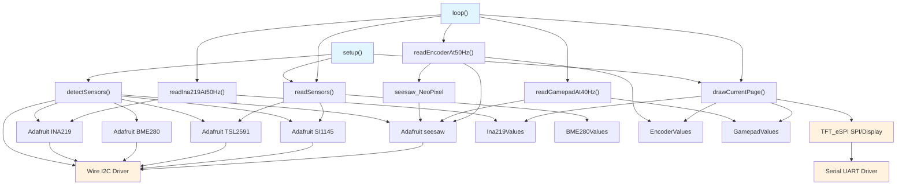

# Architecture: sensor-pages-dashboard

**Last Updated:** 2026-09-21  
**Firmware Version:** [UNKNOWN - no version constant in source]  
**Build Target:** ESP32 Dev Module  
**Display:** Freenove 3.5" 320×480 TFT (ST7796 controller, IPS panel)

---

## 1. Architectural Style / Pattern

**Style:** **Embedded Superloop with Multi-Rate Time-Gated Scheduler**

- **No RTOS:** Single-threaded bare Arduino superloop; no FreeRTOS task creation by application.
- **No State Machine Framework:** Minimal state management (page index, sensor detection flags).
- **Polling-Based:** All inputs and sensors polled at fixed time intervals.
- **Non-Blocking I/O:** Single I2C read per cycle; no multi-buffer async patterns.
- **Time-Gate Guards:** Loop actions gated by signed integer rollover-safe timing: `(int32_t)(now - deadline) >= 0`.
- **Global Mutable State:** All data structures are global (static) C structs, not encapsulated in classes.

**Rationale:** Simplicity for embedded firmware; deterministic scheduling; minimal memory overhead; suitable for polling sensor arrays on a shared I2C bus.

---

## 2. Application Layers

```
┌─────────────────────────────────────────────────────────────────┐
│  PRESENTATION LAYER                                             │
│  ├─ Page Renderers (pageBme280, pageEncoder, etc.)             │
│  ├─ TFT Display Output (drawCurrentPage, drawHeader, row, ...)  │
│  └─ User Feedback (colors, layout, status footer)              │
└─────────────────────────────────────────────────────────────────┘
                               ↑
                               │ (text, coordinates, colors)
                               ↓
┌─────────────────────────────────────────────────────────────────┐
│  BUSINESS LOGIC LAYER                                           │
│  ├─ Page Navigation Logic (Y/A buttons → page wrap)             │
│  ├─ Sensor Reading Orchestration (readSensors, ...)             │
│  ├─ LED Control Logic (encoderColorIndex, brightness)           │
│  ├─ INA219 Coulomb Accumulation (energy tracking)               │
│  └─ Input Processing (gamepad events, encoder position delta)   │
└─────────────────────────────────────────────────────────────────┘
                               ↑
                               │ (sensor values, inputs)
                               ↓
┌─────────────────────────────────────────────────────────────────┐
│  DEVICE DRIVER LAYER                                            │
│  ├─ Adafruit Sensor Libraries (INA219, BME280, TSL2591, ...)    │
│  ├─ I2C Protocol Handlers (readReg16, scd30Crc, ...)     │
│  ├─ seesaw NeoPixel Control (encoder LED)                       │
│  └─ TFT_eSPI Graphics (fillScreen, drawString, ...)             │
└─────────────────────────────────────────────────────────────────┘
                               ↑
                               │ (I2C bytes, GPIO, SPI frames)
                               ↓
┌─────────────────────────────────────────────────────────────────┐
│  HARDWARE ABSTRACTION LAYER                                     │
│  ├─ Wire (I2C): SDA=GPIO32, SCL=GPIO25, 400 kHz clock          │
│  ├─ SPI (implicit via TFT_eSPI)                                 │
│  ├─ Serial UART: 115200 baud (debug output)                     │
│  └─ GPIO: LED control (backlight), button inputs                │
└─────────────────────────────────────────────────────────────────┘
                               ↑
                               │ (electrical signals)
                               ↓
┌─────────────────────────────────────────────────────────────────┐
│  HARDWARE                                                       │
│  ├─ ESP32 (Xtensa dual-core, 520 KB RAM, 4 MB flash)           │
│  ├─ I2C Sensors (9 devices at 0x10, 0x29, 0x36, 0x40, ...)      │
│  ├─ TFT Display (320×480, SPI 80 MHz, backlight GPIO)           │
│  └─ Gamepad/Encoder Joysticks (seesaw co-processors)           │
└─────────────────────────────────────────────────────────────────┘
```

---

## 3. Components / Modules

### 3.1 Core Data Structures (DTOs)

All data structures are **global, statically allocated C structs** with mutable fields. No constructors, no methods.

#### **SensorStatus**
```cpp
struct SensorStatus {
  bool ina219;      // INA219 power monitor present?
  bool veml6075;    // VEML6075 UV sensor present?
  bool tsl2591;     // TSL2591 light sensor present?
  bool encoder;     // Rotary encoder + seesaw present?
  bool veml6070;    // VEML6070 UV sensor present?
  bool si1145;      // SI1145 multi-spectrum sensor present?
  bool scd30;       // SCD30 CO2 sensor present?
  bool bme280;      // BME280 climate sensor present?
  bool gamepad;     // Gamepad joystick + seesaw present?
};
```
- **Set once** at boot via `detectSensors()` → never changes.
- **Global instance:** `SensorStatus available{}`

#### **Ina219Values**
```cpp
struct Ina219Values {
  float shunt;              // Shunt voltage (mV)
  float bus;                // Bus voltage (V)
  float load;               // Load voltage = bus - shunt/1000 (V)
  float current;            // Current (mA), negated
  float power;              // Power (mW)
  float chargeMah;          // Accumulated charge (mAh) — Coulomb counter
  bool initialized;         // First-read flag (for accumulation baseline)
  uint32_t lastSampleUs;    // Timestamp of last sample (microseconds)
};
```
- **Unique feature:** `chargeMah` integrates current over time (never reset mid-run).
- **Read by:** `readIna219At50Hz()` every 20 µs (50 Hz via `micros()` precision).
- **Displayed by:** `pageIna219()` on page 3.

#### **Veml6075Values**
```cpp
struct Veml6075Values {
  uint16_t uva;         // Raw UVA reading
  uint16_t uvb;         // Raw UVB reading
  uint16_t comp1;       // Compensation factor 1
  uint16_t comp2;       // Compensation factor 2
  float uvaComp;        // Compensated UVA = max(0, uva - 2.22*comp1 - 1.33*comp2)
  float uvbComp;        // Compensated UVB = max(0, uvb - 2.95*comp1 - 1.74*comp2)
  float index;          // UV index = ((uvaComp*0.001461 + uvbComp*0.002591) * 0.5)
};
```
- **Read by:** `readVeml6075()` every 500 ms (in `readSensors()`).
- **Displayed by:** `pageVeml6075()` on page 8.

#### **Veml6070Values**
```cpp
struct Veml6070Values {
  uint16_t raw;      // Combined MSB:LSB value
  uint8_t lsb;       // Low byte from address 0x38
  uint8_t msb;       // High byte from address 0x39
};
```
- **Read by:** `readVeml6070()` every 500 ms; dual I2C addresses (0x38 LSB, 0x39 MSB).
- **Displayed by:** `pageVeml6070()` on page 8.

#### **Scd30Values**
```cpp
struct Scd30Values {
  float co2;         // CO2 concentration (ppm)
  float temp;        // Temperature (°C)
  float humidity;    // Relative humidity (%)
};
```
- **Read by:** `readScd30()` after `scd30Ready()` check; includes CRC8 validation.
- **Displayed by:** `pageScd30()` on page 5.

#### **EncoderValues**
```cpp
struct EncoderValues {
  int32_t position;        // Absolute encoder position (ticks, from seesaw library)
  int32_t delta;           // Change since last read
  bool pressed;            // Button currently held?
  uint32_t presses;        // Cumulative press count (never reset mid-run)
  uint8_t brightness;      // LED brightness (0–255, modified by dial delta * 8)
  const char *color;       // LED color name ("blue", "green", "red", "purple")
};
```
- **Unique:** Stateful LED color cycling and brightness tracking (not just display output).
- **Read by:** `readEncoderAt50Hz()` every 20 ms (CONTINUOUSLY, not page-conditional — required for LED updates and stats aggregation).
- **Displayed by:** `pageEncoder()` on page 4.

#### **GamepadValues**
```cpp
struct GamepadValues {
  int x;              // Joystick X axis (1023 - raw analog read 14)
  int y;              // Joystick Y axis (1023 - raw analog read 15)
  uint32_t buttons;   // Button bitmask (6 buttons + SELECT + START)
  uint8_t eventCount; // Pending event count in seesaw queue
  uint8_t lastEvent;  // Last keypad event (edge + key)
  bool hasEvent;      // Event decoded successfully?
};
```
- **Read by:** `readGamepadAt40Hz()` every 25 ms (only when available).
- **Displayed by:** `pageGamepad()` on page 1.
- **Used for:** Page navigation (Y button → prev, A button → next).

---

### 3.2 Sensor Detection & Initialization

#### **Component: detectSensors()**

| Property | Value |
|---|---|
| **Responsibility** | Boot-time enumeration of all I2C devices; initialize driver state. |
| **Inputs** | None (scans I2C bus directly). |
| **Outputs** | `SensorStatus available{}` flags set, each sensor library initialized. |
| **Dependencies** | Adafruit libraries (INA219, BME280, TSL2591, SI1145, seesaw). |
| **Constraints** | Runs once at `setup()`; no re-detection; missing sensors do not crash (all checks guarded by `if (available.X)`). |
| **Implementation Details** | <details><summary>Click to expand</summary><pre>- INA219: `ina219.begin(&Wire)` probe<br>- VEML6075: Write ID register, read back<br>- TSL2591: `tsl2591.begin()` + config gain/timing<br>- Encoder: `encoder.begin(ENCODER_ADDR)` + NeoPixel init<br>- VEML6070: Write mode, readback from MSB<br>- SI1145: `si1145.begin()` probe<br>- SCD30: Send START command<br>- BME280: `bme280.begin(BME280_ADDR, &Wire)`<br>- Gamepad: `gamepad.begin(GAMEPAD_ADDR)` + GPIO interrupt config</pre></details> |

---

### 3.3 Sensor Reading Components

#### **Component: readSensors() [Low-Frequency]**

| Property | Value |
|---|---|
| **Responsibility** | Poll "slow" sensors (VEML6075, VEML6070, SCD30) every 500 ms. |
| **Inputs** | None (reads I2C directly via Adafruit libraries). |
| **Outputs** | Updates global `veml6075Values`, `veml6070Values`, `scd30Values` structs. |
| **Dependencies** | Adafruit VEML6075, VEML6070, SCD30 libraries; Wire (I2C). |
| **Call Frequency** | Every 500 ms (gate: `(int32_t)(now - nextSensorMs) >= 0`). |
| **Constraints** | Blocks I2C for ~10–50 ms per call. Failures silently accepted; previous value persists. |

#### **Component: readIna219At50Hz() [High-Frequency Current]**

| Property | Value |
|---|---|
| **Responsibility** | Sample INA219 power monitor at 50 Hz (20 µs intervals); accumulate charge (Coulomb integration). |
| **Inputs** | None (reads I2C directly via Adafruit INA219). |
| **Outputs** | Updates `ina219Values` (shunt, bus, current, power, **chargeMah**). |
| **Dependencies** | Adafruit INA219, Wire (I2C). |
| **Call Frequency** | Every 20 µs via `micros()` (gate: `(int32_t)(nowUs - nextInaSampleUs) >= 0`). |
| **Constraints** | Uses `micros()` (not `millis()`) for µs-precision timing; 32-bit `uint32_t` wraps every ~71 minutes. Coulomb accumulator unbounded; no overflow protection. |
| **Energy Accumulation Formula** | `chargeMah += current_mA * elapsed_us / 3.6e9` |
| **Critical Behavior** | First sample: sets `initialized=true`, baseline established. Subsequent samples integrate current. |

#### **Component: readEncoderAt50Hz() [High-Frequency Input]**

| Property | Value |
|---|---|
| **Responsibility** | Poll rotary encoder position, button press; update NeoPixel LED color/brightness. |
| **Inputs** | None (reads seesaw I2C device @ 0x36). |
| **Outputs** | Updates `encoderValues` (position, delta, presses, brightness, color); controls LED via `updateEncoderLed()`. |
| **Dependencies** | Adafruit seesaw library, seesaw_NeoPixel, Wire (I2C). |
| **Call Frequency** | Every 20 ms when `available.encoder` (CONTINUOUSLY, always reads for LED updates and stats aggregation). |
| **Constraints** | LED updates are immediate (on press or dial turn); button press increments color index (wraps 0–3). Dial delta multiplied by 8 for brightness control. |
| **State Tracking** | `encoderLastPosition`, `encoderColorIndex`, `encoderBrightness` (static globals); `encoderPressCount` incremented on each press. |

#### **Component: readGamepadAt40Hz() [Input Polling]**

| Property | Value |
|---|---|
| **Responsibility** | Poll gamepad joystick X/Y, button states, keypad events. |
| **Inputs** | None (reads seesaw I2C device @ 0x50). |
| **Outputs** | Updates `gamepadValues` (x, y, buttons, eventCount, hasEvent). |
| **Dependencies** | Adafruit seesaw library, Wire (I2C). |
| **Call Frequency** | Every 25 ms when `available.gamepad`. |
| **Constraints** | X/Y inverted: `1023 - analogRead(14/15)`. Button states are active-low (0=PRESSED, 1=released). Page navigation triggered by falling edge detection (comparing current vs. previous button state). |
| **Event Handling** | Optionally reads and decodes keypad events from seesaw queue (not used for page nav; displayed as debug info). |


---

### 3.4 Display & UI Rendering Components

#### **Component: drawCurrentPage(bool pageChanged) [Page Dispatcher]**

| Property | Value |
|---|---|
| **Responsibility** | Route to page-specific renderer; optionally redraw header on page change. |
| **Inputs** | `pageChanged` (bool): if true, redraw entire screen including header; if false, only update data rows. |
| **Outputs** | TFT display output (SPI frames to display). |
| **Dependencies** | TFT_eSPI, all page-specific renderer functions (pageBme280, pageEncoder, etc.). |
| **Call Sites** | <ul><li>`setup()` (initial draw)</li><li>`loop()` on page change (`currentPage != lastPage`)</li><li>Every 20 ms when currentPage==2 or 4 (live pages)</li><li>Every 500 ms for sensor data update</li></ul> |
| **Constraints** | Single-page static layout (no scrolling); 9 pages total (indices 0–8). |

#### **Page Renderers: pageBme280(), pageEncoder(), pageGamepad(), pageIna219(), etc.**

Each page-specific renderer has identical structure:

| Property | Value |
|---|---|
| **Inputs** | Current sensor values from global structs (e.g., `bme280Values`, `encoderValues`). |
| **Outputs** | TFT display rows (text + data). |
| **Pattern** | <ul><li>Check `available.X`; if false, call `unavailable()` helper (red error screen)</li><li>Otherwise, call `row(y, label, value, color)` helper for each data field</li><li>Footer with page name/instructions</li></ul> |
| **Columns** | 2 columns: label (left-aligned at x=6) + value (right-aligned at x=474, TFT width=480). |
| **Row Height** | 24 px (fixed spacing). |
| **Constraints** | No scrolling; max ~12 rows per page (header + 9 data rows + footer). |

#### **Helper: unavailable()**

| Property | Value |
|---|---|
| **Responsibility** | Display standardized "sensor not found" error screen (red, I2C address, navigation hints). |
| **Inputs** | Sensor name, I2C address string, optional address label. |
| **Outputs** | TFT display. |

#### **Helper: drawHeader(title)**

| Property | Value |
|---|---|
| **Responsibility** | Clear screen, draw cyan title bar, dark-grey divider line. |
| **Inputs** | Title string (sensor name). |
| **Outputs** | TFT display (background and header region). |
| **Coordinates** | Title at (6, 8, font 4); divider line from (6, 42) to (474, 42). |

#### **Helper: row(y, label, value, color)**

| Property | Value |
|---|---|
| **Responsibility** | Render a single data row: label (white, left-aligned) + value (colored, right-aligned). |
| **Inputs** | y-coordinate, label string, value string, color. |
| **Outputs** | TFT display text. |
| **Coordinates** | Label at x=6, value at x=474 (right-justified). |

#### **Helper: footer(status)**

| Property | Value |
|---|---|
| **Responsibility** | Render dark-grey status text at bottom of screen. |
| **Inputs** | Status string (e.g., "Y/A: Seite wechseln | INA219"). |
| **Outputs** | TFT display. |
| **Coordinates** | Fixed at y=294 (480 - 186 px margin). |

---

### 3.5 Input & Navigation Components

#### **Component: Page Navigation (Gamepad Y/A Button Handler) [in main loop]**

| Property | Value |
|---|---|
| **Responsibility** | Detect falling edge on Gamepad Y (prev page) or A (next page) buttons; update `currentPage` with wrap-around. |
| **Inputs** | Gamepad button states from `readGamepadAt40Hz()`. |
| **Outputs** | Updated `currentPage` (0–9, wrapping). |
| **Logic** | <pre>yPressed = !(buttons & (1UL << GAMEPAD_BUTTON_Y))  // active-low<br>aPressed = !(buttons & (1UL << GAMEPAD_BUTTON_A))<br><br>if yPressed && !lastY:  // falling edge<br>  currentPage = (currentPage + 9) % 10  // prev with wrap<br>if aPressed && !lastA:  // falling edge<br>  currentPage = (currentPage + 1) % 10  // next with wrap</pre> |
| **Constraints** | Only checks gamepad if `available.gamepad`. Wrap-around is intentional (circular list of pages). |

#### **Component: Encoder LED Control [in readEncoderAt50Hz()]**

| Property | Value |
|---|---|
| **Responsibility** | On encoder button press: cycle LED color (blue → green → red → purple). On dial turn: adjust brightness. |
| **Inputs** | Encoder position delta, button state. |
| **Outputs** | Updated LED state via `updateEncoderLed()` (calls `encoderLed.setPixelColor()`, `encoderLed.show()`). |
| **Color Cycle** | `encoderColorIndex` (0–3) wrapped modulo 4 on each press; stored color names for display. |
| **Brightness Control** | `nextBrightness = brightness + delta * 8`, constrained to 0–255. |
| **Constraints** | Only active when `available.encoder` and display is on encoder page or during page change. |

---

### 3.6 Protocol & Low-Level Communication

#### **Component: readReg16() [I2C Register Read]**

| Property | Value |
|---|---|
| **Responsibility** | Read 16-bit register (LSB:MSB) from I2C device. |
| **Inputs** | I2C address, register offset. |
| **Outputs** | 16-bit value (or false on failure). |
| **Failure Mode** | Returns false if transmission fails or fewer than 2 bytes received. Last register value persists. |

#### **Component: writeReg16() [I2C Register Write]**

| Property | Value |
|---|---|
| **Responsibility** | Write 16-bit register to I2C device. |
| **Inputs** | I2C address, register offset, 16-bit value. |
| **Outputs** | Success/failure (bool). |

#### **Component: SCD30 Protocol (readScd30, scd30Ready, scd30Command, scd30Crc)**

| Property | Value |
|---|---|
| **Responsibility** | Implement Sensirion SCD30 sensor protocol: CRC8 validation, command transmission, data fetch. |
| **Protocol** | Command words (16-bit big-endian), responses with CRC8 checksums (polynomial 0x31, initial 0xFF). |
| **Commands** | <ul><li>`START` (0x0010): Initialize sensor</li><li>`READY` (0x0202): Poll measurement status</li><li>`READ` (0x0300): Fetch CO₂/temp/humidity (18 bytes: 3 × [2 data + 1 CRC])</li></ul> |
| **CRC Validation** | All incoming data validated; malformed packets rejected silently. |
| **Float Encoding** | Raw bytes (big-endian 4-byte float) extracted and byte-reversed for IEEE 754 decoding. |

#### **Component: VEML6075 UV Compensation**

| Property | Value |
|---|---|
| **Responsibility** | Read raw UV ADC counts + compensation regs; apply compensation formula. |
| **Formulas** | <pre>uvaComp = max(0, uva - 2.22*comp1 - 1.33*comp2)<br>uvbComp = max(0, uvb - 2.95*comp1 - 1.74*comp2)<br>uvIndex = ((uvaComp*0.001461 + uvbComp*0.002591) * 0.5)</pre> |
| **Constraints** | Compensation factors read from sensor registers (COMP1, COMP2); exact calibration constants per sensor (not documented in firmware). |

---

## 4. Data Flow

```
┌─────────────────────────────────────┐
│  Hardware (I2C Devices)              │
└──────────────────┬──────────────────┘
                   │ (bytes, electrical signal)
                   ↓
┌─────────────────────────────────────┐
│  Wire / SPI Drivers                 │
│  (Arduino built-in HAL)             │
└──────────────────┬──────────────────┘
                   │ (raw register values)
                   ↓
┌─────────────────────────────────────┐
│  Sensor Protocol Handlers           │
│  (readReg16, scd30Ready, ...)        │
└──────────────────┬──────────────────┘
                   │ (validated bytes)
                   ↓
┌─────────────────────────────────────┐
│  Adafruit/Library Wrappers          │
│  (ina219.getCurrent_mA, etc.)        │
└──────────────────┬──────────────────┘
                   │ (typed values)
                   ↓
┌─────────────────────────────────────┐
│  Global Sensor Value Structs        │
│  (ina219Values, bme280Values, ...)   │
└──────────────────┬──────────────────┘
                   │ (float/int fields)
                   ├──→ [readSensors()]  → every 500 ms
                   ├──→ [readIna219At50Hz()] → every 20 µs
                   ├──→ [readEncoderAt50Hz()] → every 20 ms
                   └──→ [readGamepadAt40Hz()] → every 25 ms
                   │
                   ↓
┌─────────────────────────────────────┐
│  Business Logic                     │
│  (page navigation, LED control, ...) │
└──────────────────┬──────────────────┘
                   │ (updated state)
                   ↓
┌─────────────────────────────────────┐
│  Page Renderer Functions            │
│  (drawCurrentPage, pageBme280, ...)  │
└──────────────────┬──────────────────┘
                   │ (coordinates, text, colors)
                   ↓
┌─────────────────────────────────────┐
│  TFT_eSPI Drawing Primitives        │
│  (fillScreen, drawString, ...)       │
└──────────────────┬──────────────────┘
                   │ (SPI frames)
                   ↓
┌─────────────────────────────────────┐
│  TFT Display (ST7796)               │
│  320×480 RGB output                  │
└─────────────────────────────────────┘
```

---

## 5. Control Flow for Important Use Cases

### Use Case 1: Boot & Initialization

```
setup()
├─ Serial.begin(115200)                         // Debug UART
├─ Wire.begin(SDA_PIN=32, SCL_PIN=25)           // I2C master
├─ Wire.setClock(400000)                        // 400 kHz I2C clock
├─ tft.init()                                   // Initialize display controller
├─ tft.setRotation(3)                           // Landscape mode
├─ drawHeader("Sensor Dashboard")               // Clear screen, show title
├─ detectSensors()
│  ├─ Probe INA219 @ 0x40
│  ├─ Probe VEML6075 @ 0x10
│  ├─ Probe TSL2591 (via Adafruit library)
│  └─ ... (all 9 sensors)
├─ readSensors()                                // Initial sensor read
├─ drawCurrentPage(true)                        // Display page 0 (BME280)
└─ [Loop begins]
```

### Use Case 2: Periodic Sensor Update (500 ms cycle)

```
loop() iteration at t=1500 ms (example)
├─ now = millis()
├─ [Various gates not triggered]
├─ ...
├─ (int32_t)(now - nextSensorMs) >= 0?  YES (gate expires every 500 ms)
│  ├─ readSensors()
│  │  ├─ readVeml6075() → reads UVA/UVB/COMP registers, applies compensation
│  │  ├─ readVeml6070() → reads LSB/MSB from dual addresses, combines to 16-bit raw
│  │  └─ scd30Ready()? YES → readScd30() → fetches CO₂/temp/humidity with CRC checks
│  ├─ drawCurrentPage(false)  // pageChanged=false → don't redraw header
│  │  └─ [Route to current page renderer]
│  │      └─ row(...) calls for each data field
│  └─ nextSensorMs = now + 500
└─ [Remain in loop]
```

### Use Case 3: INA219 Coulomb Integration (50 Hz via micros())

```
loop() iterations (running ~1000 Hz, every 1 ms)

[Multiple iterations; only shown for ones matching 20µs gate]

t=0 µs:  nowUs = 0
  ├─ (int32_t)(0 - nextInaSampleUs) >= 0?  YES (if nextInaSampleUs initialized)
  ├─ readIna219At50Hz()
  │  ├─ elapsedUs = nowUs - lastSampleUs = 0 - (-20000) = 20000 µs
  │  ├─ chargeMah += current_mA * 20000 / 3.6e9
  │  ├─ Fetch shunt/bus/current/power from INA219
  │  └─ lastSampleUs = 0
  └─ nextInaSampleUs = 0 + 20000 = 20000

t=20000 µs:  [Gate triggers again]
  └─ chargeMah += current_mA * 20000 / 3.6e9  // Accumulate
  
t=40000 µs:  [Gate triggers again]
  └─ chargeMah += current_mA * 20000 / 3.6e9
  
... (continues every 20 µs, 50 times per second)

[After 1 hour: micros() wraps (~4.3 billion µs), but comparison still works due to (int32_t) signed cast]
```

### Use Case 4: Encoder Button Press & LED Color Cycling

```
loop() iteration while currentPage==4 (Encoder page)

├─ readEncoderAt50Hz()
│  ├─ position = encoder.getEncoderPosition()
│  ├─ encoderValues.delta = position - encoderLastPosition
│  ├─ encoderValues.pressed = encoder.digitalRead(ENCODER_BUTTON_PIN) == LOW
│  ├─ if (pressed && !lastPressed)  // Falling edge?
│  │  ├─ encoderPressCount++
│  │  ├─ encoderColorIndex = (encoderColorIndex + 1) % 4
│  │  │   // Cycle: blue → green → red → purple → blue
│  │  ├─ updateEncoderLed()
│  │  │  ├─ encoderLed.setPixelColor(0, encoderColors[colorIndex])
│  │  │  └─ encoderLed.show()  // Update NeoPixel via seesaw I2C command
│  │  └─ encoderLastPressed = true
│  │
│  ├─ if (delta != 0)  // Dial turned?
│  │  ├─ nextBrightness = brightness + delta * 8
│  │  ├─ encoderBrightness = constrain(nextBrightness, 0, 255)
│  │  └─ updateEncoderLed()
│  │
│  └─ encoderValues.presses = encoderPressCount  // Update struct
│
├─ drawCurrentPage(false)  // Refresh display with new LED state
│  └─ pageEncoder()
│      ├─ row(52, "I2C address:", "0x36", yellow)
│      ├─ row(76, "Position:", String(encoderValues.position), green)
│      ├─ row(100, "Delta:", String(encoderValues.delta), green)
│      ├─ row(124, "Button pressed:", "true"/"false", orange)
│      ├─ row(148, "Presses total:", String(encoderValues.presses), cyan)
│      ├─ row(172, "Brightness:", String(encoderValues.brightness), cyan)
│      ├─ row(196, "LED color:", encoderValues.color, cyan)
│      └─ footer("Y/A: Seite wechseln | Rotary Encoder")
│
└─ [Continue looping]
```

### Use Case 5: Gamepad Page Navigation (Y Button = Prev, A Button = Next)

```
loop() iteration

├─ available.gamepad? YES
├─ (int32_t)(now - nextGamepadMs) >= 0?  YES (40 Hz gate)
│
├─ readGamepadAt40Hz()
│  ├─ gamepadValues.x = 1023 - gamepad.analogRead(14)
│  ├─ gamepadValues.y = 1023 - gamepad.analogRead(15)
│  ├─ gamepadValues.buttons = gamepad.digitalReadBulk(BUTTON_MASK)
│  │  // buttonsBefore (from previous call) saved for edge detection
│  └─ [Keypad event queue decoded but ignored for page nav]
│
├─ Edge Detection:
│  ├─ yPressed = !(gamepadValues.buttons & (1UL << GAMEPAD_BUTTON_Y))
│  ├─ aPressed = !(gamepadValues.buttons & (1UL << GAMEPAD_BUTTON_A))
│  ├─ lastY = !(buttonsBefore & (1UL << GAMEPAD_BUTTON_Y))
│  └─ lastA = !(buttonsBefore & (1UL << GAMEPAD_BUTTON_A))
│
├─ if (yPressed && !lastY)  // Y button falling edge?
│  └─ currentPage = (currentPage + PAGE_COUNT - 1) % PAGE_COUNT  // Previous with wrap
│
├─ if (aPressed && !lastA)  // A button falling edge?
│  └─ currentPage = (currentPage + 1) % PAGE_COUNT  // Next with wrap
│
├─ nextGamepadMs = now + 25
│
└─ [After page update, drawCurrentPage() detects change and redraws]
```

---

## 6. Communication Patterns

### 6.1 I2C Communication (All Sensors)

**Protocol:** Master (ESP32 @ GPIO32 SDA, GPIO25 SCL) ↔ Slaves (9 I2C devices @ various addresses)

**Clock:** 400 kHz (standard I2C)

**Devices & Addresses:**
| Address | Device | Sensor |
|---------|--------|--------|
| 0x10 | VEML6075 | UV sensor |
| 0x29 | TSL2591 | Light sensor |
| 0x36 | Encoder seesaw | Rotary encoder + NeoPixel |
| 0x40 | INA219 | Power monitor |
| 0x50 | Gamepad seesaw | Joystick + 6 buttons |
| 0x60 | SI1145 | Multi-spectrum sensor |
| 0x61 | SCD30 | CO₂ sensor |
| 0x77 | BME280 | Climate sensor |
| 0x38, 0x39 | VEML6070 | UV sensor (dual-address) |

**Read Patterns:**
- **Adafruit libraries** (INA219, BME280, TSL2591, SI1145): Wrapper functions `begin()`, `getXxx()`, abstract low-level protocol.
- **Low-level protocol** (SCD30, VEML6075, VEML6070): Direct `Wire.beginTransmission()` / `Wire.requestFrom()` calls.
- **seesaw libraries** (Encoder, Gamepad): Adafruit seesaw wrapper, talks to ARM Cortex-M0 co-processors on each device.

**Error Handling:** None (silent failure; last value persists).

### 6.2 Serial Communication (Debug Only)

**Baud Rate:** 115200

**Output Format:** [UNKNOWN - no structured logging framework]

**Used By:** Boot-time warning if Gamepad not detected: `Serial.println("WARNING: Gamepad QT not found at 0x50")`

**Not Used For:** Telemetry, command input, or inter-device communication.

### 6.3 SPI Communication (Display)

**Protocol:** Hardware SPI (implicit via TFT_eSPI library)

**Pins:** MISO=12, MOSI=13, SCLK=14, CS=15, DC=2, RST=-1 (hardwired in `FNK0114N_3.5_320x480_ST7796.h`)

**Clock:** ~80 MHz (per Freenove setup header; not adjustable from firmware)

**Resolution:** 320×480 pixels

**Rotation:** Set to 3 (landscape mode) via `tft.setRotation(3)` at boot; [UNKNOWN - exact pixel mapping].

---

## 7. Synchronous vs. Asynchronous Communication

| Component | Type | Rationale |
|---|---|---|
| **Sensor Reads (I2C)** | Synchronous (blocking) | Simple embedded firmware; sensors respond quickly (~1–50 ms); no async library support. |
| **Display Output (TFT_eSPI)** | Synchronous (blocking) | SPI writes are inherently synchronous; no buffering layer. |
| **Gamepad/Encoder Input** | Synchronous polling | No interrupts; polled every 20–40 ms. |
| **Interrupts** | None used by firmware | seesaw keypad interrupts configured (`gamepad.setGPIOInterrupts()`), but firmware only polls. |

**No async/await, no callbacks, no message queues.** All I/O is direct, linear, blocking.

---

## 8. Error Handling Architecture

**Philosophy:** **Fail-silent with persistence** — errors are ignored; last-known value persists.

### Error Cases

| Error | Detection | Handling |
|---|---|---|
| **Sensor not detected at boot** | Probe fails (e.g., INA219.begin() returns false) | Flag set to `available.X = false`; UI shows "Sensor nicht vorhanden"; no crash |
| **I2C read fails mid-run** | `Wire.endTransmission()` != 0 or `Wire.requestFrom()` returns < expected bytes | Function returns false; global sensor struct **not updated** (last value persists) |
| **SCD30 CRC mismatch** | All 6 CRC bytes (per 18-byte response) validated; mismatch detected | `readScd30()` returns false; CO₂/temp/humidity values **not updated** |
| **I2C bus congestion/timeout** | Wire library's internal timeouts [UNKNOWN] | No explicit recovery; next poll attempt in 20–500 ms |
| **Encoder/Gamepad event queue overflow** | seesaw internal buffer full | Old events dropped; only newest event reported [UNKNOWN - seesaw firmware behavior] |
| **Encolder dial wrap-around** | `position` is int32_t; no saturation | Firmware assumes position never overflows during session (years of operation needed to overflow) |

**No retry logic, no exponential backoff, no error counters, no status reporting.**

---

## 9. Authentication / Authorization

**None.** This is a bare-metal embedded system with no users, no network, no credentials.

Any person with physical access to the powered ESP32 and serial port can observe all sensor readings.

---

## 10. Configuration Architecture

**All configuration is hard-coded in source.** No configuration files, no SPIFFS, no NVS (non-volatile storage).

### Build-Time Configuration

| Setting | Value | File | Adjustable? |
|---|---|---|---|
| **I2C Pins** | SDA=32, SCL=25 | `#define SDA_PIN`, `#define SCL_PIN` | Recompile |
| **I2C Clock** | 400 kHz | `Wire.setClock(400000)` | Recompile |
| **Serial Baud** | 115200 | `Serial.begin(115200)` | Recompile |
| **Encoder Resolution** | 9 bits | `encoder.readPosition()` | Recompile |
| **Display Rotation** | 3 (landscape) | `tft.setRotation(3)` | Recompile |
| **Refresh Rates** | Sensor 500ms, Input 20–25ms, Gamepad 25ms | `#define SENSOR_REFRESH_MS`, etc. | Recompile |
| **Encoder LED Colors** | 4 hardcoded RGB triplets | `encoderColors[]` array | Recompile |

### Runtime Configuration

**None.** All settings are fixed at boot.

---

## 11. Persistence Architecture

**None.** All data lives in RAM-only global structs.

| Data | Storage | Persistence | Lifetime |
|---|---|---|---|
| **Sensor Values** | Global C structs (Ina219Values, etc.) | None | Until reboot (last-read value survives across reads) |
| **Page Index** | `uint8_t currentPage` | None | Until reboot (user page selection lost) |
| **Encoder Press Count** | `uint32_t encoderPressCount` | None | Until reboot |
| **INA219 Charge Accumulator** | `float ina219Values.chargeMah` | None | Until reboot (unbounded, no reset possible) |
| **LED Color/Brightness** | `encoderColorIndex`, `encoderBrightness` | None | Until reboot |

**No SPIFFS, NVS, EEPROM, SD card, or external storage used.**

**Implication:** Upon power loss or reboot, all state is lost. Energy accumulation, press counts, page position—all reset to initial values.

---

## 12. Background Jobs / Workers

**None.** Single-threaded superloop; no FreeRTOS tasks created by application.

Arduino FreeRTOS kernel (built into ESP32 framework) runs in background for WiFi (if enabled) and other core services, but these are not created or configured by this firmware.

---

## 13. Caching

**Implicit cache strategy:** Last-read sensor values persist indefinitely.

| Data | Cache Lifetime | Invalidation |
|---|---|---|
| **Sensor readings** | Until next successful read (500 ms cycle) | Age is implicit; no staleness indicator |
| **Encoder position** | Until next read (20 ms cycle) | Delta computed fresh each cycle |
| **Gamepad buttons** | Until next read (25 ms cycle) | Edge detection via compare-to-previous |

**No TTL, no automatic expiration, no invalidation signals.**

---

## 14. Logging / Monitoring

**Minimal structured logging. No framework.**

| Event | Output | Format |
|---|---|---|
| **Boot-time sensor detection** | Serial.println("WARNING: Gamepad QT not found at 0x50") | Unstructured text |
| **Sensor values** | None (UI display only) | — |
| **I2C errors** | Silent (no logging) | — |
| **Page changes** | None | — |

**No timestamps, no log levels, no rotation, no filtering.**

**Debug Output:** Developers must use `Serial.println()` + serial monitor to troubleshoot.

---

## 15. System Timing & Scheduler

### Multi-Rate Scheduling Architecture

The main loop runs at ~1000 Hz (1 ms iteration), but actions are gated by time-based conditions using rollover-safe signed comparison:

```cpp
if ((int32_t)(now - deadline) >= 0)
```

**Why signed comparison?** Handles 32-bit unsigned timer rollover every 49 days (`millis()`) or 71 minutes (`micros()`).

### Timing Gates

| Component | Interval | Precision | Gate | Call Sites |
|---|---|---|---|---|
| **Gamepad reads** | 25 ms | `millis()` | `(int32_t)(millis() - nextGamepadMs) >= 0` | `readGamepadAt40Hz()` @ 40 Hz |
| **Encoder reads** | 20 ms | `millis()` | `(int32_t)(millis() - nextEncoderMs) >= 0` | `readEncoderAt50Hz()` @ 50 Hz (CONTINUOUSLY, not page-conditional) |
| **INA219 samples** | 20 µs | `micros()` | `(int32_t)(micros() - nextInaSampleUs) >= 0` | `readIna219At50Hz()` @ 50 Hz via µs precision |
| **Sensor reads** | 500 ms | `millis()` | `(int32_t)(millis() - nextSensorMs) >= 0` | `readSensors()` @ 2 Hz |
| **Live page refresh** | 20 ms | `millis()` | `(int32_t)(millis() - nextSelectedDisplayMs) >= 0` | `drawCurrentPage(false)` for pages 2 & 4 @ 50 Hz |

### Deadline-Driven Architecture

Each gate updates its deadline after firing:

```cpp
if ((int32_t)(now - deadline) >= 0) {
  // Execute action
  deadline = now + interval;  // Reschedule
}
```

**Benefit:** Tolerates loop jitter; next deadline is relative to current time, not absolute.

---

## 15.1 Non-Blocking Rotated Sensor Architecture (FEATURE-SPEC-006) — **NEW**

### Problem: Blocking Sensor Reads

**Previous Architecture (FEATURE-SPEC-005):** All slow sensors read together in a single 500 ms window:
```
readSensors():
  readBme280()     → 2.2 ms
  readTsl2591()    → 200+ ms ← BLOCKS ENTIRE LOOP
  readSi1145()     → 0.7 ms
  readVeml6075()   → ? ms
  readVeml6070()   → ? ms
  readScd30()      → ? ms
  readDs2484Temp() → 750+ ms ← BLOCKS ENTIRE LOOP
```

**Issue:** Long sensor reads (TSL2591 integration + DS18B20 conversion) blocked the main loop for 500+ ms, preventing responsive input.

**Solution: Rotated Polling Schedule**

Split all slow I2C sensor reads into a 7-slot rotation with one sensor per 200 ms slot:

```
Slot  Time   Sensor         Operation             Duration   Max Latency
───────────────────────────────────────────────────────────────────────────
 0    0 ms   BME280         Read temp/humidity    ~2.2 ms    2.2 ms
 1    200    TSL2591        START async measure   ~0 ms      0 ms
 2    400    SI1145         Read visible/IR       ~0.7 ms    0.7 ms
 3    600    VEML6075       Read UV A/B           ~? ms      ? ms
 4    800    VEML6070       Read UV level         ~? ms      ? ms
 5    1000   SCD30          Read CO2 (CRC8)       ~? ms      ? ms
 6    1200   DS18B20        START 1-Wire conv     ~0 ms      0 ms
 7    1400   Async check    READ TSL2591 + DS18  ~? ms      ? ms
                             (if ready)
```

**Cycle Time:** 7 slots × 200 ms = 1.4 seconds (vs 500 ms prior)

### Async Measurement Patterns

**TSL2591 (200 ms integration time):**
```
Timeline (ms):
0 ────────── Start measurement (Slot 1)
200 ──────── Measurement complete, result available
1400 ─────── Read result (Slot 7, ~1200 ms later)

Non-blocking: Start → Wait in background → Read when ready
```

**DS18B20 (750 ms conversion time):**
```
Timeline (ms):
1200 ────── Start 1-Wire conversion (Slot 6)
1950 ────── Conversion complete (~750 ms later)
2800 ────── Read result (Slot 7 in next cycle, ~1600 ms later)

Non-blocking: Start → Wait in background → Read when ready
```

### Guaranteed Performance

| Metric | Value | Guarantee |
|--------|-------|-----------|
| **Max blocked time per slot** | 200 ms | ≤ 1 sensor read per slot |
| **Input response latency** | < 200 ms | Gamepad/Encoder independent of sensors |
| **Sensor freshness** | ≤ 1.4 s | Each sensor read once per cycle |
| **Display refresh** | Event-driven | Only when values change |

### State Machines for Async Sensors

**TSL2591State:**
```cpp
enum Tsl2591State { IDLE, MEASURING, READY };
static Tsl2591State tsl2591State = IDLE;
static uint32_t tsl2591MeasureStartMs = 0;

Slot 1: startTsl2591Measurement()
  → tsl2591State = MEASURING
  → tsl2591MeasureStartMs = millis()
  → Return (no blocking)

Slot 7: readTsl2591Async()
  → if (millis() - tsl2591MeasureStartMs >= TSL2591_INTEGRATION_TIME_MS)
      → readTsl2591(tsl2591Values)  // Cache result
      → tsl2591State = IDLE
    else
      → Return (not ready, retry next cycle)
```

**Ds18b20State:**
```cpp
enum Ds18b20State { IDLE, CONVERTING, READY };
static Ds18b20State ds18b20State = IDLE;
static uint32_t ds18b20ConvertStartMs = 0;

Slot 6: startDs18b20Conversion()
  → ds18b20State = CONVERTING
  → ds18b20ConvertStartMs = millis()
  → Return (no blocking)

Slot 7+ : readDs18b20Async()
  → if (millis() - ds18b20ConvertStartMs >= DS18B20_CONVERSION_TIME_MS)
      → readDs2484Temperatures(ds2484Values)  // Cache result
      → ds18b20State = IDLE
    else
      → Return (not ready, retry next cycle)
```

### Display Update Optimization (On-Change Only)

**Previous:** Display refreshed every 500 ms regardless of changes (wasteful).

**New:** Display only redrawn when:
1. Page changed (full redraw with header)
2. Sensor values actually changed (partial redraw, data only)
3. Timer event fired (INA219 seconds counter incremented)

```cpp
if (currentPage != lastPage) {
  drawCurrentPage(true);  // Full redraw
} else if (valuesChanged()) {
  drawCurrentPage(false);  // Partial redraw
} else if (timerEventFired()) {
  drawCurrentPage(false);  // Partial redraw
}
// Otherwise: no redraw (save CPU)
```

**Benefit:** Eliminates flicker, reduces SPI load, responsive UI.

### Configuration

```cpp
// Timing constraints (immutable)
constexpr uint32_t SENSOR_SLOT_INTERVAL_MS = 200;
constexpr uint32_t INPUT_STATS_INTERVAL_MS = 1000;

// Sensor-specific (adjustable)
static uint32_t TSL2591_INTEGRATION_TIME_MS = 200;
static uint32_t DS18B20_CONVERSION_TIME_MS = 750;  // 12-bit (can use 95/375 for faster)

// Feature toggles
#define ENABLE_STATS_REPORTING 1  // 1 = enabled, 0 = disabled
```

---




---

## Communication Sequence: Main Loop Cycle

```mermaid
sequenceDiagram
    participant Loop as Main Loop
    participant GateMgr as Timing Gates
    participant Gamepad as Gamepad (I2C)
    participant Sensors as Sensors (I2C)
    participant Display as TFT Display
    
    Loop->>GateMgr: Check if 25ms gamepad gate expired
    alt Gamepad gate ready
        Loop->>Gamepad: readGamepadAt40Hz()
        Gamepad->>Sensors: I2C read joystick + buttons
        Sensors-->>Gamepad: Button states
        Gamepad-->>Loop: Update gamepadValues struct
        GateMgr->>GateMgr: Set next gamepad deadline
    end
    
    Loop->>GateMgr: Check if 20ms encoder gate expired
    alt Encoder gate ready (continuous read)
        Loop->>Gamepad: readEncoderAt50Hz()
        Gamepad->>Gamepad: Read position, button; update LED
        Gamepad-->>Loop: Update encoderValues struct
        GateMgr->>GateMgr: Set next encoder deadline
    end
    
    Loop->>GateMgr: Check if 20µs INA219 gate expired
    alt INA219 gate ready
        Loop->>Sensors: readIna219At50Hz()
        Sensors->>Sensors: Read current; integrate Coulomb
        Sensors-->>Loop: Update ina219Values struct
        GateMgr->>GateMgr: Set next INA219 deadline
    end
    
    Loop->>GateMgr: Check if page changed
    alt Page changed
        Loop->>Display: drawCurrentPage(pageChanged=true)
        Display->>Display: Draw header + page-specific rows
        Display-->>Loop: TFT written
    end
    
    Loop->>GateMgr: Check if live page refresh ready
    alt On page 2 or 4, and 20ms refresh gate ready
        Loop->>Display: drawCurrentPage(pageChanged=false)
        Display->>Display: Redraw data rows only (no header)
        Display-->>Loop: TFT written
        GateMgr->>GateMgr: Set next refresh deadline
    end
    
    Loop->>GateMgr: Check if 500ms sensor gate expired
    alt Sensor gate ready
        Loop->>Sensors: readSensors()
        Sensors->>Sensors: Read VEML6075, VEML6070, SCD30
        Sensors-->>Loop: Update sensor value structs
        Loop->>Display: drawCurrentPage(pageChanged=false)
        Display->>Display: Redraw data rows
        Display-->>Loop: TFT written
        GateMgr->>GateMgr: Set next sensor deadline
    end
    
    Loop->>Loop: Sleep remainder of 1ms iteration (if any)
```

---

## Mermaid: Sensor Detection Flow

```mermaid
flowchart TD
    DETECT["detectSensors()"]
    
    DETECT --> INA219["INA219.begin()"]
    INA219 --> INA219_OK{Probe OK?}
    INA219_OK -->|Yes| INA219_TRUE["available.ina219 = true"]
    INA219_OK -->|No| INA219_FALSE["available.ina219 = false"]
    
    INA219_TRUE --> VEML6075
    INA219_FALSE --> VEML6075
    
    VEML6075["VEML6075: readReg16 ID"]
    VEML6075 --> VEML6075_OK{Read OK?}
    VEML6075_OK -->|Yes| VEML6075_TRUE["available.veml6075 = true<br/>Write config reg"]
    VEML6075_OK -->|No| VEML6075_FALSE["available.veml6075 = false"]
    
    VEML6075_TRUE --> TSL2591
    VEML6075_FALSE --> TSL2591
    
    TSL2591["TSL2591.begin()"]
    TSL2591 --> TSL2591_OK{Probe OK?}
    TSL2591_OK -->|Yes| TSL2591_TRUE["available.tsl2591 = true<br/>Set gain/timing"]
    TSL2591_OK -->|No| TSL2591_FALSE["available.tsl2591 = false"]
    
    TSL2591_TRUE --> ENCODER
    TSL2591_FALSE --> ENCODER
    
    ENCODER["encoder.begin()"]
    ENCODER --> ENCODER_OK{Probe OK?}
    ENCODER_OK -->|Yes| ENCODER_TRUE["available.encoder = true<br/>Init NeoPixel"]
    ENCODER_OK -->|No| ENCODER_FALSE["available.encoder = false"]
    
    ENCODER_TRUE --> VEML6070
    ENCODER_FALSE --> VEML6070
    
    VEML6070["VEML6070: Write mode,<br/>read MSB"]
    VEML6070 --> VEML6070_OK{Both OK?}
    VEML6070_OK -->|Yes| VEML6070_TRUE["available.veml6070 = true"]
    VEML6070_OK -->|No| VEML6070_FALSE["available.veml6070 = false"]
    
    VEML6070_TRUE --> SI1145
    VEML6070_FALSE --> SI1145
    
    SI1145["SI1145.begin()"]
    SI1145 --> SI1145_OK{Probe OK?}
    SI1145_OK -->|Yes| SI1145_TRUE["available.si1145 = true"]
    SI1145_OK -->|No| SI1145_FALSE["available.si1145 = false"]
    
    SI1145_TRUE --> SCD30
    SI1145_FALSE --> SCD30
    
    SCD30["SCD30: Send START cmd"]
    SCD30 --> SCD30_OK{Cmd OK?}
    SCD30_OK -->|Yes| SCD30_TRUE["available.scd30 = true"]
    SCD30_OK -->|No| SCD30_FALSE["available.scd30 = false"]
    
    SCD30_TRUE --> BME280
    SCD30_FALSE --> BME280
    
    BME280["BME280.begin()"]
    BME280 --> BME280_OK{Probe OK?}
    BME280_OK -->|Yes| BME280_TRUE["available.bme280 = true"]
    BME280_OK -->|No| BME280_FALSE["available.bme280 = false"]
    
    BME280_TRUE --> GAMEPAD
    BME280_FALSE --> GAMEPAD
    
    GAMEPAD["gamepad.begin()"]
    GAMEPAD --> GAMEPAD_OK{Probe OK?}
    GAMEPAD_OK -->|Yes| GAMEPAD_TRUE["available.gamepad = true<br/>Config interrupts"]
    GAMEPAD_OK -->|No| GAMEPAD_FALSE["available.gamepad = false"]
    
    GAMEPAD_TRUE --> END["detectSensors() done"]
    GAMEPAD_FALSE --> END["detectSensors() done"]
```



---

## Error Scenarios & Mitigations

### Scenario 1: INA219 I2C Bus Collision (Low Probability)

**Cause:** Multiple devices on 400 kHz I2C bus; one device holds SDA low.

**Detection:** I2C timeout (implicit in Wire library, value unknown).

**Behavior:** `Wire.endTransmission()` returns non-zero error code; `readIna219At50Hz()` silently returns without updating `ina219Values`.

**Mitigation:** [UNKNOWN - no retry, no reset, no timeout configuration in firmware].

**User Impact:** INA219 displays stale charge value; no visual error indicator.

### Scenario 2: SCD30 CRC Checksum Mismatch

**Cause:** I2C bit corruption, software/hardware error, or sensor malfunction.

**Detection:** All 6 CRC bytes validated in `readScd30()`; any mismatch causes return false.

**Behavior:** `readScd30()` returns false; `readSensors()` silently skips the update.

**Mitigation:** None (failure is accepted).

**User Impact:** CO₂ value freezes until next successful read.

### Scenario 4: Encoder LED NeoPixel Command Timeout

**Cause:** seesaw co-processor unresponsive (hardware fault, I2C congestion).

**Detection:** I2C timeout (implicit in seesaw library).

**Behavior:** `updateEncoderLed()` returns without error reporting; LED color/brightness may not update.

**Mitigation:** [UNKNOWN - no error return from NeoPixel library, no timeout configuration].

**User Impact:** LED appears stuck on previous color; user may not notice if button presses are rare.

---

## 4. Large Display Mode Rendering (INA219 Page 2) — **NEW**

### Overview

The large display mode provides an alternate rendering path for the INA219 power monitor page (Page 2) that shows individual sensor values in enlarged, centered format. This is controlled by global mode flags (`largeDisplayMode`, `largeDisplayIndex`) and implemented through a conditional in the page dispatcher and dedicated rendering function.

### 4.1 Integration Points

**Mode Activation:**
- Button B handler (Page 2 context) sets `largeDisplayMode = true` when not active
- Button X handler cycles backward: `largeDisplayIndex = (largeDisplayIndex - 1 + 7) % 7` 
- Button Y handler cycles forward OR exits: sets `largeDisplayMode = false` if in mode
- Safety reset: On page change away from Page 2, reset `largeDisplayMode = false`, `largeDisplayIndex = 0`

**Rendering Path:**
```
pageIna219() [dispatcher]
  └─ if (largeDisplayMode) {
       pageLargeDisplayIna219(largeDisplayIndex);
       return;
     }
  └─ else { [standard rendering] }
```

### 4.2 Component: pageLargeDisplayIna219(uint8_t valueIndex) [Alternate Page Renderer]

| Property | Value |
|---|---|
| **Responsibility** | Render single INA219 value in enlarged, centered format (Font 8 value, Font 4 label/unit). |
| **Inputs** | `valueIndex` (0–6): which value to display; `ina219Values` global struct (read-only). |
| **Outputs** | TFT display (SPI write-only). |
| **Call Frequency** | Inherits from INA219 page native rate (500 ms). Called once per refresh cycle when `largeDisplayMode == true`. |
| **Logic** | <pre>fillScreen(TFT_BLACK)  // Atomic clear<br>Set text datum MC_DATUM (middle-center for all)<br>Draw header "INA219 Large Display" (y=18, Font 4, Cyan)<br>Draw separator line (y=48, DarkGrey)<br>Draw label (y=70, Font 4, Cyan)<br>Draw value (y=160, Font 8, Color per index)<br>Draw unit (y=240, Font 4, White)<br>Draw footer "B:next X:prev Y:exit" (y=295, Font 2, DarkGrey)<br>Reset text datum TL_DATUM</pre> |
| **State Dependencies** | Reads: `largeDisplayMode` (is mode active?), `largeDisplayIndex` (which value?), `ina219Values` (sensor data) |
| **Real-Time Updates** | No caching; reads live `ina219Values` on every render cycle (500 ms). Values update in real-time. |
| **Performance** | Render time < 450 ms (must fit within 500 ms refresh cycle). |
| **Layout Coordinates** | x=240 (center of 480px width); y positions: header=18, separator=48, label=70, value=160, unit=240, footer=295. All fit within 320px height. |
| **Constraints** | Only callable from `pageIna219()` when `largeDisplayMode == true`. Assumes `ina219Values` is populated by `readIna219At50Hz()`. |

### 4.3 Helper Functions

**`getLargeDisplayLabel(uint8_t valueIndex)` → const char***
- Returns German label for value index (0–6)
- Range check: return "???" if out of range
- No I/O; pure lookup function

**`getLargeDisplayValue(uint8_t valueIndex)` → String**
- Reads live value from `ina219Values` struct
- Applies formatting (decimals per value type; runtime formatted as HH:MM:SS)
- Returns formatted string (no units)
- Consistency: Must match standard `pageIna219()` formatting exactly

**`getLargeDisplayUnit(uint8_t valueIndex)` → const char***
- Returns unit string (e.g., "V", "mA", "") for value index
- Empty string for index 0 (Laufzeit; time already formatted)
- Range check: return "" if out of range

**`getLargeDisplayColor(uint8_t valueIndex)` → uint16_t**
- Returns TFT_eSPI color constant per value type
- Cyan for computed values (Laufzeit, Ladung)
- Green for primary voltages (Batterie, Versorgung, Shunt-Spannung)
- Orange for secondary measurements (Strom, Power)
- White fallback for invalid index

### 4.4 Button Remapping (Page 2 Context)

| Button | Standard Page | Large Display Mode |
|--------|---------------|-------------------|
| B | Previous (unused on Page 2) | Enter mode / Cycle forward |
| X | Page-independent (unused on Page 2) | Cycle backward (active only in mode) |
| Y | Previous page | Exit mode / Previous page (if not in mode) |
| A | Next page | Next page (inactive in mode) |

---

## Unknown / [UNKNOWN] Markers Summary

| Item | Impact | Note |
|---|---|---|
| ST7796 Rotation Semantics (setRotation(3)) | Display layout | Pixel coordinate mapping unknown; assumed landscape. |
| I2C Bus Clock Stretching Timeout | Fault recovery | Wire library timeout value unspecified; behavior on slow devices unknown. |
| Encoder Dial Resolution | UI responsiveness | Position units unspecified; delta per mechanical tick unknown. |
| seesaw NeoPixel Command Timeout | LED control robustness | Failure mode unknown; LED may silently freeze. |
| Serial Output Format | Debugging | Only one hardcoded message; no structured telemetry format. |
| I2C Bus Congestion Recovery | Fault tolerance | No explicit recovery logic; retry strategy unknown. |

---

## Summary

The **sensor-pages-dashboard** is a **tightly integrated, polling-based embedded firmware** with:

✅ **Clean layered architecture** (HAL → Drivers → Business Logic → UI)  
✅ **Deterministic multi-rate scheduling** (gates with rollover-safe timing)  
✅ **Explicit component responsibilities** (each module does one job)  
✅ **Simple error model** (fail-silent with value persistence)  

⚠️ **No async abstractions** (all I/O is blocking/synchronous)  
⚠️ **No persistence** (RAM-only, lost on reboot)  
⚠️ **No monitoring/logging** (minimal debug output)  
⚠️ **All configuration hardcoded** (requires recompilation to change)  

This design is **appropriate for single-developer prototyping** on a fixed hardware platform with known sensor suite. Scaling to multiple sensors, networked systems, or production deployment would require refactoring (persistence, error recovery, OTA updates, configuration management).

