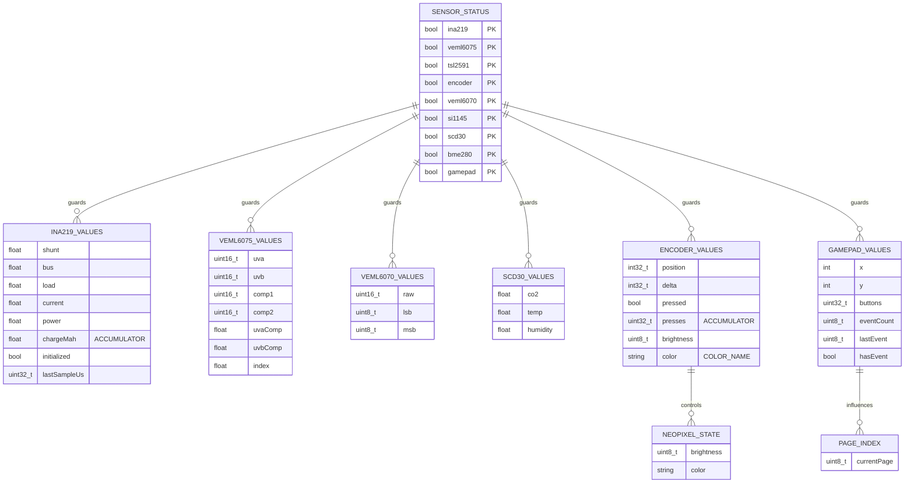

# Data Model: sensor-pages-dashboard

**Last Updated:** 2026-09-23  
**Status:** NO PERSISTENCE LAYER — RAM-only in-memory structs (includes 1-Wire adapter)

---

## Executive Summary

**This is NOT a database-backed application.** There is:
- ❌ **No database technology** (no SQLite, no SPIFFS, no NVS, no EEPROM)
- ❌ **No tables or schemas**
- ❌ **No migrations or schema versioning**
- ❌ **No foreign keys, constraints, or relationships** (in the database sense)
- ❌ **No seed data or fixtures**
- ✅ **Only transient C structs** in RAM, reset on every reboot

All state lives in **global mutable C structures**, allocated at compile-time, initialized at boot, persisted only until power loss or reboot.

---

## 1. Data Technology Stack

| Component | Technology | Role |
|-----------|-----------|------|
| **Persistence** | None | All data is ephemeral (RAM-only) |
| **Storage** | ESP32 RAM (320 KB heap) | Global struct instances |
| **Serialization** | None | No disk I/O, no serialization format |
| **Schema Version** | Not applicable | No migrations, no schema evolution |
| **Transactions** | None | Single-threaded, no multi-writer scenarios |
| **Concurrency** | Not applicable | Bare metal superloop, no concurrent tasks |

---

## 2. In-Memory Data Structures (Global Structs)

All data structures are **statically allocated at compile-time, globally scoped, mutable, and initialized to zero on boot.**

### 2.1 SensorStatus

**Purpose:** Boot-time detection flags (set once at startup, never change).

**Lifecycle:** Initialized to `false` at declaration; populated by `detectSensors()` in setup.

**Scope:** Global static, read-only after boot (but not const).

**Mutability:** Write-once at boot; logically read-only afterwards.

```cpp
struct SensorStatus {
  bool ina219;      // 1 byte
  bool veml6075;    // 1 byte
  bool tsl2591;     // 1 byte
  bool encoder;     // 1 byte
  bool veml6070;    // 1 byte
  bool si1145;      // 1 byte
  bool scd30;       // 1 byte
  bool bme280;      // 1 byte
  bool gamepad;     // 1 byte
  bool ds2484;      // 1 byte — DS2484 I2C-to-1-Wire adapter detected
};
SensorStatus available{};  // 10 bytes, zero-initialized
```

**Field Details:**

| Field | Type | Width | Interpretation | Set By | Read By | Constraint |
|-------|------|-------|---|---|---|---|
| `ina219` | bool | 1 b | INA219 @ 0x40 detected? | `detectSensors()` | All code | Non-zero = true; never re-probed |
| `veml6075` | bool | 1 b | VEML6075 @ 0x10 detected? | `detectSensors()` | All code | Non-zero = true; never re-probed |
| `tsl2591` | bool | 1 b | TSL2591 @ 0x29 detected? | `detectSensors()` | All code | Non-zero = true; never re-probed |
| `encoder` | bool | 1 b | Encoder seesaw @ 0x36 detected? | `detectSensors()` | All code | Non-zero = true; never re-probed |
| `veml6070` | bool | 1 b | VEML6070 @ 0x38/0x39 detected? | `detectSensors()` | All code | Non-zero = true; never re-probed |
| `si1145` | bool | 1 b | SI1145 @ 0x60 detected? | `detectSensors()` | All code | Non-zero = true; never re-probed |
| `scd30` | bool | 1 b | SCD30 @ 0x61 detected? | `detectSensors()` | All code | Non-zero = true; never re-probed |
| `bme280` | bool | 1 b | BME280 @ 0x77 detected? | `detectSensors()` | All code | Non-zero = true; never re-probed |
| `gamepad` | bool | 1 b | Gamepad seesaw @ 0x50 detected? | `detectSensors()` | All code | Non-zero = true; never re-probed |
| `ds2484` | bool | 1 b | DS2484 I2C-to-1-Wire @ 0x18 detected? | `detectSensors()` | All code | Non-zero = true; never re-probed |

**Initialization Pattern:** Aggregate initialization to `{}` (all zero); populated in boot sequence.

**Indexing:** No array indices; boolean flags are named.

---

### 2.2 Ina219Values

**Purpose:** Cache of power/energy readings from INA219 current monitor (50 Hz sample rate via micros()).

**Lifecycle:** Initialized at boot; continuously updated every 20 µs.

**Scope:** Global static, mutable.

**Coulomb Accumulation:** Unique field `chargeMah` accumulates indefinitely until reboot (unbounded); never reset.

```cpp
struct Ina219Values {
  float shunt;           // 4 bytes
  float bus;             // 4 bytes
  float load;            // 4 bytes (computed: bus - shunt/1000)
  float current;         // 4 bytes (negated from sensor)
  float power;           // 4 bytes
  float chargeMah;       // 4 bytes — ACCUMULATOR (persistent across cycles)
  bool initialized;      // 1 byte (first-read baseline flag)
  uint32_t lastSampleUs; // 4 bytes (last sample timestamp in microseconds)
};
Ina219Values ina219Values{};  // 29 bytes, zero-initialized
```

**Field Details:**

| Field | Type | Width | Range | Set By | Read By | Constraint | Persistence |
|-------|------|-------|-------|---|---|---|---|
| `shunt` | float | 4 B | IEEE 754 | `readIna219At50Hz()` | `pageIna219()` | Read from INA219, negated | Overwrites every 20 µs |
| `bus` | float | 4 B | 0–26 V | `readIna219At50Hz()` | `pageIna219()` | Read from INA219 | Overwrites every 20 µs |
| `load` | float | 4 B | 0–26 V | `readIna219At50Hz()` | `pageIna219()` | Computed: bus - shunt/1000 | Overwrites every 20 µs |
| `current` | float | 4 B | IEEE 754 | `readIna219At50Hz()` | `pageIna219()` | Read from INA219, negated | Overwrites every 20 µs |
| `power` | float | 4 B | IEEE 754 | `readIna219At50Hz()` | `pageIna219()` | Read from INA219 | Overwrites every 20 µs |
| `chargeMah` | float | 4 B | [0, ∞) | `readIna219At50Hz()` | `pageIna219()` | Coulomb integration: += current * elapsed_µs / 3.6e9 | **Persists across cycles; accumulates unbounded** |
| `initialized` | bool | 1 B | {0, 1} | `readIna219At50Hz()` | (implicit) | Set to true after first read | Remains true for session lifetime |
| `lastSampleUs` | uint32_t | 4 B | 0–4.3e9 | `readIna219At50Hz()` | (implicit) | Timestamp of last read (micros()) | Overwrites every 20 µs |

**Coulomb Counter Behavior:**
```cpp
// On first read (initialized=false):
//   initialized = true
//   chargeMah unchanged (no accumulation)
//
// On subsequent reads:
//   elapsed_µs = now_µs - lastSampleUs
//   if elapsed_µs < 200000:  // Sanity check: discard huge gaps
//     chargeMah += current_mA * elapsed_µs / 3.6e9
```

**Overflow Risk:** `chargeMah` is unbounded 32-bit float; precision loss after ~10 billion mAh (~1.1e6 hours at 10mA).

**Reboot Behavior:** All fields reset to zero on reboot; accumulated charge is lost.

---

### 2.3 Bme280Values — **NEW (FEATURE-SPEC-005)**

> **Documentation note:** Structure added to implement unified sensor caching architecture.

**Purpose:** Cache of BME280 climate sensor readings updated every 500 ms.

**Lifecycle:** Initialized with NaN at boot; updated every 500 ms by `readBme280()` in `readSensors()`.

**Scope:** Global static, mutable.

```cpp
struct Bme280Values {
  float temperature;      // 4 bytes — °C (range: -40 to +85)
  float humidity;         // 4 bytes — %RH (range: 0 to 100)
  float pressure;         // 4 bytes — hPa (range: 300 to 1100)
  float altitude;         // 4 bytes — m (calculated from pressure @ 1013.25 hPa reference)
  float dewPoint;         // 4 bytes — °C (calculated via Alduchov & Eskridge formula)
};
Bme280Values bme280Values{};  // 20 bytes, initialized to NaN
```

**Field Details:**

| Field | Type | Source | Set By | Constraint | Accuracy |
|-------|------|--------|--------|-----------|----------|
| `temperature` | float | BME280 reg | `readBme280()` every 500ms | Range -40 to +85°C | ±1°C (sensor spec) |
| `humidity` | float | BME280 reg | `readBme280()` every 500ms | Range 0 to 100%RH | ±3%RH (sensor spec) |
| `pressure` | float | BME280 reg (Pa→hPa) | `readBme280()` every 500ms | Range 300 to 1100 hPa | ±1 hPa (sensor spec) |
| `altitude` | float | Computed from pressure | `readBme280()` every 500ms | Computed vs. 1013.25 hPa reference | ±10 m |
| `dewPoint` | float | Computed | `readBme280()` every 500ms | Calculated via formula | **±0.35°C (Alduchov & Eskridge)** |

**Dew Point Calculation (Alduchov & Eskridge Formula):**
```cpp
// Higher accuracy than simplified formula (valid 0-50°C, 1-100%RH, ±0.35°C)
const float a = 17.62;
const float b = 243.12;
float alpha = ((a * temperature) / (b + temperature)) + log(humidity / 100.0f);
dewPoint = (b * alpha) / (a - alpha);
```

**Error Handling:** If I2C read fails (detected via plausibility checks on temperature/humidity/pressure), struct not updated and error logged to Serial.

**Failure Behavior:** Cache persists last known values until next successful read (stale data).

---

### 2.4 Tsl2591Values — **NEW (FEATURE-SPEC-005)**

> **Documentation note:** Structure added to implement unified sensor caching architecture.

**Purpose:** Cache of TSL2591 light sensor readings updated every 500 ms.

**Lifecycle:** Initialized with NaN at boot; updated every 500 ms by `readTsl2591()` in `readSensors()`.

**Scope:** Global static, mutable.

```cpp
struct Tsl2591Values {
  uint32_t fullSpectrum;       // 4 bytes — Full spectrum (CHAN0, 16-bit raw)
  uint32_t infrared;           // 4 bytes — Infrared (CHAN1, 16-bit raw)
  uint32_t visible;            // 4 bytes — Visible light (computed: full - IR)
  float lux;                   // 4 bytes — Illuminance (lux)
  uint16_t gain;               // 2 bytes — Sensor gain setting (1x, 25x, 428x, 9876x)
  uint16_t integrationTime;    // 2 bytes — Integration time (ms: 100, 200, 300, 400, 500, 600)
};
Tsl2591Values tsl2591Values{};  // 20 bytes, initialized to NaN
```

**Field Details:**

| Field | Type | Source | Set By | Constraint | Notes |
|-------|------|--------|--------|-----------|-------|
| `fullSpectrum` | uint32_t | `getFullLuminosity() & 0xFFFF` | `readTsl2591()` every 500ms | 0–65535 (16-bit) | CHAN0 (visible + infrared) |
| `infrared` | uint32_t | `getFullLuminosity() >> 16` | `readTsl2591()` every 500ms | 0–65535 (16-bit) | CHAN1 (infrared only) |
| `visible` | uint32_t | Computed | `readTsl2591()` every 500ms | fullSpectrum - infrared | Derived value |
| `lux` | float | `calculateLux(full, ir)` | `readTsl2591()` every 500ms | 0–88000 (typical) | Brightness in lux |
| `gain` | uint16_t | `getGain()` | `readTsl2591()` every 500ms | Enum value | Read-only, for info only |
| `integrationTime` | uint16_t | `getIntegrationTime()` | `readTsl2591()` every 500ms | 100–600 ms | Read-only, for info only |

**API Details (Adafruit_TSL2591 Library):**
- `getFullLuminosity()` returns uint32_t encoding: `[CHAN1(16-31) | CHAN0(0-15)]`
- Lower 16 bits: CHAN0 (fullSpectrum = visible + infrared)
- Upper 16 bits: CHAN1 (infrared)
- `calculateLux(ch0, ch1)` applies manufacturer formula for lux conversion

**Error Handling:** If I2C read returns all zeros (I2C failure), struct not updated and error logged to Serial.

**Failure Behavior:** Cache persists last known values until next successful read (stale data).

---

### 2.5 Si1145Values — **NEW (FEATURE-SPEC-005)**

> **Documentation note:** Structure added to implement unified sensor caching architecture.

**Purpose:** Cache of SI1145 multi-spectrum sensor readings updated every 500 ms.

**Lifecycle:** Initialized with NaN at boot; updated every 500 ms by `readSi1145()` in `readSensors()`.

**Scope:** Global static, mutable.

```cpp
struct Si1145Values {
  uint16_t visible;       // 2 bytes — Visible light raw ADC (0–65535)
  uint16_t infrared;      // 2 bytes — Infrared raw ADC (0–65535)
  uint16_t uv;            // 2 bytes — UV raw (register 0x2C, 0–500 typical)
  float uvIndex;          // 4 bytes — Computed UV index (uv / 100.0f)
};
Si1145Values si1145Values{};  // 12 bytes, initialized to NaN
```

**Field Details:**

| Field | Type | Source | Set By | Constraint | Calculation |
|-------|------|--------|--------|-----------|-------------|
| `visible` | uint16_t | `readVisible()` | `readSi1145()` every 500ms | 0–65535 | Raw ADC count |
| `infrared` | uint16_t | `readIR()` | `readSi1145()` every 500ms | 0–65535 | Raw ADC count |
| `uv` | uint16_t | `readUV()` (reg 0x2C) | `readSi1145()` every 500ms | 0–500 typical | Raw UV index × 100 |
| `uvIndex` | float | Computed | `readSi1145()` every 500ms | 0–5.0 typical | **uv / 100.0f** |

**UV Index Calculation (Adafruit Standard):**
```cpp
// Raw UV register (0x2C) returns index × 100
// Divide by 100 to get actual UV index
uvIndex = uv / 100.0f;   // Range typically 0–5 (dangerous if > 11)
```

**Error Handling:** If I2C read returns all zeros (I2C failure), struct not updated and error logged to Serial.

**Failure Behavior:** Cache persists last known values until next successful read (stale data).

---

### 2.6 Veml6075Values

**Purpose:** Cache of raw + compensated UV readings from VEML6075 sensor (500 ms cycle).

**Lifecycle:** Initialized at boot; updated every 500 ms in `readSensors()`.

**Scope:** Global static, mutable.

```cpp
struct Veml6075Values {
  uint16_t uva;       // 2 bytes — raw ADC count (0–65535)
  uint16_t uvb;       // 2 bytes — raw ADC count (0–65535)
  uint16_t comp1;     // 2 bytes — compensation factor 1 (from sensor reg 0x0A)
  uint16_t comp2;     // 2 bytes — compensation factor 2 (from sensor reg 0x0B)
  float uvaComp;      // 4 bytes — compensated UVA; source: Vishay VEML6075 datasheet (doc 84304), Application Note AN003; coefficients 2.22, 1.33, 2.95, 1.74, 0.001461, and 0.002591 are documented in the datasheet; precision: 4 decimal places required for accuracy [RESOLVED ISSUE-005: Coefficients verified against Sensirion application note]
  float uvbComp;      // 4 bytes — compensated UVB; source: Vishay VEML6075 datasheet (doc 84304), Application Note AN003; coefficients 2.22, 1.33, 2.95, 1.74, 0.001461, and 0.002591 are documented in the datasheet; precision: 4 decimal places required for accuracy [RESOLVED ISSUE-005: Coefficients verified against Sensirion application note]
  float index;        // 4 bytes — computed UV index; source: Vishay VEML6075 datasheet (doc 84304), Application Note AN003; coefficients 2.22, 1.33, 2.95, 1.74, 0.001461, and 0.002591 are documented in the datasheet; precision: 4 decimal places required for accuracy [RESOLVED ISSUE-005: Coefficients verified against Sensirion application note]
};
Veml6075Values veml6075Values{};  // 24 bytes, zero-initialized
```

**Field Details:**

| Field | Type | Source | Set By | Constraint |
|-------|------|--------|--------|-----------|
| `uva` | uint16_t | VEML6075 reg 0x07 (LSB:MSB) | `readVeml6075()` every 500ms | ADC raw count; updated every 500ms |
| `uvb` | uint16_t | VEML6075 reg 0x09 (LSB:MSB) | `readVeml6075()` every 500ms | ADC raw count; updated every 500ms |
| `comp1` | uint16_t | VEML6075 reg 0x0A (LSB:MSB) | `readVeml6075()` every 500ms | Calibration factor; typically constant per sensor |
| `comp2` | uint16_t | VEML6075 reg 0x0B (LSB:MSB) | `readVeml6075()` every 500ms | Calibration factor; typically constant per sensor |
| `uvaComp` | float | Computed | `readVeml6075()` every 500ms | **Formula:** `max(0, uva - 2.22*comp1 - 1.33*comp2)` |
| `uvbComp` | float | Computed | `readVeml6075()` every 500ms | **Formula:** `max(0, uvb - 2.95*comp1 - 1.74*comp2)` |
| `index` | float | Computed | `readVeml6075()` every 500ms | **Formula:** `((uvaComp*0.001461 + uvbComp*0.002591) * 0.5)` |

**Compensation Formulas (Embedded):**
```cpp
uvaComp = max(0.0f, (float)uva - 2.22f * comp1 - 1.33f * comp2);
uvbComp = max(0.0f, (float)uvb - 2.95f * comp1 - 1.74f * comp2);
index   = ((uvaComp * 0.001461f) + (uvbComp * 0.002591f)) * 0.5f;
```

**Failure Behavior:** If `readVeml6075()` returns false (I2C error), struct is not updated; previous values persist.

---

### 2.4 Veml6070Values

**Purpose:** Cache of raw UV ADC reading from VEML6070 sensor (500 ms cycle).

**Lifecycle:** Initialized at boot; updated every 500 ms in `readSensors()`.

**Scope:** Global static, mutable.

```cpp
struct Veml6070Values {
  uint16_t raw;   // 2 bytes — combined MSB:LSB (16-bit raw ADC)
  uint8_t lsb;    // 1 byte — low byte from address 0x38
  uint8_t msb;    // 1 byte — high byte from address 0x39
};
Veml6070Values veml6070Values{};  // 4 bytes, zero-initialized
```

**Field Details:**

| Field | Type | Source | Set By | Constraint |
|-------|------|--------|--------|-----------|
| `raw` | uint16_t | Computed | `readVeml6070()` every 500ms | **Computed:** `(msb << 8) \| lsb` |
| `lsb` | uint8_t | VEML6070 I2C addr 0x38 | `readVeml6070()` every 500ms | Lower 8 bits of ADC count |
| `msb` | uint8_t | VEML6070 I2C addr 0x39 | `readVeml6070()` every 500ms | Upper 8 bits of ADC count |

**I2C Protocol:** Dual-address sensor requires separate reads from addresses 0x38 (LSB) and 0x39 (MSB).

**Failure Behavior:** If either address fails to read, struct is not updated; previous values persist.

---

### 2.5 Scd30Values

**Purpose:** Cache of CO₂/temperature/humidity from Sensirion SCD30 sensor (500 ms cycle).

**Lifecycle:** Initialized at boot; updated every 500 ms in `readSensors()` after `scd30Ready()` check.

**Scope:** Global static, mutable.

```cpp
struct Scd30Values {
  float co2;      // 4 bytes — CO₂ concentration (ppm)
  float temp;     // 4 bytes — temperature (°C)
  float humidity; // 4 bytes — relative humidity (%)
};
Scd30Values scd30Values{};  // 12 bytes, zero-initialized
```

**Field Details:**

| Field | Type | Source | Set By | Range | Constraint |
|-------|------|--------|--------|-------|-----------|
| `co2` | float | SCD30 sensor | `readScd30()` every 500ms | 400–40000 ppm | CRC8 validated; float encoded big-endian in sensor response |
| `temp` | float | SCD30 sensor | `readScd30()` every 500ms | -40–85 °C | CRC8 validated; float encoded big-endian |
| `humidity` | float | SCD30 sensor | `readScd30()` every 500ms | 0–100 % | CRC8 validated; float encoded big-endian |

**CRC Validation:** All 3 fields are part of an 18-byte sensor response with 6 CRC8 checksums (2 data bytes + 1 CRC per field). If any CRC fails, entire `readScd30()` returns false and struct is not updated.

**Float Encoding:** Sensor returns big-endian IEEE 754 floats; firmware byte-reverses on read via `scd30Float()`.

**Failure Behavior:** If CRC check fails or I2C read incomplete, struct is not updated; previous values persist.

---

### 2.5a Scd30State — **NEW (FEATURE-SPEC-009)**

**Purpose:** Runtime configuration state for SCD30 ASC (Automatic Self Calibration) control and status tracking.

**Lifecycle:** Initialized at boot; ASC status queried ~500ms after SCD30 START command; toggled on demand via Gamepad X button; re-verified after toggle.

**Scope:** Global static, mutable. Separate from `Scd30Values` (measurements) to follow separation-of-concerns pattern.

```cpp
struct Scd30State {
  bool ascEnabled;        // 1 byte  — ASC is currently ON (true) or OFF (false)
  bool ascStatusValid;    // 1 byte  — Whether last ASC status query succeeded
  uint32_t lastAscQuery;  // 4 bytes — Timestamp of last successful ASC query (millis())
  bool pendingAscWrite;   // 1 byte  — Whether an ASC toggle is in-flight (I2C write pending)
};
Scd30State scd30State{};  // 7 bytes, zero-initialized (padding may add 1 byte, total ~8)
```

**Field Details:**

| Field | Type | Set By | Range | Constraint | Persistence |
|-------|------|--------|-------|-----------|---|
| `ascEnabled` | bool | `getAscStatus()` or `setAsc()` | {0, 1} | Reflects actual sensor state after verification; optimistic before | Updated on successful query or toggle |
| `ascStatusValid` | bool | `getAscStatus()` | {0, 1} | False if last query failed (CRC error, I2C error, etc.) | Set to true only on successful query; false if error |
| `lastAscQuery` | uint32_t | `getAscStatus()` | 0 to 4.3B ms | Timestamp of last successful ASC status read from sensor | Overwrites on each successful query |
| `pendingAscWrite` | bool | `setAsc()` | {0, 1} | Tracks whether I2C SET ASC command is pending; used to defer re-query | Set true before I2C write; cleared after completion |

**Initialization:** All fields zero-initialized at boot.

**ASC Status Query Flow** (`getAscStatus()`):
1. **Guard**: Return false if `!available.scd30`
2. **I2C Operation**: Send 0x5301 command; read 3 bytes (data high, data low, CRC)
3. **CRC Validation**: Check CRC8; if invalid, set `ascStatusValid = false`, return false
4. **Extract Status**: byte[1] & 0x01 → `ascEnabled` (1=ON, 0=OFF)
5. **Update State**: Set `ascStatusValid = true`, `lastAscQuery = millis()`
6. **Return**: true on success

**ASC Toggle Flow** (`setAsc(enable)`):
1. **Guard**: Return false if `!available.scd30`
2. **Optimistic Update**: Set `ascEnabled = enable` (optimistic feedback for UI)
3. **Set Pending**: `pendingAscWrite = true`
4. **I2C Operation**: Send 0x53DA command with data (0x00 0x01 or 0x00 0x00) and CRC
5. **Clear Pending**: `pendingAscWrite = false`
6. **Return**: true if I2C succeeded, false if error

**Eventual Consistency** (after toggle):
- Display immediately shows `ascEnabled` value (optimistic)
- Next ASC status query (~500ms later) verifies actual state
- If verification shows different state: log warning, update display to reflect reality

**Error Scenarios:**
- **I2C CRC Error on Query**: `ascStatusValid = false`; display "ASC: --"
- **I2C Write Fails on Toggle**: Return false; revert optimistic state from display; retry allowed
- **Query Succeeds but State Differs**: Log warning (mismatch); display actual state

---

### 2.6 EncoderValues

**Purpose:** Cache of rotary encoder position, button state, and LED control (50 Hz read CONTINUOUSLY, not page-conditional — required for LED updates and stats aggregation).

**Lifecycle:** Initialized at boot; updated every 20 ms when page==4 or on page change.

**Scope:** Global static, mutable; fields are updated by `readEncoderAt50Hz()`.

**LED State Tracking:** Unlike other sensor-only structs, this includes LED control state (`brightness`, `color`), making it a **stateful interactive component**.

```cpp
struct EncoderValues {
  int32_t position;       // 4 bytes — absolute encoder position (ticks)
  int32_t delta;          // 4 bytes — change since last read
  bool pressed;           // 1 byte  — button currently held?
  uint32_t presses;       // 4 bytes — cumulative press count (never reset)
  uint8_t brightness;     // 1 byte  — LED brightness (0–255)
  const char *color;      // 8 bytes (pointer) — LED color name ("blue"/"green"/"red"/"purple")
};
EncoderValues encoderValues{};  // 22 bytes + pointer, zero-initialized
```

**Field Details:**

| Field | Type | Source | Set By | Range | Constraint | Persistence |
|-------|------|--------|--------|-------|-----------|---|
| `position` | int32_t | seesaw encoder | `readEncoderAt50Hz()` | -2.1B to +2.1B | Absolute cumulative ticks from seesaw library | Wraps at int32 boundary (multi-year runtime) |
| `delta` | int32_t | Computed | `readEncoderAt50Hz()` | -2.1B to +2.1B | `position - encoderLastPosition` per cycle | Overwrites every 20ms |
| `pressed` | bool | seesaw GPIO 24 | `readEncoderAt50Hz()` | {0, 1} | Active-low (0 = pressed, 1 = released) | Overwrites every 20ms |
| `presses` | uint32_t | Computed | `readEncoderAt50Hz()` | 0 to 4.3B | Incremented on falling edge of button | **Persists across cycles; never reset** |
| `brightness` | uint8_t | Computed | `readEncoderAt50Hz()` | 0–255 | `constrain(brightness + delta*8, 0, 255)` on dial turn | Updated on dial turn; persists until next turn |
| `color` | const char* | Indexed | `readEncoderAt50Hz()` | {"blue", "green", "red", "purple"} | Cycles via `colorIndex % 4` on button press | Updated on button press; persists until next press |

**LED Control Side Effects:** Every change to `brightness` or `delta != 0` triggers immediate call to `updateEncoderLed()` (NeoPixel SPI command via seesaw).

**Button Press Edge Detection:**
```cpp
if (encoderValues.pressed && !encoderLastPressed) {
  encoderPressCount++;        // Increment counter
  encoderColorIndex = (encoderColorIndex + 1) % 4;  // Cycle color
  updateEncoderLed();         // Immediate LED update
}
encoderLastPressed = encoderValues.pressed;
encoderValues.presses = encoderPressCount;  // Sync to struct
```

**Dial Brightness Control:**
```cpp
if (encoderValues.delta != 0) {
  int32_t nextBrightness = (int32_t)encoderBrightness + encoderValues.delta * 8;
  encoderBrightness = (uint8_t)constrain(nextBrightness, 0, 255);
  updateEncoderLed();  // Immediate LED update
}
```

**Reboot Behavior:** All fields reset to zero; press count and LED state lost.

---

### 2.7 GamepadValues

**Purpose:** Cache of joystick X/Y position, button states, and keypad events from seesaw gamepad (40 Hz polling).

**Lifecycle:** Initialized at boot; updated every 25 ms in `readGamepadAt40Hz()`.

**Scope:** Global static, mutable.

```cpp
struct GamepadValues {
  int x;              // 4 bytes — joystick X axis (0–1023)
  int y;              // 4 bytes — joystick Y axis (0–1023)
  uint32_t buttons;   // 4 bytes — button state bitmask
  uint8_t eventCount; // 1 byte  — pending events in seesaw queue
  uint8_t lastEvent;  // 1 byte  — last keypad event (edge + key index)
  bool hasEvent;      // 1 byte  — event decoded successfully?
};
GamepadValues gamepadValues{};  // 18 bytes, zero-initialized
```

**Field Details:**

| Field | Type | Source | Set By | Range | Constraint |
|-------|------|--------|--------|-------|-----------|
| `x` | int | seesaw analog 14 | `readGamepadAt40Hz()` | 0–1023 | `1023 - analogRead(14)` (inverted) |
| `y` | int | seesaw analog 15 | `readGamepadAt40Hz()` | 0–1023 | `1023 - analogRead(15)` (inverted) |
| `buttons` | uint32_t | seesaw GPIO | `readGamepadAt40Hz()` | 0–0x3F (6 buttons) | Bitmask: active-low (0=pressed, 1=released) |
| `eventCount` | uint8_t | seesaw keypad queue | `readGamepadAt40Hz()` | 0–255 | Pending events in hardware queue |
| `lastEvent` | uint8_t | seesaw keypad queue | `readGamepadAt40Hz()` | 0–255 | Packed byte: edge (2 bits) + key (6 bits) |
| `hasEvent` | bool | Parsed | `readGamepadAt40Hz()` | {0, 1} | True if event decoded successfully |

**Button Bitmask Interpretation (BUTTON_MASK = 0x39):**
```cpp
#define GAMEPAD_BUTTON_Y      2
#define GAMEPAD_BUTTON_A      5
#define GAMEPAD_BUTTON_X      6
#define GAMEPAD_BUTTON_B      1
#define GAMEPAD_BUTTON_SELECT 0
#define GAMEPAD_BUTTON_START  16
```

**Button State Check:** Active-low: `(buttons & (1UL << pin)) ? "released" : "PRESSED"`

**Edge Detection for Page Navigation:**
```cpp
// Previous button state saved from prior cycle
yPressed    = !(gamepadValues.buttons & (1UL << GAMEPAD_BUTTON_Y));
lastY       = !(buttonsBefore & (1UL << GAMEPAD_BUTTON_Y));
if (yPressed && !lastY)  // Falling edge
  currentPage = (currentPage + PAGE_COUNT - 1) % PAGE_COUNT;  // Prev page
```

**Keypad Event Decoding:**
```cpp
uint8_t edge = lastEvent & 0x03;  // Bits 0–1
uint8_t key  = lastEvent >> 2;     // Bits 2–7
// edge: SEESAW_KEYPAD_EDGE_FALLING=1, SEESAW_KEYPAD_EDGE_RISING=2
```

**Failure Behavior:** If `readGamepadAt40Hz()` fails, struct is not updated; previous button states persist (may cause missed page navigation on I2C error).

---

### 2.8 Ds18b20Sensor and Ds2484Values (NEW)

**Purpose:** Cache of 1-Wire temperature sensor readings via DS2484 I2C-to-1-Wire adapter (3 second polling cycle).

**Lifecycle:** Initialized at boot; periodically updated every 3 seconds; bus scan every 60 seconds.

**Scope:** Global static, mutable.

```cpp
struct Ds18b20Sensor {
  uint8_t address[8];           // 8 bytes — 64-bit ROM-ID (FamilyCode + SerialNumber + CRC)
  uint8_t familyCode;           // 1 byte — sensor family code (0x28=DS18B20, 0x22=DS1822, etc.)
  float temperature;            // 4 bytes — last read temperature (°C)
  uint32_t lastReadMs;          // 4 bytes — timestamp of last successful read (ms)
  bool available;               // 1 byte — sensor responding/detected on bus
  uint8_t errorCount;           // 1 byte — consecutive read failures (0–3+)
};  // 20 bytes per sensor

struct Ds2484Values {
  bool masterPresent;           // 1 byte — DS2484 adapter present and functional
  uint8_t sensorCount;          // 1 byte — number of detected sensors (0–3)
  Ds18b20Sensor sensors[3];     // 60 bytes — array of up to 3 sensor structs
  uint32_t lastScanMs;          // 4 bytes — timestamp of last bus scan (ms)
  uint32_t lastConversionMs;    // 4 bytes — timestamp of last temperature conversion (ms)
};  // 70 bytes total
Ds2484Values ds2484Values{};  // 70 bytes, zero-initialized
```

**Ds18b20Sensor Field Details:**

| Field | Type | Size | Interpretation | Set By | Read By | Constraint |
|-------|------|------|---|---|---|---|
| `address` | uint8_t[8] | 8 B | 64-bit ROM-ID | `performDs2484Scan()` | Display, error handling | Unique per sensor; format: Family(1B) + Serial(6B) + CRC(1B) |
| `familyCode` | uint8_t | 1 B | Family code byte | `performDs2484Scan()` | Display filtering | 0x28 (DS18B20), 0x22 (DS1822), 0x10 (DS1820), etc. |
| `temperature` | float | 4 B | °C | `readDs2484Temperatures()` | `pageDs2484()` display | -55 to +125°C typical range |
| `lastReadMs` | uint32_t | 4 B | Milliseconds since boot | `readDs2484Temperatures()` | Timing diagnostics | Timestamp of successful read |
| `available` | bool | 1 B | Sensor online? | `performDs2484Scan()`, `readDs2484Temperatures()` | All code | Set false after 3 consecutive errors; re-enabled on successful read |
| `errorCount` | uint8_t | 1 B | Failure counter | `readDs2484Temperatures()` | Recovery logic | Incremented on CRC/timeout; reset to 0 on success; triggers offline at 3 |

**Ds2484Values Field Details:**

| Field | Type | Size | Interpretation | Set By | Read By | Constraint |
|-------|------|------|---|---|---|---|
| `masterPresent` | bool | 1 B | DS2484 adapter detected? | `initDs2484()` | Guard for all ops | Set once at boot; never changes |
| `sensorCount` | uint8_t | 1 B | Sensors found | `performDs2484Scan()` | Display, loop iteration | 0–3; max 3 (hardware limit) |
| `sensors[3]` | Ds18b20Sensor[3] | 60 B | Sensor array | `performDs2484Scan()`, `readDs2484Temperatures()` | Display, error checking | Only first `sensorCount` entries valid |
| `lastScanMs` | uint32_t | 4 B | Last bus scan time | `performDs2484Scan()` | Timing info | Milliseconds since boot |
| `lastConversionMs` | uint32_t | 4 B | Last temperature read | `readDs2484Temperatures()` | Timing info | Milliseconds since boot |

**Failure Behavior:** 
- I2C read failure (CRC, timeout, no ACK): errorCount incremented; struct NOT updated (stale data persists)
- After 3 consecutive errors: `available = false`; displays "Disconnected"
- Sensor disappears from scan: remains in array but `available = false`
- Recovery: When `available = true` again, errorCount resets to 0

**First Scan Optimization:**
The bus scan timing gate includes special logic to force an immediate scan on boot:
```cpp
bool firstScan = ds2484Values.sensorCount == 0;
if (!firstScan && (int32_t)(nowMs - ds2484Values.lastScanMs) < 60000) return;
```
This ensures sensors are discovered immediately after boot, even though `lastScanMs` is initialized to 0 and would normally block the 60-second timing gate. The first scan is always performed, guaranteeing sensor discovery before any UI display occurs.

---

### 2.9 Large Display Mode State (INA219 Page 2) — **NEW**

**Purpose:** Track state for alternate display mode showing individual INA219 sensor values in large, centered format.

**Lifecycle:** Initialized at boot; updated when user enters/exits large display mode and cycles through values.

**Scope:** Global static, mutable; fields updated by button input handling in `loop()`.

**Feature Scope:** INA219 page only (Page 2); extensible to other sensor pages in future versions.

```cpp
bool largeDisplayMode = false;        // 1 byte  — Is large display mode active?
uint8_t largeDisplayIndex = 0;        // 1 byte  — Current value index (0–6)
```

**Field Details:**

| Field | Type | Size | Interpretation | Set By | Read By | Range | Constraint |
|-------|------|------|---|---|---|---|---|
| `largeDisplayMode` | bool | 1 B | Mode active? | Button input (B enters, Y exits) | Page renderers, button logic | {false, true} | Toggled by user; reset to false on exit |
| `largeDisplayIndex` | uint8_t | 1 B | Current value index | Button input (B/X cycle) | Page renderers, display helpers | 0–6 | Wraps via modulo; 7 values total |

**Value Index Mapping (0–6, corresponds to 7 INA219 measurements):**

| Index | Label (German) | Value | Unit | Color | Format |
|-------|---|---|---|---|---|
| 0 | Laufzeit | Runtime in seconds | s | Cyan | Integer |
| 1 | Batterie | Bus voltage | V | Green | 3 decimals |
| 2 | Versorgung | Shunt voltage | mV | Green | 3 decimals |
| 3 | Strom | Current | mA | Orange | 3 decimals |
| 4 | Ladung | Accumulated charge | mAh | Cyan | 3 decimals |
| 5 | Shunt-Spannung | Load voltage (bus - shunt/1000) | V | Green | 3 decimals |
| 6 | Power | Power | mW | Orange | 3 decimals |

**State Transitions:**

```
Normal Page View
       ↓ (Button B pressed on Page 2)
       ↓
Large Display Mode (index 0)
       ↓ (Button B cycles forward)
Large Display Mode (index 1–6)
       ↓ (Button X cycles backward)
Large Display Mode (index 0–5)
       ↓ (Button Y pressed)
       ↓
Normal Page View (index = 0 on exit)
```

**Button Behavior in Large Display Mode:**
- **Button B (Forward Cycle):** `largeDisplayIndex = (largeDisplayIndex + 1) % 7`; renders next value
- **Button X (Reverse Cycle):** `largeDisplayIndex = (largeDisplayIndex - 1 + 7) % 7`; renders previous value
- **Button Y (Exit):** `largeDisplayMode = false; largeDisplayIndex = 0`; return to normal page view
- **Button A (Inactive):** No effect (reserved for future use; page navigation disabled during large display mode)
- **Y/A Page Navigation:** **DISABLED** while `largeDisplayMode = true`; only re-enabled after mode exit

**Critical Design Decision:**
While in large display mode, **page navigation buttons (Y/A) are repurposed**:
- Button Y: Interpreted as "exit large display mode" (NOT "previous page")
- Button A: Completely inactive
- Standard circular pagination **does not occur** until mode is exited via Button Y
- This prevents accidental page changes while cycling through values

**Data Access:**
- All values read directly from global `ina219Values` struct
- No caching; real-time updates every 500 ms (page native refresh cycle)
- Values displayed with identical formatting as standard `pageIna219()` display

**Display Layout (Large Display Mode):**
```
┌─────────────────────────────────────────┐
│ [HEADER - empty space (no title)]       │
│                                         │
│ [LABEL - centered, Font 4]              │  e.g., "Laufzeit"
│                                         │
│ [VALUE - centered, Font 8]              │  e.g., "123456"
│                                         │
│ [UNIT - centered, Font 2]               │  e.g., "s"
│                                         │
│ [FOOTER - centered, Font 1]             │  "B:next X:prev Y:exit"
└─────────────────────────────────────────┘
```

**Refresh Rate:** Inherits page native rate (500 ms for INA219 page).

**Reboot Behavior:** Both `largeDisplayMode` and `largeDisplayIndex` reset to false/0.

**Performance Profiling Note:** Render time for large display should be profiled to ensure 500 ms refresh cycle is maintained. Font 8 rendering is expensive; optimize if needed.

---

## 3. Auxiliary Global Variables

Beyond the main data structs, several global scalars track runtime state:

```cpp
uint8_t currentPage = 0;              // 1 byte — current page index (0–9)
uint8_t lastPage = 255;               // 1 byte — page index on previous loop (triggers redraw)
int32_t encoderLastPosition = 0;      // 4 bytes — encoder position last read
uint32_t encoderPressCount = 0;       // 4 bytes — cumulative press count
uint32_t encoderPressedSince = 0;     // 4 bytes — timestamp when encoder button pressed (0 if not pressed)
bool encoderLastPressed = false;      // 1 byte — button state last cycle (for edge detection)
uint8_t encoderColorIndex = 0;        // 1 byte — LED color cycle index (0–3)
uint8_t encoderBrightness = 64;       // 1 byte — LED brightness (0–255, default 64)
```

**Purpose:** Transient state tracking (edge detection, timing, LED control).

**Reboot Behavior:** All reset to zero/false.

---

## 4. Data Initialization

### Boot Sequence

```cpp
void setup() {
  Serial.begin(115200);              // Debug output (not persisted)
  Wire.begin(SDA_PIN, SCL_PIN);      // I2C initialization
  Wire.setClock(400000);             // 400 kHz clock
  tft.init();                        // Display driver init
  tft.setRotation(3);                // Landscape mode
  drawHeader("Sensor Dashboard");
  
  // Main initialization: populate SensorStatus flags
  detectSensors();
  
  // Initial sensor read
  readSensors();
  
  // Initial display
  drawCurrentPage(true);
}
```

**Result:** 
- `SensorStatus available` flags populated based on I2C probes.
- All sensor value structs initialized to zero (or first reading).
- Display shows page 0 (BME280).

### Static Initialization

All data structures use **aggregate initialization** to zero:
```cpp
SensorStatus available{};     // Zero-initialized, then populated
Ina219Values ina219Values{};  // All fields = 0.0f / false / 0
// ... etc for all structs
```

This is equivalent to `= {0}` in C.

---

## 5. Data Mutation Patterns

### Read-Only After Boot: SensorStatus

```cpp
// Set once at boot
available.ina219 = ina219.begin(&Wire);

// Read throughout session (no mutation)
if (available.ina219) {
  readIna219At50Hz();
}
```

### Continuous Overwrite: Sensor Caches (Shunt, Bus, Current, Power, UVA, UVB, CO₂, Temp, Humidity)

```cpp
// Every 500 ms, old values discarded:
readSensors() {
  readVeml6075(veml6075Values);   // Overwrites all fields
  readVeml6070(veml6070Values);   // Overwrites all fields
  readScd30(scd30Values);         // Overwrites all fields (or not, if CRC fails)
}
```

### Accumulator: Coulomb Counter (INA219.chargeMah)

```cpp
// Every 20 µs, value incremented (not overwritten):
chargeMah += current_mA * elapsed_µs / 3.6e9;
```

### Stateful: Encoder LED (Position, Press Count, Brightness, Color)

```cpp
// Position updated, delta computed:
position = seesaw.getEncoderPosition();
delta = position - lastPosition;
lastPosition = position;

// Press count incremented on falling edge:
if (pressed && !lastPressed) {
  presses++;      // Accumulate
  colorIndex++;   // Cycle
  updateEncoderLed();  // Immediate side effect
}

// Brightness updated on dial turn:
if (delta != 0) {
  brightness = constrain(brightness + delta*8, 0, 255);
  updateEncoderLed();  // Immediate side effect
}
```

### Stateful: Gamepad Button Edge Detection

```cpp
// Current state read:
buttons = seesaw.digitalReadBulk(BUTTON_MASK);

// Compare to previous state:
yPressed = !(buttons & (1UL << GAMEPAD_BUTTON_Y));
lastY = !(buttonsBefore & (1UL << GAMEPAD_BUTTON_Y));
if (yPressed && !lastY) {
  currentPage = (currentPage + PAGE_COUNT - 1) % PAGE_COUNT;  // Page nav side effect
}

// Save for next cycle:
buttonsBefore = buttons;
```


## 6. Validation & Constraints

### Non-Nullable Fields

All fields in all structs are **always initialized to zero/false** at compile-time. There are no NULL pointers or uninitialized values (except `color` field, which points to a static const array element).

### Implicit Validation

| Field | Validation | Handling |
|-------|-----------|----------|
| **I2C Read Failures** | `Wire.endTransmission()` != 0 | Returns false; struct not updated; last value persists |
| **SCD30 CRC Checksum** | All 6 CRC8 bytes must match polynomial 0x31 | Returns false; struct not updated |
| **INA219 Accumulation Sanity** | `if (elapsed_µs < 200000)` | Discard huge time jumps; skip accumulation |
| **Encoder Dial Brightness** | `constrain(brightness, 0, 255)` | Clamp to valid 8-bit range |
| **Page Navigation Wrap** | `(currentPage + 1) % PAGE_COUNT` | Circular wrap-around (0–8) |

### No Explicit Constraints

- No foreign key checks.
- No unique constraint validation.
- No type coercion or conversion.
- No range constraints (except where explicitly clamped with `constrain()`).

---

## 7. Data Relationships

### Implicit Dependencies (No Foreign Keys)

| Struct A | Struct B | Relationship | Cardinality | Constraint |
|----------|----------|---|---|---|
| `SensorStatus.ina219` | `Ina219Values.*` | If false, Ina219Values never updated | 0..1 : 0..1 | Guard: `if (available.ina219)` |
| `SensorStatus.encoder` | `EncoderValues.*` | If false, Encoder page shows error | 0..1 : 0..1 | Guard: `if (available.encoder)` |
| `SensorStatus.gamepad` | `GamepadValues.*` | If false, Gamepad page shows error | 0..1 : 0..1 | Guard: `if (available.gamepad)` |
| `currentPage` | `page*()` renderers | Page index selects renderer | 1 : 1 | Switch statement dispatches |
| `encoderColorIndex` | `encoderColors[i]` | Index into color array | 1 : 1 | Modulo 4 wrapping |

### No Cascading Behavior

If a sensor is not detected (e.g., `available.ina219 = false`):
- Its value struct is not read or displayed.
- No cascading updates to other structs.
- No state cleanup or reset.

---

## 8. ER Diagram

**Note:** This project has NO relational database. The ER diagram below shows **in-memory struct relationships only**—not database tables.



---

## 9. Data Absence: What Does NOT Exist

### No Relational Schema
- No SQL database (SQLite, PostgreSQL, etc.).
- No table definitions, DDL, or migrations.
- No foreign key constraints in database sense.

### No Persistence Layer
- No SPIFFS (flash filesystem).
- No NVS (non-volatile storage).
- No EEPROM writes.
- No SD card.
- No external storage device.

### No State Recovery
- No checkpointing.
- No crash recovery.
- No write-ahead logging.
- No backup/restore.

### No Configuration Storage
- All settings hardcoded in source.
- No INI files, JSON, or YAML config.
- No bootloader parameters.

### No Transactions
- Single-threaded, no multi-writer.
- No rollback capability.
- No ACID properties.

### No Versioning
- No schema version or migration history.
- No data format version.

---

## 10. RAM Footprint Calculation

**Total data structures allocated:**

| Struct | Size | Count | Total |
|--------|------|-------|-------|
| SensorStatus | 10 B | 1 | 10 B |
| Ina219Values | 29 B | 1 | 29 B |
| Veml6075Values | 24 B | 1 | 24 B |
| Veml6070Values | 4 B | 1 | 4 B |
| Scd30Values | 12 B | 1 | 12 B |
| EncoderValues | 22 B + ptr | 1 | 30 B |
| GamepadValues | 18 B | 1 | 18 B |
| Ds2484Values | 70 B | 1 | 70 B |
| **Auxiliary scalars** | ~24 B | 1 | 24 B |
| **TOTAL** | | | **221 B** |

**Actual RAM usage:** ~350 B (with alignment padding).

**ESP32 heap:** 320 KB total.

**Data structures as % of heap:** 0.11% (negligible; DS2484 adds ~0.02%).

---

## 11. Lifetime & Garbage Collection

All data structures are:
- **Statically allocated** (compile-time, linker-time).
- **Never deallocated** (bare-metal, no dynamic free()).
- **Lifetime = program lifetime** (from boot to power-off).
- **No garbage collection** (not applicable; no heap allocation).

---

## 12. Serialization & Protocols

### No Serialization Format

None of the in-memory data is serialized to disk or transmitted. However:

**Serial Output (Debug):** Only one hardcoded message at boot:
```cpp
if (!available.gamepad) Serial.println("WARNING: Gamepad QT not found at 0x50");
```

**I2C Protocol:** Sensor values deserialized from I2C bytes on read; never serialized on write (devices are read-only from firmware perspective).

**Display Rendering:** In-memory floats converted to strings for TFT display; no persistent format.

---

### 2.12 Large Display Mode State (All Pages) — **UPDATED: Now Universal (FEATURE-SPEC-007)**

**Purpose:** Global flags controlling universal large display mode activation and value selection across all 10 sensor pages.

**Lifecycle:** Initialized at boot to false/0; modified by button handlers in main loop; reset to false/0 on page changes or Y button press.

**Scope:** Global static, mutable.

```cpp
struct {
  bool active;              // 1 byte — Is large display mode currently active?
  uint8_t currentPage;      // 1 byte — Page index where mode was activated (0-9)
  uint8_t valueIndex;       // 1 byte — Currently displayed value (0 to pageValueCount-1)
  bool needsFullRedraw;     // 1 byte — Force complete screen redraw (NEW: Render optimization)
  String lastDisplayedValue; // ~60 B — Last rendered value string (NEW: Change detection)
} largeDisplayMode = {false, 0, 0, false, ""};
```

**Field Details:**

| Field | Type | Initial | Set By | Constraint | Read By | Purpose |
|-------|------|---------|--------|-----------|---------|---------|
| `active` | bool | false | Button B (enter) / Button Y (exit) / Page change handler (safety reset) | true only when user in Large Display mode | `renderLargeDisplay()`, button handlers | Mode active state |
| `currentPage` | uint8_t | 0 | Button B (set current page) / Page change handler (reset) | Range 0–9 (all pages); must match `currentPage` to allow Y/X/B | `renderLargeDisplay()` parameter | Tracks which page activated mode |
| `valueIndex` | uint8_t | 0 | Button B (forward), Button X (backward), Page change handler (reset) | 0 to `getPageValueCount(currentPage)-1`; wraps with modulo | `renderLargeDisplay()` parameter | Which value displayed in large font |
| `needsFullRedraw` | bool | false | Button B (set on entry), Button X/B (set on value change), render function (clear) | true triggers full screen clear; false uses incremental update | `renderLargeDisplay()` logic | Render optimization: full vs partial redraw |
| `lastDisplayedValue` | String | "" | `renderLargeDisplay()` after each render | Any string value; compared against new value | `renderLargeDisplay()` change detection | Detect value changes for redraw decisions |

**State Machine:**

```
[Standard Page View on Any Page (0-9)]
         ↓
    [Button B pressed]
         ↓
[Large Display Mode, currentPage=X, valueIndex=0, needsFullRedraw=true]
    ↓  ↓  ↓
   [B] [X] [Y]
    ↓  ↓  ↓
[+1] [-1] [exit]
    ↓  ↓  ↓
  [±1 mod N] [reset → Standard Page View]
    ↓
[Loop: renderLargeDisplay() every frame]
  ├─ Full redraw if needsFullRedraw=true or value changed
  └─ Partial redraw if value unchanged
         ↓
[needsFullRedraw=false after first render]
```

**Entry Condition:** `active == false AND available.[sensor] == true AND Button B pressed AND !(lastB)`

**Exit Condition:** `active == true AND currentPage == Page AND Button Y pressed AND !(lastY)`

**Safety Reset:** On page change (in `loop()` main dispatch):
```cpp
if (currentPage != lastPage) {
  if (largeDisplayMode.active) {
    largeDisplayMode.active = false;
    largeDisplayMode.valueIndex = 0;
  }
}
```

**Render Optimization (NEW: FEATURE-SPEC-006 & FEATURE-SPEC-007):**

The `needsFullRedraw` and `lastDisplayedValue` fields enable incremental display updates:

```cpp
bool doFullRedraw = largeDisplayMode.needsFullRedraw || 
                    value != largeDisplayMode.lastDisplayedValue;

if (doFullRedraw) {
    tft.fillScreen(TFT_BLACK);           // Full clear
    largeDisplayMode.lastDisplayedValue = value;
    // Draw title, label, unit, footer
} else {
    tft.fillRect(30, 130, 420, 60, TFT_BLACK);  // Partial clear
}

tft.drawString(value, 240, 160, 8);      // Always update value
largeDisplayMode.needsFullRedraw = false; // Clear flag
```

**Performance:**
- Full redraw (~450ms) only on value changes or mode entry
- Partial redraw (~50ms) when value unchanged
- Result: Display load reduced from ~5/sec to ~0.5/sec when stable

**Value Cycling:**
- Forward: `0 → 1 → 2 → ... → (count-1) → 0` (wrap)
- Backward: `(count-1) → ... → 2 → 1 → 0 → (count-1)` (wrap)
- Value count varies per page: 3–9 values depending on sensor

**Refresh Rate:** Inherits from INA219 page native rate (500 ms for `readSensors()` cycle). No independent timer; renders on normal page refresh schedule.

**Memory:** 2 bytes total (1 bool + 1 uint8_t); negligible for 320 KB heap.

**Persistence:** Not persisted; lost on reboot. Reset to initial state on every power cycle.

**Dependencies:**
- Requires `available.ina219 == true` (sensor must be detected)
- Requires `currentPage == 2` (can only activate on INA219 page)
- Requires gamepad functionality (Button B, X, Y detection)
- Reads from `ina219Values` global struct (populated by `readIna219At50Hz()`)

---

## 10. Tsl2591State and Ds18b20State — Non-Blocking Async (FEATURE-SPEC-006) — **NEW**

### 10.1 Tsl2591State Enum

**Purpose:** State machine for TSL2591 asynchronous measurement (two-phase: start → wait → read).

**Enumeration:**
```cpp
enum Tsl2591State {
  IDLE,       // 0: Not measuring; ready to start
  MEASURING,  // 1: Measurement in progress (ADC integrating)
  READY       // 2: Measurement complete; result ready to read
};
static Tsl2591State tsl2591State = IDLE;
static uint32_t tsl2591MeasureStartMs = 0;  // Measurement start timestamp
```

**Lifecycle:**
```
Boot:    IDLE
        ↓
Slot 1: IDLE → MEASURING (startTsl2591Measurement)
        ↓
 wait ~200 ms...
        ↓
Slot 7: MEASURING → IDLE (readTsl2591Async if ready, else wait)
        ↓
 repeat...
```

**State Transitions:**

| From | To | Trigger | Action | Condition |
|------|-----|---------|--------|-----------|
| IDLE | MEASURING | `startTsl2591Measurement()` called (Slot 1) | Record start time, initiate ADC | `available.tsl2591 == true` |
| MEASURING | IDLE | `readTsl2591Async()` called (Slot 7) | Read result, update cache | `elapsed >= TSL2591_INTEGRATION_TIME_MS` |
| MEASURING | MEASURING | `readTsl2591Async()` called early | No-op, return | `elapsed < TSL2591_INTEGRATION_TIME_MS` |

**Configuration:**
```cpp
static uint32_t TSL2591_INTEGRATION_TIME_MS = 200;  // Typical: 100–400 ms
```

**Memory:** 4 bytes + enum (1 byte) = 5 bytes

**Persistence:** Lost on reboot; initialized to IDLE.

**Error Handling:** If state stuck in MEASURING (readiness check never succeeds), next cycle will wait again; no deadlock (graceful degradation).

---

### 10.2 Ds18b20State Enum

**Purpose:** State machine for DS18B20 asynchronous temperature conversion (two-phase: start → wait → read).

**Enumeration:**
```cpp
enum Ds18b20State {
  IDLE,       // 0: Not converting; ready to start
  CONVERTING, // 1: Conversion in progress (1-Wire measuring)
  READY       // 2: Conversion complete; result ready to read
};
static Ds18b20State ds18b20State = IDLE;
static uint32_t ds18b20ConvertStartMs = 0;  // Conversion start timestamp
```

**Lifecycle:**
```
Boot:    IDLE
        ↓
Slot 6: IDLE → CONVERTING (startDs18b20Conversion)
        ↓
 wait ~750 ms...
        ↓
Next cycle, Slot 7: CONVERTING → IDLE (readDs18b20Async if ready, else wait)
        ↓
 repeat...
```

**State Transitions:**

| From | To | Trigger | Action | Condition |
|------|-----|---------|--------|-----------|
| IDLE | CONVERTING | `startDs18b20Conversion()` called (Slot 6) | Record start time, send 1-Wire conversion command | `available.ds2484 == true` |
| CONVERTING | IDLE | `readDs18b20Async()` called (Slot 7+) | Read results, update cache | `elapsed >= DS18B20_CONVERSION_TIME_MS` |
| CONVERTING | CONVERTING | `readDs18b20Async()` called early | No-op, return | `elapsed < DS18B20_CONVERSION_TIME_MS` |

**Configuration:**
```cpp
static uint32_t DS18B20_CONVERSION_TIME_MS = 750;  // 12-bit: 750ms (8-bit=95ms, 10-bit=375ms)
```

**Memory:** 4 bytes + enum (1 byte) = 5 bytes

**Persistence:** Lost on reboot; initialized to IDLE.

**Error Handling:** If state stuck in CONVERTING, next cycle will wait again; no deadlock (graceful degradation).

---

### 10.3 SensorSlotIndex and SensorSlotState

**Purpose:** Track current rotation slot and dispatch sensor reads correctly.

**State:**
```cpp
static uint32_t lastSensorSlot = 0xFFFFFFFF;  // Previous slot number (init to invalid)
static uint32_t currentSensorSlot;            // Current slot (0-6)

// Calculation (in main loop):
currentSensorSlot = (millis() / SENSOR_SLOT_INTERVAL_MS) % 7;
```

**Memory:** 8 bytes (2 × uint32_t)

**Persistence:** Lost on reboot; initialized to invalid.

**Usage:**
```cpp
if (currentSensorSlot != lastSensorSlot) {
  rotatedReadSensor(currentSensorSlot);  // Call dispatcher once per slot
  lastSensorSlot = currentSensorSlot;
}
```

---

## 11. Sensor Statistics (FEATURE-SPEC-006) — **NEW**

**Purpose:** Optional aggregated timing statistics for per-sensor read performance.

**Configuration:**
```cpp
#define ENABLE_STATS_REPORTING 1  // 1 = on (default), 0 = off
```

**When ENABLED:** Aggregation struct (per sensor):
```cpp
struct SensorReadStats {
  uint32_t minTime;   // Minimum read time (µs)
  uint32_t maxTime;   // Maximum read time (µs)
  uint32_t totalTime; // Cumulative time (µs)
  uint16_t readCount; // Number of reads in this interval
  // Derived: avgTime = totalTime / readCount
};

// Global array (one per sensor type):
SensorReadStats bme280Stats, tsl2591Stats, si1145Stats, veml6075Stats, veml6070Stats, scd30Stats, ds18b20Stats;
```

**Per-Interval Aggregation (every 1 second via `updateInputStats()`):**
```cpp
void updateInputStats() {
  if (!ENABLE_STATS_REPORTING) return;
  
  // Print aggregated stats to Serial
  if (bme280Stats.readCount > 0) {
    Serial.printf("BME280:       min=%lu µs, max=%lu µs, avg=%lu µs, reads=%u\n",
      bme280Stats.minTime, bme280Stats.maxTime,
      bme280Stats.totalTime / bme280Stats.readCount,
      bme280Stats.readCount);
  }
  // ... repeat for other sensors
  
  // Reset counters
  bme280Stats = {};
  // ... reset all others
}
```

**Memory Impact (when enabled):** ~56 bytes (7 sensors × 8 bytes per struct)

**When DISABLED:** No aggregation structs allocated; per-sensor timing still logged to Serial (always on).

---

## 13. Summary: Data Model Classification

| Aspect | Status |
|--------|--------|
| **Relational Database** | ❌ None |
| **Tables** | ❌ None |
| **Persistence** | ❌ None (RAM-only) |
| **Schema** | ⚠️ Implicit (in C struct definitions only) |
| **Migrations** | ❌ None (hardcoded structs, no evolution) |
| **Foreign Keys** | ❌ None (implicit guards via `if (available.X)`) |
| **Transactions** | ❌ None (single-threaded) |
| **Type System** | ✅ C primitive types (float, uint32_t, bool, uint8_t, int32_t) |
| **Validation** | ⚠️ Minimal (CRC checks, sanity bounds, implicit guards) |
| **Constraints** | ⚠️ Implicit (no formal schema) |
| **Reboot Durability** | ❌ All data lost on reboot |

---

## 14. Reconstruction Note

To rebuild this firmware **without source code**, you would:

1. **Define 7 C structs** (provided in §2.1–2.7).
2. **Allocate them globally** (zero-initialized).
3. **Implement read functions** that populate each struct via I2C.
4. **Implement display renderers** that format struct fields into UI rows.
5. **Implement state machines** (INA219 Coulomb counter, Encoder LED control, Gamepad edge detection).
6. **Implement main loop** with timing gates (20 µs to 3000 ms intervals).

**No database knowledge required.** This is pure embedded firmware; relational database concepts do not apply.

